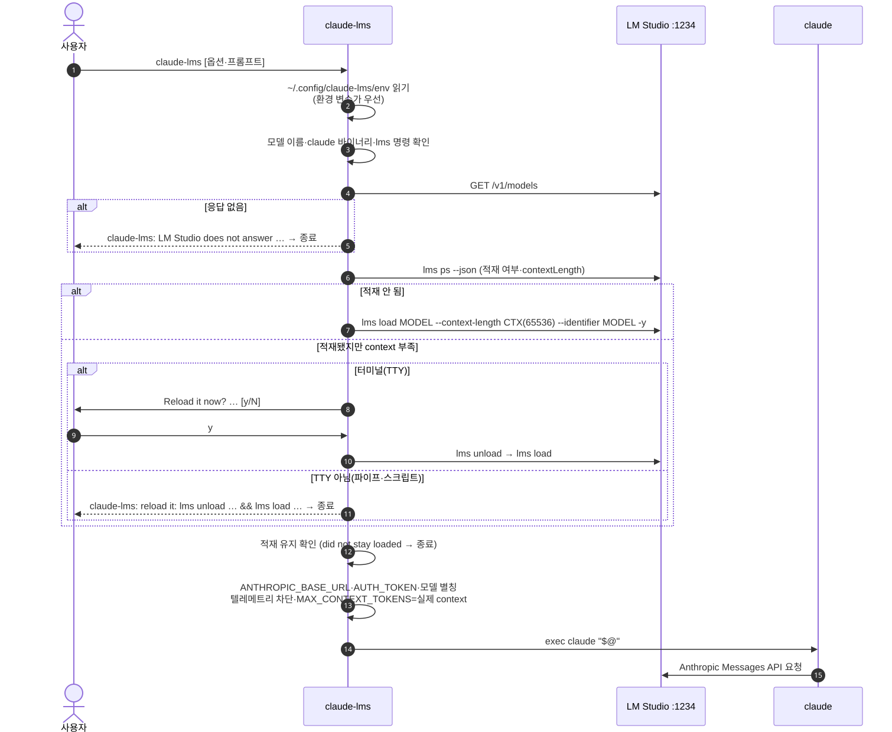
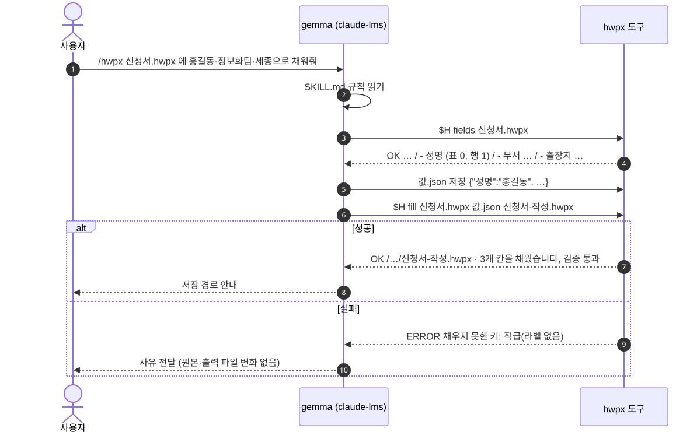

# claude-lms · hwpx skill 사용 매뉴얼

guardian 번들에 들어 있는 **오프라인 Claude Code(claude-lms)** 와 그 위에서 도는 **hwpx skill**(한글 문서 읽기·만들기·양식 채우기)의 구조와 사용법입니다.

- 기준: 2026-11-09, hwpx skill(인수 시험 403개 통과, `accept_hwpx.sh` sha256 `8cdfa5dd…` 확인) + skill 자동 설치(설치기 시험 130개 통과, 시험 파일은 아직 저장소 밖) + `SKILL.md` 보강(gemma 재시험 시험 Mac 5/5, 운영 Mac 1/1)
- 대상: 번들을 설치하고 쓰는 사람, skill을 고치거나 시험하는 사람
- 관련 문서:
  - [USAGE.md](USAGE.md): Open WebUI·wiki 사용법
  - [INSTALL-GUIDE.md](INSTALL-GUIDE.md): 설치
  - [OPERATIONS.md](OPERATIONS.md): 운영
  - [LM-STUDIO.md](LM-STUDIO.md): 모델
  - [CLAUDE-LMS-SKILLS.md](dev/CLAUDE-LMS-SKILLS.md): skill 설계와 구현·시험 기록
- 그림: 모든 그림은 `diagrams/`에 Mermaid 원본(`.mmd`)과 SVG를 따로 둡니다. 그림을 고칠 때는 `.mmd`를 고친 뒤 다시 렌더합니다. 명령은 `docs/` 폴더에서 실행합니다.

```bash
npx -y -p @mermaid-js/mermaid-cli mmdc -i diagrams/이름.mmd -o diagrams/이름.svg -b white
```

> **현재 상태 요약**
> - claude-lms와 hwpx skill은 번들 설치 4단계(`install-claude-code.sh`)에서 함께 자동으로 설치됩니다([§2.3](#23-hwpx-skill-설치)).
> - `SKILL.md` 보강 후 gemma-4-e4b 시험은 시험 Mac 5/5, 운영 Mac 1/1 성공입니다. 표본이 작아 실수(skill 재호출, 인수 빠뜨림)가 다시 나올 수 있습니다([§5.1](#51-claude-lms에서-부르기)).
> - 한/글로 만든 실제 누름틀 양식으로는 아직 검증하지 않았습니다([§8](#8-제한-사항과-알려진-한계)).
> - VS Code 확장으로도 같은 로컬 모델을 쓸 수 있습니다. 단, 환경 변수를 VS Code 사용자 설정으로 넣어야 claude.ai 커넥터가 실리지 않습니다([§3.5](#35-vs-code에서-쓰기)).
> - 오피스 skill(docx·xlsx·pptx)도 같은 설치 단계에서 함께 설치됩니다. 시험 Mac gemma 실시험 3/3 성공([§11](#11-오피스-skill-docx--xlsx--pptx)).

---

## 1. 시스템 개요



원본: [diagrams/claude-lms-architecture.mmd](diagrams/claude-lms-architecture.mmd)

한 대의 Mac에서 인터넷 없이 돕니다. 모델은 LM Studio가 하나만 올려 두고, 그 모델을 Open WebUI·wiki·Claude Code가 함께 씁니다.

| 구성 요소 | 위치·포트 | 역할 |
|---|---|---|
| LM Studio | `:1234`, `~/.lmstudio/bin/lms` | 모델 서버. OpenAI·Anthropic 호환 API |
| gemma-4-e4b-it-mlx | LM Studio에 적재 | 채팅·코딩 모델 (Open WebUI, wiki, Claude Code가 공유) |
| bge-m3 | LM Studio에 적재 | 임베딩 (wiki 검색) |
| Open WebUI | `:8080`, venv `~/.guardian-llm` | 브라우저 채팅 화면. LaunchAgent `dev.guardian.openwebui` |
| llm-wiki | mcpo `127.0.0.1:8766`, 자료 `~/llm-wiki` | wiki-mcp(Python) + watch. Open WebUI의 도구 서버 |
| claude | `~/.local/bin/claude` | Anthropic 서명 Claude Code 바이너리 |
| claude-lms | `~/.local/bin/claude-lms` | claude를 LM Studio에 붙여 실행하는 래퍼 |
| hwpx skill | `~/.claude/skills/hwpx` | 한글 문서 도구. guardian venv 파이썬으로 실행 |

### 1.1 claude-lms가 필요한 이유

Claude Code의 시스템 프롬프트와 도구 설명만으로 약 10k 토큰이 듭니다.

- **문제:** Open WebUI 같은 다른 요청 때문에 LM Studio가 모델을 자동(JIT)으로 올리면 context가 기본값 4096 또는 8192로 잡힙니다. 그러면 프롬프트가 잘리고 모델이 엉뚱한 답을 합니다.
- **해결:** `claude-lms`는 모델이 충분한 context(기본 65536)로 올라가 있는지 먼저 확인합니다. 그다음 Claude Code의 모든 모델 호출을 그 로컬 모델로 돌립니다.

---

## 2. 설치


원본: [diagrams/claude-lms-install-flow.mmd](diagrams/claude-lms-install-flow.mmd)

### 2.1 번들 전체 설치

압축본, `.sha256`, `install-llm-wiki.sh`를 한 폴더(예: `~/bundles`)에 두고 실행합니다.

```bash
bash install-llm-wiki.sh --dry-run
```

```bash
bash install-llm-wiki.sh
```

`install-all.sh`는 다음 순서로 진행합니다.

1. guardian `install.sh`: LM Studio 런타임·모델, Python 3.12, Open WebUI
2. LM Studio.app 설치
3. `wiki-layer/install-wiki.sh`
4. `claude-code/install-claude-code.sh`
5. `wiki-mcp-kit/install-wiki-mcp.sh`: wiki-mcp 를 공용 HTTP 서버 하나로(Chroma writer 단일화). `--no-wiki-mcp-http`로 건너뛸 수 있습니다

`install-llm-wiki.sh` 래퍼는 `install-all.sh`가 끝난 뒤에도 두 단계를 더 돌립니다. LM Studio를 한 번도 실행하지 않은 Mac이면 LM Studio를 직접 띄워 첫 실행을 기다리고(`~/.lmstudio/settings.json`이 이때 생깁니다), 이어서 `wiki-layer/install-wiki.sh`를 한 번 더 돌려 LM Studio 서버가 앱과 함께 시작하게 합니다. LM Studio를 이미 쓰던 Mac(설정 파일이 있고 `:1234`가 응답)이면 이 두 단계는 건너뜁니다.

Claude Code가 필요 없으면 `--no-claude-code`를 붙입니다. Claude Code 단계는 wiki 단계 **뒤에** 돌기 때문에, `~/llm-wiki/.env`의 `WIKI_INGEST_MODEL`을 claude-lms 모델로 그대로 가져갑니다.

### 2.2 Claude Code만 따로 설치·재설정

번들의 `claude-code/` 폴더는 다른 Mac에 따로 복사해서 쓸 수 있습니다. 옵션은 모두 `=` 형식입니다.

```bash
./install-claude-code.sh --dry-run
```

| 옵션 | 뜻 | 기본값 |
|---|---|---|
| `--model=ID` | claude-lms가 쓸 LM Studio 모델 id | 기존 env 파일 → `~/llm-wiki/.env`의 `WIKI_INGEST_MODEL` → LM Studio 목록의 첫 LLM(embed·bge·nomic 제외) |
| `--context=N` | 모델을 올릴 최소 context | 65536 |
| `--lmstudio-url=URL` | LM Studio 서버 | `http://127.0.0.1:1234` |
| `--no-skills` | hwpx·docx·xlsx·pptx skill을 설치하지 않음 | |
| `--no-path` | `~/.zshrc`에 PATH 블록을 넣지 않음 | |
| `--dry-run` | 바뀔 내용만 표시 | |

설치기가 하는 일:

- **서명 확인:** 바이너리의 서명이 팀 `Q6L2SF6YDW`, 식별자 `com.anthropic.claude-code`인지 확인합니다.
- **바이너리 설치:** `~/.local/share/claude/versions/<버전>`에 넣고 `~/.local/bin/claude`로 링크합니다. 같거나 더 새 버전이 이미 있으면 그대로 둡니다.
- **claude-lms:** `~/.local/bin/claude-lms`로 복사합니다.
- **설정 파일:** `~/.config/claude-lms/env`를 씁니다. 모델 id는 LM Studio `/v1/models` 목록과 대조합니다. LM Studio가 응답하는데 목록에 그 id가 없으면 멈춥니다. 응답하지 않으면 경고만 내고 계속합니다(검사를 건너뜁니다).
- **skill:** `~/.claude/skills/hwpx`에 설치합니다([§2.3](#23-hwpx-skill-설치)). 같은 단계에서 오피스 skill(docx·xlsx·pptx)도 파이썬이 그 모듈을 import 할 수 있으면 `~/.claude/skills/<이름>`에 설치합니다([§11.2](#112-설치)).
- **PATH:** `~/.local/bin`이 PATH에 없으면 `~/.zshrc`에 표시된 블록을 한 번 넣습니다.

**묶음 파일로 옮기기.** `guardian/pack-claude-code.sh`가 이 Mac의 `claude`와 설치기·skill을 한 파일로 묶습니다. 결과물은 `dist/claude-code-kit/`에 쌓이고, 이름에 버전과 UTC 시각이 붙어 겹치지 않습니다.

```bash
guardian/pack-claude-code.sh                      # ~/.local/bin/claude 를 묶음
guardian/pack-claude-code.sh --claude-code=/경로/claude --out=/다른/폴더 --name=이름 --no-tar
```

스크립트는 번들 빌드(`build-merged-bundle.sh` §4b)와 같은 검사를 합니다. Anthropic 서명(TeamIdentifier `Q6L2SF6YDW`), 휠 sha256 고정값, 비밀 파일(`.env*`, `*key*.json`, `*.pem` 등)과 심볼릭 링크가 없는지 확인합니다. `.partial`로 만든 뒤 압축본을 임시 폴더에 다시 풀어 `SHA256SUMS`가 맞을 때만 이름을 바꾸고, 같은 이름의 결과물이 있으면 덮어쓰지 않고 멈춥니다. 마지막에 받는 Mac에서 칠 명령을 출력합니다.

받는 Mac에서는 새 폴더에 두 파일을 놓고 다음 순서로 확인하고 설치합니다.

```bash
shasum -a 256 -c <이름>.tar.gz.sha256 && tar xzf <이름>.tar.gz && cd <이름> && shasum -a 256 -c SHA256SUMS && ./install-claude-code.sh
```

스크립트는 `COPYFILE_DISABLE=1`로 macOS tar가 `._*` 확장 속성 파일을 끼워 넣지 않게 합니다. 2026-11-10 운영 Mac에 같은 구성의 묶음으로 2.1.321과 skill-guard를 설치했습니다([CLAUDE-LMS-SKILLS.md §6.5](dev/CLAUDE-LMS-SKILLS.md#65-skill-guard-pretooluse-hook-2026-11-09)).

### 2.3 hwpx skill 설치

`install-claude-code.sh`의 3절(`==> skills`)이 자동으로 설치합니다. `build-merged-bundle.sh`는 번들의 `claude-code/claude-kit/`에 skill 폴더와 python-hwpx 6.11.0 휠을 넣고, 휠의 sha256을 고정값과 비교합니다.

설치기가 하는 일:

1. **사전 점검:** 휠의 sha256을 확인합니다. guardian venv 파이썬(`CLAUDE_LMS_PY`가 있으면 그것)이 10초 안에 `import lxml.etree`를 하는지 봅니다. 못 하면 경고만 내고 skill을 건너뜁니다(rc 0, `~/.claude`는 그대로).
2. **임시 폴더에서 조립:** `${TMPDIR}/claude-lms-skills.XXXXXX`에 skill을 복사하고(오피스 skill도 같은 폴더에, [§11.2](#112-설치)) 휠을 `lib/`에 풉니다. 이 단계까지 `~/.claude`에는 아무것도 쓰지 않습니다.
3. **smoke 시험:** 조립본으로 `from-md` → `validate`를 돌려 첫 줄이 `OK`인지 봅니다(오피스 skill은 `from-md` → `read`). 실패하면 도구의 오류 끝부분을 보여 주고 멈춥니다. 조립한 skill을 모두 시험한 뒤에야 설치를 시작하므로, 하나라도 실패하면 어떤 skill도 바뀌지 않습니다.
4. **이미 최신이면 그대로:** 설치본과 내용이 같고 래퍼에 실행 권한이 있으면 `already up to date`.
5. **교체:** 조립본을 `~/.claude/.claude-lms-hwpx.partial`로 복사합니다. 기존 설치는 `~/.claude/skills-backup/hwpx.<시각>.<pid>`로 옮기고, partial을 `~/.claude/skills/hwpx`로 rename 합니다. 오피스 skill도 같은 방식으로 `~/.claude/.claude-lms-<이름>.partial`과 `~/.claude/skills-backup/<이름>.<시각>.<pid>`를 씁니다.

설계 이유:

- **같은 볼륨 rename:** TMPDIR와 HOME이 다른 볼륨이면 `mv`가 '복사 후 삭제'가 됩니다. 그래서 마지막 교체는 `~/.claude` 안에서의 rename으로 하여, 중간에 끊겨도 반쯤 쓴 skill이 남지 않게 합니다.
- **백업 위치:** 백업을 `skills/` 밖에 두는 것은 Claude Code가 hwpx skill을 두 개로 보지 않게 하기 위해서입니다.
- **lib ACL:** `lib/`의 폴더에는 `owner deny add_file,add_subdirectory` ACL을 겁니다. 실수로 `import hwpx`를 해도 `__pycache__`가 생기지 않게 막습니다. 설치본은 보통 폴더라서 `rm -rf`로 지울 수 있습니다. FAT·exFAT처럼 ACL이 없는 볼륨에서는 `lib ACL not supported on this volume: skipped`만 나오고 설치는 계속됩니다.
- **다른 skill:** `~/.claude/skills`의 다른 skill은 건드리지 않습니다.

| 출력 | 뜻 |
|---|---|
| `installed …/skills/hwpx` | 새로 설치함 |
| `previous copy moved to …` | 기존 설치를 백업으로 옮김 |
| `…/skills/hwpx already up to date` | 바뀐 것 없음 |
| `--no-skills: skipped` | `--no-skills` 옵션을 줬음 |
| `warning: … cannot import lxml …: hwpx skill skipped` | guardian 번들(venv)이 먼저 설치되어야 함 |
| `warning: … cannot import <모듈>: <이름> skill skipped` | 그 오피스 skill의 모듈이 파이썬에 없음. 그 skill만 건너뜀 |
| `no claude-kit/ in …: skills skipped` | 번들에 `claude-kit/`가 없음(옛 번들) |
| `no skill can run with …: nothing installed` | 어느 skill도 모듈을 import하지 못함. 아무것도 설치하지 않음 |
| `the <이름> skill does not run with …; nothing was changed` | 그 skill의 smoke 시험 실패. 어떤 skill도 설치·교체하지 않음. 위에 찍힌 도구 오류를 확인 |

**확인:** 첫 줄이 `OK`로 시작하면 설치된 것입니다.

```bash
~/.claude/skills/hwpx/scripts/hwpx validate 아무문서.hwpx
```

**수동 설치(번들 없이 저장소에서 바로 쓸 때, 저장소 루트에서 실행):**

```bash
mkdir -p ~/.claude/skills && rm -rf ~/.claude/skills/hwpx && cp -R guardian/claude-kit/skills/hwpx ~/.claude/skills/hwpx
```

> `~/.claude/skills/hwpx`가 이미 있는데 `cp -R`을 그대로 다시 쓰면 그 안에 `hwpx` 폴더가 한 겹 더 생깁니다. 그래서 먼저 지우고 복사합니다.

```bash
/usr/bin/unzip -qo guardian/claude-kit/wheels/python_hwpx-6.11.0-py3-none-any.whl -d ~/.claude/skills/hwpx/lib
```

| 이렇게 나오면 | 원인 |
|---|---|
| `ERROR 파이썬 없음: … (guardian 번들 설치 필요)` | `~/.guardian-llm/venv`가 없음 |
| `ERROR python-hwpx import 실패: …` | `lib/`에 휠이 풀리지 않음 |

---

## 3. claude-lms



원본: [diagrams/claude-lms-launch-sequence.mmd](diagrams/claude-lms-launch-sequence.mmd)

### 3.1 실행

`claude`와 같은 옵션을 그대로 받습니다.

대화형으로 시작:

```bash
claude-lms
```

한 번만 묻고 끝내기:

```bash
claude-lms -p "이 폴더의 README를 요약해줘"
```

> ssh heredoc이나 스크립트 안에서 `claude-lms -p`를 쓰면 표준입력을 기다리며 멈출 수 있습니다. 끝에 `< /dev/null`을 붙입니다.

### 3.2 설정

설정 파일은 `${XDG_CONFIG_HOME:-~/.config}/claude-lms/env`입니다. 설치기가 만들어 주며, 셸 변수 형식입니다.

```sh
CLAUDE_LMS_MODEL='google/gemma-4-e4b'
CLAUDE_LMS_URL='http://127.0.0.1:1234'
CLAUDE_LMS_CONTEXT=65536
```

> LM Studio는 모델 파일이 놓인 위치로 id를 정하므로 Mac마다 id가 다릅니다. 번들로 설치한 Mac은 `gemma-4-e4b-it-mlx`, 직접 받은 Mac은 `google/gemma-4-e4b`처럼 됩니다. 설치기는 wiki가 이미 쓰는 id를 가져와 모델이 하나만 올라가게 합니다.

**같은 이름의 환경 변수가 있으면 파일보다 우선합니다.** 예를 들어 이번 실행만 context를 늘리려면:

```bash
CLAUDE_LMS_CONTEXT=131072 claude-lms
```

| 변수 | 뜻 | 기본값 |
|---|---|---|
| `CLAUDE_LMS_MODEL` | LM Studio 모델 id (`/v1/models`에 나오는 이름) | 없음(필수) |
| `CLAUDE_LMS_URL` | LM Studio 서버 | `http://127.0.0.1:1234` |
| `CLAUDE_LMS_CONTEXT` | 모델이 올라가 있어야 하는 최소 context | 65536 |
| `CLAUDE_LMS_TOKEN` | LM Studio에 보낼 토큰 | `lmstudio` |
| `CLAUDE_LMS_SKILL_GUARD` | `0`이면 skill-guard hook을 붙이지 않음([§3.4](#34-skill-guard-hook)) | `1` |

claude-lms가 Claude Code에 넘기는 값:

| 설정 | 효과 |
|---|---|
| `ANTHROPIC_BASE_URL`, `ANTHROPIC_AUTH_TOKEN` | 모든 요청이 LM Studio로 감 |
| `ANTHROPIC_MODEL` 등 모델 별칭 전부(opus·sonnet·haiku·subagent) | 같은 로컬 모델로 감 |
| `CLAUDE_CODE_DISABLE_NONESSENTIAL_TRAFFIC=1`, `DISABLE_AUTOUPDATER=1` | 업데이트·원격 측정을 끔 (인터넷이 없는 Mac 전제) |
| `CLAUDE_CODE_ATTRIBUTION_HEADER=0` | 요청마다 바뀌는 헤더를 없애 LM Studio 프롬프트 캐시를 살림 |
| `CLAUDE_CODE_MAX_CONTEXT_TOKENS=<실제 적재 context>` | 자동 압축이 실제 창 크기에 맞춰 일어남 |
| `--settings '{"hooks":{"PreToolUse":[…skill-guard…],"Stop":[…skill-guard…]}}'` (인수 맨 앞) | 같은 Skill 반복 호출, 오피스 파일을 글자로 만드는 것, 안내만 읽고 멈추는 것을 막는 hook. 이 실행에만 붙고 `~/.claude/settings.json`은 건드리지 않음([§3.4](#34-skill-guard-hook)) |

### 3.3 문제 해결

claude-lms의 오류는 `claude-lms: …`로 시작하고 exit 1로 끝납니다.

| 메시지 | 원인 | 조치 |
|---|---|---|
| `no model: set CLAUDE_LMS_MODEL in …` | 설정 파일에 모델이 없음 | `./install-claude-code.sh --model=ID` 또는 env 파일 수정 |
| `claude is not installed: run install-claude-code.sh` | `~/.local/bin/claude`가 없고 PATH에도 없음 | 설치기 실행 |
| `… lms is missing: LM Studio has not been set up on this Mac` | LM Studio를 한 번도 실행하지 않음 | LM Studio를 한 번 실행 |
| `LM Studio does not answer at …` | 서버가 꺼져 있음 | LM Studio 앱을 열거나 `~/.lmstudio/bin/lms server start` |
| `… is loaded with context N, under the 65536 Claude Code needs.` 다음에 `Reload it now? … [y/N]` | 다른 요청 때문에 작은 context로 올라가 있음 | `y`를 누르면 다시 올립니다. **그 순간 Open WebUI·wiki가 받던 응답은 끊깁니다.** |
| `reload it: lms unload … && lms load …` | 위와 같은데 터미널이 아님(파이프·스크립트) | 안내된 명령을 직접 실행 |
| `lms load … failed` / `… did not stay loaded` | 모델 id가 틀렸거나 메모리 부족 | `curl -s http://127.0.0.1:1234/v1/models`로 id 확인 |

### 3.4 skill-guard hook


원본: [diagrams/skill-guard-hook.mmd](diagrams/skill-guard-hook.mmd)

gemma는 `Skill` 도구가 명령을 실행해 준다고 믿고 `Skill(hwpx, args="fields ./양식.hwpx")`를 수십 번 되풀이하는 일이 있습니다. `Skill`은 `SKILL.md` 안내만 대화에 싣고 아무것도 실행하지 않습니다. 그래서 claude-lms는 PreToolUse hook `~/.claude/skills/hwpx/scripts/skill-guard`를 붙여 실행합니다.

- 한 세션에서 같은 skill의 **첫 호출은 그대로 둡니다**(안내를 읽어야 하므로).
- **두 번째부터는 거부**하고, 거부 이유로 Bash에서 실행할 명령을 알려 줍니다. 모델은 이 이유를 도구 결과로 받습니다.
  - 예: `hwpx 안내는 이미 읽었습니다. Skill 을 다시 부르지 말고 Bash 로 실행하세요: ~/.claude/skills/hwpx/scripts/hwpx fields ./양식.hwpx`
  - args가 명령 모양이 아니거나(자연어·빈 값), 300자를 넘거나, 셸 특수 문자(`;` `&` `|` `$` `` ` `` `<` `>` `(` `)` `\`)가 있으면 args를 옮기지 않고 `--help`를 안내합니다.
  - 명령 파일이 없는 다른 skill은 "안내대로 바로 실행하라"는 일반 문구만 씁니다(경로를 지어내지 않음).
- 기록은 `${TMPDIR:-/tmp}/claude-lms-skill-guard-<uid>/<session_id>`(폴더 700, 파일 600)에 skill 이름을 한 줄씩 남깁니다. 폴더가 심볼릭 링크이거나 남의 것이면 아무것도 쓰지 않고 허용합니다.
- **언제나 대화를 막지 않는 쪽으로 실패합니다**: 입력이 이상하거나, 파이썬이 없거나, 5초 안에 끝나지 않으면 출력 없이 허용합니다.

**오피스 파일 거부와 Stop 가드(2026-11-10 추가).** 운영 Mac 실전 시험에서 gemma가 두 가지로 실패했습니다. Markdown을 `Write`로 `회의록.docx`에 써 놓고 성공이라고 답한 경우와, `SKILL.md`를 읽고 "다음 작업을 지시해 주세요"라며 멈춘 경우입니다. 그래서 같은 hook이 두 가지를 더 합니다(matcher `Skill|Write|Edit|MultiEdit|Bash`, 그리고 matcher 없는 Stop).



원본: [diagrams/skill-guard-office-stop.mmd](diagrams/skill-guard-office-stop.mmd)

- **오피스 파일 거부**: 다음 방법으로 `.docx .xlsx .pptx .hwpx`(옛 `.doc .xls .ppt .hwp` 포함) 파일을 만들려 하면 거부합니다.
  - `Write`·`Edit`·`MultiEdit`
  - Bash 리다이렉트(`>` `>>` `>|` `&>`, `tee`의 모든 대상)
  - Markdown이나 텍스트 파일을 오피스 이름으로 바꾸는 `mv`·`cp`

  거부 이유에는 `[skill-guard]` 표지와 함께 "Bash heredoc으로 Markdown을 저장한 뒤 `from-md`로 변환하라"는 명령을 적습니다. 그 skill을 아직 부르지 않은 세션이면 `Skill T`를 먼저 부르라고 하고, 이미 불렀으면 다시 부르지 말라고 합니다.
  - 파일 이름이 안전하면(글자·숫자로 시작, `글자 숫자 _ . -`만, 64자 이내) 그 이름을 그대로 넣습니다. 예: `Write ./회의록.docx` → `~/.claude/skills/docx/scripts/docx from-md ./회의록.md`. 절대 경로·대문자 확장자도 이름만 씁니다(`/Users/u/문서/예산.XLSX` → `xlsx from-md ./예산.md`). 2026-11-11부터 안내 명령은 md 경로 하나만 씁니다(출력은 같은 이름의 `.T`).
  - 공백·`$`·따옴표가 있거나 `-`로 시작하는 이름은 옮기지 않고 `from-md ./이름.md`와 "이름 자리에는 사용자가 말한 파일 이름을 쓰세요"를 적습니다.
  - 명령 파일이 있으면 거부할 때도 Stop 가드 표시를 남깁니다(아래). 거부된 뒤 `.md`만 저장하고 멈추는 일을 막기 위해서입니다.
- **끝나지 않은 heredoc 거부(2026-11-11 추가)**: `cat > ./a.md <<'MD' … MD && …/xlsx from-md …`처럼 끝 표시 줄에 다른 글자를 붙이면 bash는 그 줄을 본문으로 읽어 변환이 실행되지 않습니다. lexer가 끝 표시를 찾지 못한 heredoc이 있으면 거부하고, "끝 표시 `MD`는 혼자 한 줄에, 변환 명령은 그 다음 줄에" 쓰라고 알려 줍니다. 뒤 공백(`MD `), `MD;`, 끝 줄 없음, `<<-`에 공백 들여쓰기도 같은 이유로 거부합니다. `$((1<<2))`, `(( y = 1 << 3 ))`, `<<< "…"`, 따옴표 안 `"<<MD"`, 한 줄에 heredoc 두 개, `$(cat <<'EOF' … EOF\n)`는 그대로 둡니다. 거부해도 Stop 표시는 지우지 않습니다.
  - `<<`를 시프트 연산자로 보는 곳은 산술 `(( … ))`·`$(( … ))` 안뿐입니다. 하위 셸 `( … )`, 명령 치환 `$( … )`, `{ … }` 안의 heredoc도 bash처럼 heredoc으로 보고 끝 표시를 검사합니다. `( (cmd) )`처럼 띄어 쓴 괄호는 하위 셸이고, `((cmd); …)`처럼 붙여 쓰면 bash와 같이 산술로 봅니다.
  - 끝 표시를 bash와 같게 읽습니다. `<<$'EOF'`(ANSI-C 따옴표)는 끝 표시 `EOF`이고, 따옴표 없는 끝 표시(`<<EOF`)의 본문에서 홀수 개 `\`로 끝나는 줄은 다음 줄과 이어 붙여 비교합니다(`EO\` + `F` → `EOF`로 닫힘). 따옴표 있는 끝 표시는 이어 붙이지 않습니다. `$'\x45OF'`처럼 풀이를 확신할 수 없는 끝 표시는 거부하지 않고, 남은 명령을 본문으로 보아 Stop 표시도 지우지 않습니다.
  - Bash 명령은 따옴표·주석·heredoc 본문을 아는 선형 lexer로 나눕니다. 따라서 `printf "%s" "> a.docx" > ./a.md`나 Markdown 본문 안의 `> 첨부: 회의록.docx` 인용 줄은 거부하지 않습니다.
  - `cp ./a.docx ./b.docx`, `from-md`, `read`도 거부하지 않습니다.
  - Python 코드 안에서 여는 파일(`python -c "open('a.docx','w')…"`)은 검사하지 않습니다. 모델이 따로 쓴 프로그램까지 막는 장치가 아닙니다.
- **from-md 결과 이름 검사(2026-11-12 추가)**: 4차 실전 시험에서 gemma가 요청한 `계획.pptx` 대신 SKILL 예시 이름(`발표`)이나 제목에서 지은 이름(`주간회의록`)으로 `.md`부터 만들어 변환한 일에 대응합니다. Bash 명령에 `skills/T/scripts/T from-md`가 있으면, 결과 파일 이름(두 인자면 둘째, 한 인자면 md 이름의 확장자만 바꾼 것)을 마지막 사용자 요청(`last-prompt`)에 나온 같은 종류 이름과 견줍니다.
  - 요청 이름 가운데 하나와 같으면(양쪽 NFC 정규화, 띄어쓰기 든 이름은 요청 글에 `<이름>.T`가 통째로 나오는지로 판단) 그대로 둡니다. 다르면 변환 **전에** 거부하고, 요청한 이름을 모두 `./이름.T`로 적어 줍니다.
  - 같은 Bash 명령이 그 md를 리다이렉트로 쓰고 있으면(`cat > ./발표.md <<'MD' … MD` 다음 줄 `pptx from-md ./발표.md`) "이름 두 곳을 모두 바꿔 다시 보내라"며 `cat > ./계획.md <<'MD'`와 `… from-md ./계획.md` 두 줄을 줍니다. md가 이미 있으면 두 인자 명령 `… from-md ./발표.md ./계획.pptx`를 줍니다. 입력 md 이름에 빈칸이 있으면 그 명령에서 따옴표로 감쌉니다(`… from-md './my draft.md' ./보고서.docx`). 후보가 여럿이면 두 줄 안내에서는 "두 곳의 계획 자리에", 두 인자 안내에서는 "`./계획.pptx` 자리에" 다른 이름을 쓰라고 덧붙입니다.
  - 요청 이름이 모두 이미 `cwd`에 있으면 허용합니다(`from-md`는 있는 파일을 덮어 쓰지 않으므로 막으면 막다른 길이 됩니다). 일부만 있으면 없는 이름만 후보로 줍니다.
  - 세션·종류마다 **최대 두 번** 거부합니다(`<session_id>.name-T` 횟수 파일, 같은 잠금 사용). Stop 표시(`.pending`)는 만들지도 지우지도 않습니다. 거부된 명령은 돌지 않았으므로 Stop 가드가 그대로 이어집니다.
  - 대화 기록이 없거나 일반 파일이 아님(FIFO에서 멈추지 않음), `last-prompt`가 없음, 요청에 그 종류 이름이 없음, `cwd`를 모름, 결과 이름이나 (두 인자일 때) 입력 md 이름에 셸 확장 글자(`$` `` ` `` `*` `?` `[` `{` `\`)가 있음, 잠금 실패, 예상 못 한 예외에서는 모두 허용합니다.
- **Stop 가드**: 다음 순서로 동작합니다.
  1. 명령 파일이 있는 skill의 첫 `Skill` 호출을 허용할 때 `<session_id>.pending` 표시를 남깁니다.
  2. 그 skill의 명령이 Bash 명령 자리에서 `--help`가 아닌 인자와 함께 실행되면 표시를 지웁니다. `echo` 인자, 주석, 인자 없는 실행은 표시를 지우지 않습니다.
  3. 오피스 파일 쓰기를 거부할 때도 표시를 남깁니다. 표시는 `skill 이름 / 차단 횟수 / 파일 이름` 세 줄입니다. 거부가 거듭되어도 횟수는 그대로 두고 이름만 바꿉니다. 오피스 거부로 표시가 생긴 뒤 처음 `Skill`을 부를 때도 횟수는 유지하고, 같은 skill이면 파일 이름도 유지합니다(Stop 차단이 다시 두 번부터 시작하지 않게).
     - 횟수 줄은 1~3자리 숫자만 인정합니다. 옛 한 줄 형식(`docx` 한 줄)만 횟수 0으로 읽고, 둘째 줄이 비었거나 숫자가 아니거나 너무 긴 기록은 깨진 것으로 보아 Stop에서 지우고 허용합니다. 오피스 거부와 Skill 호출은 깨진 기록을 고치지 않고 그대로 둡니다.
     - 표시를 읽고 고쳐 쓰는 일(오피스 거부, Skill, 실행 확인, Stop)은 세션마다 `<session_id>.lock` 파일을 `flock`으로 잠근 채 합니다. 2초(0.05초 × 40번) 안에 잠그지 못하면 막지 않는 쪽으로 넘어갑니다(Stop은 허용, 나머지는 표시를 건드리지 않음). 잠금 파일은 기다리는 쪽이 있을 수 있어 지우지 않습니다.
  4. 표시가 남은 채 모델이 멈추려 하면 Stop을 **최대 두 번** 막습니다. `stop_hook_active`와 상관없이 같은 규칙입니다.
     - 첫 번째: "아직 파일이 없습니다. 원래 요청대로 이번 답에서 Bash 도구로 다음 명령을 실행하세요"와 `from-md` 명령, "지어내지 말라"를 줍니다. Skill을 이미 불렀으면 "다시 부르지 말라"를 덧붙입니다. gemma가 이 이유를 사용자 지적으로 읽고 "앞으로 …하겠습니다"라고만 답하던 일을 줄이려고 "앞으로"라는 말은 쓰지 않습니다.
     - 두 번째: 더 짧은 다른 문구로 Bash 도구 호출 하나만 요구합니다.
     - 세 번째부터, 또는 횟수 줄이 깨졌으면 표시를 지우고 허용합니다. 횟수를 기록하지 못해도 허용합니다(무한 루프 방지).
     - 표시에 파일 이름이 없으면(Skill만 부른 경우) 대화 기록(`transcript_path`) 끝 4MB에서 마지막 사용자 요청(`last-prompt`)을 찾아, 그 skill과 같은 확장자의 이름으로 명령을 줍니다(예: "예산.xlsx 만들어 줘" → `xlsx from-md ./예산.md`). 조사가 붙은 `주간회의록.docx로`도 찾습니다. 못 찾으면 `./이름.md`와 "사용자가 말한 파일 이름" 안내입니다.
  5. **끝 답 주장 검사(2026-11-11 추가)**: 표시 쪽이 막지 않을 때, 마지막 답(`last_assistant_message`)에서 "만들었다/저장했다/created" 같은 말과 함께 나온 `.docx .xlsx .pptx .hwpx` 이름을 찾습니다. 그 파일이 `cwd` 기준으로 없거나 일반 파일이 아니거나 zip 머리(`PK\x03\x04`)가 아니면 세션마다 **한 번** 막고 "아직 없다, 이번 답에서 Bash 도구로 `from-md ./이름.md`를 실행하라, 만들 수 없으면 사실대로 말하라"고 합니다.
     - 이름은 백틱(띄어쓰기·괄호 포함)·`**`·따옴표·Markdown 링크 대상(`%20` 등은 풀어서)에서 찾고, 한국어 조사가 바로 붙은 `회의록.docx를`과 `report+final.docx`도 찾습니다. `report.docx.md`, 웹 주소(`https://…/a.docx`), 옛 형식(`.doc .hwp`)은 보지 않습니다.
     - 상대 이름은 `cwd` 기준, `~/`는 HOME 기준, 절대 경로는 그대로 봅니다. 단 `/계획.pptx`처럼 `/` 바로 아래 이름 하나는 모델이 `cwd` 파일 이름 앞에 `/`를 잘못 붙인 경우가 많아 `cwd/계획.pptx`도 함께 봅니다(2026-11-13). 더 깊은 절대 경로는 그 경로만 봅니다.
     - 물음 문장(`?`로 끝남), 부정(못·않·실패·없·not·n't·never·could not)이 있는 문장, 만드는 방법 안내(`…하려면 …하세요`, `To create …`, `if`)는 주장으로 보지 않습니다. 주장 말·부정 말·안내 말은 모두 파일 이름을 지운 나머지에서 찾습니다(`created.docx`라는 이름만으로는 주장이 아님).
     - 끝 답이 아주 길어도 끝 20000자만 보고, 이름 찾기는 입력 길이에 비례해 끝납니다(20만 자 답에서 약 0.04초).
     - 파일은 논블로킹으로 열고 일반 파일인지 확인한 뒤 앞 4바이트만 읽습니다(FIFO에서 멈추지 않음). 한 번 막은 세션은 `<session_id>.claim` 표시가 있어 파일을 열어 보지도 않고 허용합니다.
- 명령은 `skills/N/scripts/N` 경로로 실행해야 인정됩니다. `cd ~/.claude/skills/xlsx/scripts && ./xlsx …`처럼 상대 경로로 돌리면 표시가 남아 Stop이 한 번 더 요청합니다. `SKILL.md`가 전체 경로를 쓰라고 안내하므로 정상 흐름에서는 생기지 않습니다.

claude-lms가 hook을 붙이지 **않는** 경우: `CLAUDE_LMS_SKILL_GUARD=0`, skill-guard가 설치되지 않음, 첫 인수가 하위 명령(`mcp`, `config`, `update`, `doctor`, `install`, `plugin`, `migrate-installer`, `setup-token`, `auth`), 사용자가 직접 `--settings`를 줌, HOME 경로에 `A-Z a-z 0-9 / . _ 공백 -` 밖의 글자가 있음(JSON을 손으로 만들기 때문).

사용자가 직접 입력한 `/hwpx …`는 Skill 도구 호출이 아니어서 hook을 거치지 않습니다. 그래서 모델이 처음 스스로 부르는 `Skill(hwpx)`는 허용되고, 그다음부터 거부됩니다.

시험 Mac(Claude Code 2.1.319)에서 hook이 붙는 것, 기존 사용자 hook과 함께 실행되는 것, 거부 이유가 `PreToolUse:Skill hook error: …` 도구 결과로 모델에 전달되고 모델이 다음 차례에 그 명령을 Bash로 부르는 것을 확인했습니다([CLAUDE-LMS-SKILLS.md §6.5](dev/CLAUDE-LMS-SKILLS.md#65-skill-guard-pretooluse-hook-2026-11-09)).

알려진 한계:
- hook은 호출 **전에** 기록하므로, 첫 Skill 호출이 권한 거부 등으로 실패해도 "읽음"으로 칩니다.
- 자동 압축으로 `SKILL.md` 안내가 대화에서 사라진 뒤에도 다시 부르면 거부됩니다. 거부 이유의 명령과 `--help` 안내가 이를 덜어 주지만 fields → JSON → fill 순서까지 되살리지는 못합니다.
- args의 유니코드 제어 문자(U+2028, 양방향 표시 등)는 지우지 않습니다. 같은 세션의 동시 호출은 Stop 표시(`.pending`)만 잠그고, Skill 호출 기록 파일은 잠그지 않습니다.
- 세션마다 `<session_id>.lock` 빈 파일이 기록 폴더에 남습니다(임시 폴더라 재부팅 때 정리됨).

### 3.5 VS Code에서 쓰기

VS Code의 Claude Code 확장도 같은 로컬 모델로 쓸 수 있습니다.

- 확장은 claude-lms를 거치지 않고, 확장에 들어 있는 자기 실행 파일(`resources/native-binary/claude`)을 직접 띄웁니다.
- 그래서 claude-lms가 해 주던 일을 설정으로 대신해야 합니다. 환경 변수, skill-guard hook, 모델 적재 세 가지입니다.



원본: [diagrams/claude-lms-vscode-env.mmd](diagrams/claude-lms-vscode-env.mmd)

**환경 변수는 반드시 프로세스 환경으로 넣습니다.**

- Claude Code에 claude.ai 로그인이 저장돼 있는 경우가 문제입니다. 이때 `ANTHROPIC_*` 값을 `.claude/settings.json`의 `env`에만 넣으면, 실행 파일은 저장된 로그인을 그대로 씁니다.
- 그 결과 Anthropic에서 claude.ai 커넥터를 내려받습니다. Notion·Gmail·M365·Drive·Figma 등 234개입니다.
- 대화 둘째 차례쯤 도구 258개(약 43만 자)가 프롬프트에 실립니다. LM Studio는 `The number of tokens to keep from the initial prompt is greater than the context length`로 500을 돌려줍니다.
- 이것은 Mac 밖으로 나가는 트래픽이기도 하고, 작은 모델에 메일 보내기·지우기 도구를 쥐여 주는 일이기도 합니다.
- `env`에 `ENABLE_CLAUDEAI_MCP_SERVERS=false`를 넣어도, `ANTHROPIC_BASE_URL`만 프로세스 환경에 넣어도 막히지 않았습니다.
- **`ANTHROPIC_BASE_URL`과 `ANTHROPIC_AUTH_TOKEN`이 둘 다 프로세스 환경에 있어야** 커넥터가 0개가 됩니다(시험 Mac, Claude Code 2.1.319·2.1.322).
- 첫 차례만 보는 `claude -p` 시험은 커넥터가 실리기 전에 끝나서 통과한 것처럼 보입니다. 시험은 여러 차례로 합니다(아래 확인 방법).

**VS Code 사용자 설정**(`~/Library/Application Support/Code/User/settings.json`)에 넣습니다.

- `claudeCode.environmentVariables`는 machine 범위 설정이어서 폴더의 `.vscode/settings.json`에 넣으면 무시됩니다.
- 모델 id는 그 Mac의 `CLAUDE_LMS_MODEL`과 맞춥니다([§3.2](#32-설정)).
- `CLAUDE_CODE_MAX_CONTEXT_TOKENS`는 모델을 올린 context와 맞춥니다.

```jsonc
"claudeCode.disableLoginPrompt": true,
"claudeCode.environmentVariables": [
    {"name": "ANTHROPIC_BASE_URL", "value": "http://127.0.0.1:1234"},
    {"name": "ANTHROPIC_AUTH_TOKEN", "value": "lmstudio"},
    {"name": "ANTHROPIC_MODEL", "value": "gemma-4-e4b-it-mlx"},
    {"name": "ANTHROPIC_DEFAULT_OPUS_MODEL", "value": "gemma-4-e4b-it-mlx"},
    {"name": "ANTHROPIC_DEFAULT_SONNET_MODEL", "value": "gemma-4-e4b-it-mlx"},
    {"name": "ANTHROPIC_DEFAULT_HAIKU_MODEL", "value": "gemma-4-e4b-it-mlx"},
    {"name": "ANTHROPIC_SMALL_FAST_MODEL", "value": "gemma-4-e4b-it-mlx"},
    {"name": "CLAUDE_CODE_SUBAGENT_MODEL", "value": "gemma-4-e4b-it-mlx"},
    {"name": "CLAUDE_CODE_ATTRIBUTION_HEADER", "value": "0"},
    {"name": "CLAUDE_CODE_DISABLE_NONESSENTIAL_TRAFFIC", "value": "1"},
    {"name": "DISABLE_AUTOUPDATER", "value": "1"},
    {"name": "CLAUDE_CODE_MAX_CONTEXT_TOKENS", "value": "65536"},
    {"name": "ENABLE_CLAUDEAI_MCP_SERVERS", "value": "false"}
]
```

> - 이 설정은 그 Mac에서 여는 **모든** VS Code 창의 Claude를 LM Studio로 보냅니다. Anthropic 클라우드 모델을 함께 쓰려면 VS Code 프로필을 나눕니다.
> - 설정 파일은 주석·끝 쉼표가 허용되는 JSONC입니다. 표준 JSON 도구로 읽고 다시 쓰지 말고, 편집기에서 직접 넣거나 맨 끝 `}` 앞에 끼워 넣습니다.

**skill-guard hook은 작업 폴더의 `.claude/settings.json`에 둡니다.** 프로젝트 설정의 hook은 프로세스 환경과 상관없이 실행됩니다. `~/.claude/settings.json`은 건드리지 않습니다.

```json
{
  "hooks": {
    "PreToolUse": [
      {"matcher": "Skill|Write|Edit|MultiEdit|Bash", "hooks": [{"type": "command", "command": "'/Users/<사용자>/.claude/skills/hwpx/scripts/skill-guard'", "timeout": 10}]}
    ],
    "Stop": [
      {"hooks": [{"type": "command", "command": "'/Users/<사용자>/.claude/skills/hwpx/scripts/skill-guard'", "timeout": 10}]}
    ]
  }
}
```

**모델은 미리 충분한 context로 올려 둡니다.**

- 확장은 claude-lms의 context 점검을 하지 않습니다([§1.1](#11-claude-lms가-필요한-이유)).
- 재부팅 등으로 모델이 내려간 상태에서 VS Code부터 쓰면, LM Studio가 기본 context로 자동 적재해 실패합니다.
- 그 전에 claude-lms를 한 번 실행하거나 아래 명령으로 올립니다. LM Studio에서 모델별 기본 context를 65536으로 정해 두는 방법도 있습니다.

```bash
~/.lmstudio/bin/lms load gemma-4-e4b-it-mlx --context-length 65536 --identifier gemma-4-e4b-it-mlx -y
```

**확인 방법**

- **커넥터:** 출력 패널의 "Claude VSCode" 로그(`~/Library/Application Support/Code/logs/<시각>/window1/exthost/Anthropic.claude-code/`)에 `[claudeai-mcp] Disabled via env var`가 찍히면 됩니다.
- **환경 변수:** `ps eww -p <claude pid>`로 프로세스 환경에 들어갔는지 볼 수 있습니다.
- **도구 수:** LM Studio 서버 로그(`~/.lmstudio/server-logs/<연-월>/<날짜>.N.log`)의 요청 본문에서 도구 목록을 셉니다.
- **시험 프롬프트:** Skill을 두 번 부르게 합니다. 예: `Call the Skill tool with skill hwpx. After it returns, call the Skill tool with skill hwpx a second time. Then reply DONE.`

시험 Mac 결과(2026-11-10, 확장 2.1.322, gemma-4-e4b 65536):

- 요청마다 내장 도구 13개만 실렸고(claude-lms보다 AskUserQuestion 하나 많음), claude.ai 커넥터는 0개였습니다.
- 두 번째 Skill 호출은 skill-guard가 거부했습니다.

---

## 4. hwpx skill 구조



원본: [diagrams/hwpx-skill-components.mmd](diagrams/hwpx-skill-components.mmd)

| 파일 | 역할 |
|---|---|
| `SKILL.md` | 모델(gemma)이 읽는 사용 규칙. 1k 토큰 미만으로 짧게 유지합니다 |
| `scripts/hwpx` | bash 래퍼. 파이썬을 고르고 사전 점검한 뒤 `python -I hwpx_tool.py`를 실행 |
| `scripts/hwpx_tool.py` | 명령 구현: read · from-md · fields · fill · validate |
| `lib/hwpx_fields.py` | 양식 칸 찾기, 누름틀 판정, 채우기 전후 비교 |
| `lib/hwpx_slots.py` | 표 라벨 칸(자리) 찾기, 위치 키·문맥 묶음, `다시 시도할 키` 힌트 계산 |
| `scripts/skill-guard`, `scripts/skill_guard.py` | claude-lms가 붙이는 PreToolUse·Stop hook. 같은 Skill 반복 호출과 오피스 파일을 글자로 만드는 것을 거부하고 Bash 명령을 알려 주며, 안내만 읽고 멈추면 한 번 막음([§3.4](#34-skill-guard-hook)) |
| `lib/hwpx/` (설치 시) | python-hwpx 6.11.0 (설치기가 휠을 풀어 넣음, [§2.3](#23-hwpx-skill-설치)) |

### 4.1 래퍼의 사전 점검

모델은 Traceback이나 긴 오류를 잘 다루지 못합니다. 그래서 래퍼는 실패도 **한국어 한 줄**로 돌려줍니다.

1. **파이썬 선택:** `CLAUDE_LMS_PY`를 쓰고, 없으면 `~/.guardian-llm/venv/bin/python`을 씁니다. 파일이 없으면 `ERROR 파이썬 없음: …`(rc 2).
2. **실행 점검:** 5초 제한으로 `python -I -c 'print("hwpx-py-ok")'`를 돌립니다. 제한에는 perl의 `alarm`을 쓰며, perl이 없으면 제한 없이 돕니다. 실패하면 `ERROR 파이썬을 실행할 수 없음: …`(rc 2).
3. **경로 해석:** 심볼릭 링크를 최대 40단계까지 따라가 skill 폴더를 찾습니다.
4. **설치 확인:** `hwpx_tool.py`가 없거나 읽을 수 없으면 `ERROR hwpx skill 설치가 불완전합니다(…)`.
5. **실행:** `exec python -I hwpx_tool.py "$@"`. `-I`는 현재 폴더의 파이썬 파일과 사용자 환경 변수를 무시합니다.

---

## 5. 사용법

### 5.1 claude-lms에서 부르기

**`/hwpx`로 직접 부르는 것을 기본으로 합니다.**

```text
/hwpx 보고서.hwpx 내용을 요약해줘
```

```text
/hwpx 신청서.hwpx 양식에 성명 홍길동, 부서 정보화팀, 출장지 세종으로 채워서 신청서-작성.hwpx로 저장해줘
```

> 사전 실험에서 gemma-4-e4b는 "한글 문서를 읽어줘"처럼 skill 설명만 보고 스스로 skill을 고르는 경우가 없었습니다(0/2).
> - `/hwpx`로 부르거나 "hwpx skill로 …"처럼 이름을 말하면 동작했습니다.
> - 답변에 `<|channel>thought` 같은 모델 내부 토큰이 섞여 보일 수 있습니다. 결과에는 영향이 없습니다.

> **2026-11-09 설치 후 확인(`claude-lms -p`, "회의록.md 저장 → from-md" 지시).** 같은 프롬프트(단계 명시, Skill 금지)로 운영 Mac(`google/gemma-4-e4b`, Claude Code 2.1.317)은 1/1 성공해 `회의록.hwpx`를 만들었고(135초, validate OK), 시험 Mac(`gemma-4-e4b-it-mlx`, 2.1.319)은 0/1 실패했습니다. 시험 Mac은 다른 프롬프트 2회(`/hwpx` + Skill 허용, Skill 금지)도 실패했습니다. 두 대 모두 설치·도구는 정상입니다(직접 실행 `from-md`·`validate` OK). 두 기계는 모델 빌드와 CLI 버전이 달라서, 차이가 모델 빌드·CLI 버전·우연 중 무엇 때문인지는 아직 가르지 못했습니다. 시험 Mac에서 본 실패 유형:
> - **skill 재호출 반복:** `/hwpx …`로 부른 뒤 다시 `Skill(hwpx)`를 부르는 일을 되풀이하다 600초 제한에 걸렸습니다.
> - **인수 빠뜨림:** `from-md 회의록.md`처럼 출력 경로 없이 실행했습니다(`ERROR 사용법: …`).
> - **상대 경로를 skill 폴더 기준으로 해석:** `회의록.md`를 `~/.claude/skills/hwpx/회의록.md`에 쓰려 했습니다. `~/.claude` 아래라 권한 거부로 막혔고, 이어서 작업 폴더에서 `ERROR 파일 없음`이 났습니다.
>
> **같은 날 `SKILL.md` 보강 후 재시험.** 명령은 전체 경로로, 저장(heredoc)과 `from-md` 두 인수를 Bash 한 번에 묶은 예시, 작업 파일은 현재 폴더 `./이름`, skill 재호출 금지를 적었습니다. 같은 시험 Mac(같은 모델·CLI)에서 위 단계 명시 프롬프트 3/3, `/hwpx` + Skill 허용 프롬프트 2/2 성공했고(66–156초), 운영 Mac은 1/1(75초)이었습니다. 세션 기록에 skill 재호출·인수 빠뜨림·skill 폴더 쓰기가 없었습니다. 표본이 작으므로 대화형으로 쓸 때는 여전히 결과 첫 줄(`OK`/`ERROR`)을 보고, `ERROR`면 한 번 더 지시합니다. 자세한 기록은 [CLAUDE-LMS-SKILLS.md §6.3](dev/CLAUDE-LMS-SKILLS.md#63-skillmd-보강-후-재시험-2026-11-09)에 있습니다.

모델은 `SKILL.md`에 따라 아래 명령을 Bash로 실행하고, 첫 줄(`OK 경로` 또는 `ERROR 사유`)을 사용자에게 전합니다.

### 5.2 터미널에서 직접 쓰기

모든 명령은 터미널에서도 똑같이 쓸 수 있습니다. 모델이 무엇을 하는지 확인할 때 유용합니다.

```bash
H=~/.claude/skills/hwpx/scripts/hwpx
```

| 명령 | 하는 일 |
|---|---|
| `$H read <파일> [--max-chars N]` | HWPX/HWP를 Markdown으로 출력 |
| `$H from-md <in.md> <out.hwpx>` | Markdown으로 새 HWPX 만들기 |
| `$H fields <양식.hwpx>` | 채울 수 있는 칸 목록 |
| `$H fill <양식.hwpx> <값.json> <out.hwpx>` | 양식 채우기 |
| `$H validate <파일.hwpx>` | 한/글 형식 검증 |
| `$H --help` | 도움말 |

### 5.3 읽기 — `read`

```text
$ $H read 신청서-작성.hwpx
OK /…/신청서-작성.hwpx
# 출장 신청서

| 항목 | 내용 |
| --- | --- |
| 성명 | 홍길동 |
| 부서 | 정보화팀 |
| 출장지 | 세종 |
```

- **길이 제한:** 앞 6000자만 보여 줍니다. 바꾸려면 `--max-chars N`을 씁니다.
- **전체본:** 6000자를 넘으면 전체본을 `<파일>.hwpx.md`로 저장하고 `(앞 6000자만 표시. 전체 저장: …)`를 덧붙입니다. 같은 이름의 파일이 이미 있으면 덮어쓰지 않고 그렇다고만 알립니다.
- **HWP:** `.hwp`(HWP 5)도 읽습니다. 형식은 확장자가 아니라 파일 앞부분 바이트로 판별합니다.
  - 암호·배포용·DRM 문서와 변환 한도를 넘는 문서는 각각 그 이유를 알려 줍니다.
  - 그 밖의 실패는 `한글에서 '다른 이름으로 저장 → HWPX' 후 다시 시도하세요.`로 안내합니다.
- `--md`는 예전 호환용 옵션이며, 출력은 언제나 Markdown입니다.

### 5.4 새 문서 만들기 — `from-md`

Markdown을 **먼저 파일로 저장한 뒤** 변환합니다. 모델이 긴 내용을 명령줄에 직접 넣으면 따옴표 처리가 깨지기 때문입니다.

```text
$ cat 신청서.md
# 출장 신청서
| 항목 | 내용 |
| --- | --- |
| 성명 |  |
| 부서 |  |
| 출장지 |  |

$ $H from-md 신청서.md 신청서.hwpx
OK /…/신청서.hwpx
문단 1개, 표 1개 저장, 검증 통과
```

지원 문법:

- `#`~`###` 제목
- `□`·`ㅇ`·`-`로 시작하는 개조식 줄
- Markdown 표
- `**굵게**` (별표 바로 안쪽에 공백이 없어야 함)

### 5.5 양식 채우기 — `fields` → JSON → `fill`



원본: [diagrams/hwpx-form-fill-sequence.mmd](diagrams/hwpx-form-fill-sequence.mmd)

**① 칸 목록 보기**

```text
$ $H fields 신청서.hwpx
OK /…/신청서.hwpx
- 성명 (표 0, 행 1)
- 부서 (표 0, 행 2)
- 출장지 (표 0, 행 3)
```

칸은 두 종류입니다.

- `(누름틀 필드)`: 한/글의 누름틀
- `(표 N, 행 R)`: 표에서 왼쪽 칸이 라벨이고 오른쪽 칸이 빈 칸인 것

채울 수 없는 칸에는 ` (fill 불가: 사유)`가 붙습니다([§7.2](#72-fill-불가-사유)). 칸이 하나도 없으면 `채울 칸을 찾지 못했습니다`가 나옵니다.

**② 값 JSON 쓰기**

```json
{"성명": "홍길동", "부서": "정보화팀", "출장지": "세종"}
```

- 키는 `fields`에 나온 이름 **그대로** 씁니다.
- 값은 문자열이나 정수만 됩니다. `true`·`null`·실수·목록은 거부합니다.
- 같은 키를 두 번 쓰면 거부합니다.
- `fill 불가`인 칸은 넣지 않습니다.

**③ 채우기**

```text
$ $H fill 신청서.hwpx 값.json 신청서-작성.hwpx
OK /…/신청서-작성.hwpx
3개 칸을 채웠습니다, 검증 통과
```

실패하면 **출력 파일이 생기지 않고**, 원본도 바뀌지 않습니다.

```text
$ $H fill 신청서.hwpx bad.json x.hwpx          # {"직급":"주무관"}
ERROR 채우지 못한 키: 직급(라벨 없음); 다시 시도할 키: 직급 → 없음(fields 줄의 키를 그대로 복사)
```

**같은 라벨이 여러 칸인 양식(실제 사업계획서 등).** `fields`는 표 칸마다 위치 키와 문맥을 붙입니다.

```text
- 성명 (표 0, 행 7) ← 책임자 / 사업 책임자 (PM)
- 성명 (표 0, 행 10) ← 책임자 / 행정 실무자
```

- JSON 키는 ` ← ` **앞까지**(`성명 (표 0, 행 7)`)를 씁니다. 줄을 통째로 붙여도 됩니다.
- ` ← ` 뒤는 어느 묶음의 칸인지 알려 주는 설명입니다. 문맥이 없는 칸은 ` ← `가 붙지 않습니다.
- 같은 행에 같은 라벨이 둘이면 `(표 N, 행 M, 열 C)`처럼 열까지 붙습니다.
- 라벨 이름만 쓰면(`"성명"`) 후보 위치 키를 나열하며 거부합니다.

사용자 말을 그대로 키로 쓰면(`"사업책임자(PM) 성명"`) 그 이름의 칸은 없으므로 거부되지만, 고칠 키를 같은 줄에 알려 줍니다. **자동으로 채우지는 않습니다.**

```text
ERROR 채우지 못한 키: 사업책임자(PM) 성명(라벨 없음), 행정실무자 성명(라벨 없음); 다시 시도할 키: 사업책임자(PM) 성명 → 성명 (표 0, 행 7); 다시 시도할 키: 행정실무자 성명 → 성명 (표 0, 행 10)
```

키를 `→` 뒤 위치 키로 바꿔 새 출력 이름으로 다시 `fill`하면 됩니다. 후보가 여럿이면 ` 또는 `으로 이어지며, 이때는 `fields`의 ` ← ` 설명을 보고 고릅니다.

### 5.6 검증 — `validate`

```text
$ $H validate 신청서-작성.hwpx
OK /…/신청서-작성.hwpx
검증 통과
```

검증은 python-hwpx의 스키마 검사입니다. 경고가 있으면 `검증 통과, 경고 N개`로 나옵니다. HWP 5 파일은 검증하지 않습니다(`검증은 HWPX 파일만 지원합니다`).

---

## 6. 안전 장치



원본: [diagrams/hwpx-fill-pipeline.mmd](diagrams/hwpx-fill-pipeline.mmd)

hwpx skill은 "**틀린 결과를 OK로 내느니 거부한다**"를 원칙으로 합니다. 지키는 것:

| 보장 | 방법 |
|---|---|
| 원본을 덮어쓰지 않음 | 출력 경로가 입력과 같거나 이미 있으면 거부 |
| 반쯤 쓴 파일이 남지 않음 | 같은 폴더에 임시 파일로 저장 → 다시 열어 검증 → 하드 링크로 게시 → 임시 파일 삭제. 실패하면 출력도 임시 파일도 남지 않음 |
| 한/글이 못 여는 파일을 만들지 않음 | 저장 직후 다시 열어 검증. 실패하면 `한/글이 열지 못하는 문서가 되어 저장하지 않았습니다` |
| 요청하지 않은 곳이 바뀌지 않음 | 채우기 전후로 다른 누름틀, 하이퍼링크 같은 양식 밖 필드, 구간 밖 글자 서식을 비교. 하나라도 바뀌면 거부 |
| 엉뚱한 칸을 채우지 않음 | 같은 라벨이 여러 칸, 한 칸을 여러 키가 가리킴, 중첩·겹친 누름틀은 미리 거부 |
| 모델이 읽을 수 있는 출력 | 첫 줄은 항상 `OK` 또는 `ERROR`. Traceback을 출력하지 않음 |
| 위험한 입력 차단 | 파일 50MB, 압축 해제 200MB 상한. 경로·값에 든 제어 문자 거부 |

출력 파일의 권한은 일반 파일처럼 umask를 따릅니다.

---

## 7. 출력 규칙과 메시지

### 7.1 공통 규칙

| 상황 | 첫 줄 | 종료 코드 |
|---|---|---|
| 성공 | `OK <절대 경로>` | 0 |
| 처리 실패 | `ERROR <사유>` | 1 |
| 사용법 오류(인자 수 등) | `ERROR 사용법: …` | 2 |
| 파이썬 없음·실행 불가 | `ERROR 파이썬 …` | 2 |

자주 보는 `ERROR` 사유:

| 사유 | 뜻·조치 |
|---|---|
| `출력 경로가 이미 존재합니다: …` | 다른 이름을 쓰거나 기존 파일을 옮김 |
| `JSON 파싱 실패: … ; JSON 은 { 로 시작해 } 로 끝나야 하고 …` | 값.json 문법 오류. 바깥 `{ }`만 빠진 경우는 `fill`이 스스로 감싸 읽으므로 이 오류가 나지 않음. 끝 쉼표·따옴표 확인 |
| `출력 경로가 입력과 같습니다: …` | 원본 보호. 다른 이름 사용 |
| `출력 폴더가 없습니다: …` | 폴더를 먼저 만듦 |
| `파일 없음: …` / `HWPX/HWP 형식이 아닌 파일입니다: …` | 경로나 파일 종류 확인 |
| `파일이 너무 큽니다: …` | 50MB(압축 해제 200MB) 초과 |
| `HWPX 파일이 손상되었습니다: …` | ZIP 구조가 깨짐 |
| `한/글이 열지 못하는 문서입니다(필드 표시 id 가 빠졌거나 짝이 없음): …` | 누름틀 표시가 망가진 문서. 한/글에서 다시 저장 |
| `JSON 에 같은 키가 여러 번 있습니다: …` / `값은 문자열(또는 정수)이어야 합니다: …` | 값 JSON 수정 |
| `같은 칸을 가리키는 키가 여러 개: …` / `한 칸을 여러 라벨이 가리킵니다: …` | 키를 하나만 남김 |
| `채우지 못한 키: 키(사유), …` | 사유는 [§7.2](#72-fill-불가-사유) |
| `요청한 키를 채우면 다른 누름틀이 바뀜: …` | 다른 누름틀이 손상되므로 거부 |
| `요청한 키를 채우면 하이퍼링크 등 다른 필드가 바뀜` | 양식 밖 필드 보호 |
| `요청한 키를 채우면 구간 밖 글자 서식이 바뀜` | 서식 보호 |
| `python-hwpx import 실패: …` | `lib/`에 python-hwpx 없음. 설치기를 다시 실행([§2.3](#23-hwpx-skill-설치)) |
| `hwpx skill 설치가 불완전합니다(…)` | 설치기를 다시 실행 |

### 7.2 `fill 불가` 사유

`fields`에서 칸 옆에 붙고, `fill`에서는 `채우지 못한 키: 키(사유)`로 나옵니다.

| 사유 | 뜻 |
|---|---|
| `라벨 없음` | 그 이름의 칸이 문서에 없음. `fill`은 뒤에 `다시 시도할 키: 키 → 위치 키`를 붙임([§5.5](#55-양식-채우기--fields--json--fill)) |
| `그 위치에 라벨 없음` | 위치 키의 표·행(·열)에 그 라벨이 없음. `fields` 줄을 다시 복사 |
| `같은 행에 같은 라벨이 여러 칸: 열 을 붙이세요` | 위치 키에 `, 열 C`가 필요 |
| `이미 값이 있음` | 오른쪽 칸에 이미 글자가 있음. 덮어쓰지 않음 |
| `같은 라벨이 여러 칸: … 중 하나를 키로 쓰세요` | 라벨 이름만으로는 칸을 정할 수 없음. 나열된 위치 키 중 하나를 씀 |
| `라벨에 > 가 있음` | 내부 구분자와 겹쳐 쓸 수 없는 라벨 |
| `누름틀과 표 라벨이 모두 있음` | 같은 이름이 두 방식으로 있어 모호함 |
| `같은 이름의 누름틀이 여러 개` | 어느 누름틀인지 정할 수 없음 |
| `누름틀 끝 표시가 없음` | 누름틀 구간을 알 수 없음 |
| `다른 누름틀 안에 있어 함께 채울 수 없음` / `다른 누름틀과 구간이 겹쳐 채울 수 없음` | 중첩·겹친 누름틀 |
| `채우면 구간 밖 글자 서식이 바뀜` | 누름틀 앞뒤 글자의 서식이 바뀌는 배치 |
| `구간 안에 글자가 아닌 내용이 있음` | 누름틀 안에 표·자동 번호·덧말이 있어, 채우면 '새 값 + 기존 내용'이 됨 |
| `오른쪽 칸이 누름틀임(누름틀 이름으로 채우세요)` | 표 라벨 대신 누름틀 이름을 키로 씀 |
| `오른쪽 칸에 …가 있음` | 빈 칸 자리에 글자가 아닌 개체가 있음 |

---

## 8. 제한 사항과 알려진 한계

| 항목 | 내용 |
|---|---|
| 실제 한/글 양식 | 공공기관 사업계획서·제안서 양식 3종으로 `fields`·`fill`·`read`와 gemma 대화를 확인했습니다([CLAUDE-LMS-SKILLS.md §6.4](dev/CLAUDE-LMS-SKILLS.md#64-실제-한글-양식-검증-2026-11-09)). 누름틀이 있는 실제 양식은 아직 못 봤습니다 |
| 글 속 빈칸 | `( )`, `____`처럼 문단 안에 있는 빈칸은 칸으로 잡지 않습니다. 표에서 라벨 오른쪽 빈 칸과 누름틀만 채웁니다 |
| skill 자동 선택 안 됨 | gemma-4-e4b는 `/hwpx`나 skill 이름을 말해야 씀 |
| gemma의 skill 사용 실수 | 보강 전 시험 Mac에서 skill 재호출 반복, 인수 빠뜨림, 상대 경로를 skill 폴더 기준으로 해석. `SKILL.md` 보강 후 6회 시험에서는 나오지 않았지만 표본이 작음([§5.1](#51-claude-lms에서-부르기)). 재호출 반복은 skill-guard hook이 두 번째부터 거부하고 Bash 명령을 알려 줌([§3.4](#34-skill-guard-hook)) |
| 보수적 거부 | 하이퍼링크가 겹친 배치, 누름틀 안에 다른 누름틀이 있는 배치 등은 안전할 수도 있지만 거부합니다 |
| `구간 안 비글자 내용` 판정 | 채우기 전 정적 판정에만 있고 사후 검사는 없음. 구간 **밖**은 사후 검사가 지킴 |
| 망가진 누름틀 하나 | id가 빠진 누름틀이 하나라도 있으면 `fields`·`fill`이 문서 전체를 거부 |
| 래퍼 점검 | 점검용 표지만 출력하는 가짜 파이썬은 사전 점검을 통과함(실제 실행 단계에서 걸림) |
| 지원하지 않음 | HWP 5 쓰기·검증, 이미지·도형 삽입, 기존 문단 고치기. 이미지 skill은 계획 단계. docx·xlsx·pptx skill은 [§11](#11-오피스-skill-docx--xlsx--pptx) 참고 |

---

## 9. 시험 (개발자용)

인수 시험(407개)은 python-hwpx 6.11.0이 설치된 파이썬으로 돌립니다.

```bash
CLAUDE_LMS_PY=/경로/python guardian/claude-kit/tests/accept_hwpx.sh
```

skill-guard hook과 claude-lms의 hook 주입은 따로 시험합니다(111개, 가짜 HOME·가짜 lms·가짜 claude로 돌아 LM Studio가 필요 없습니다).

```bash
CLAUDE_LMS_PY=/경로/python bash guardian/claude-kit/tests/accept_skill_guard.sh
```

마지막 줄이 `ACCEPT PASS`면 통과입니다. `accept_hwpx.sh`는 다음을 함께 확인합니다.

- 각 명령의 정상·오류 경로
- 래퍼의 사전 점검
- 출력 파일이 남지 않는지
- 서식과 다른 필드가 보존되는지

skill을 고친 뒤에는 이 시험을 다시 돌립니다.

---

## 10. 파일 위치 요약

| 무엇 | 저장소(소스) | 설치 위치 |
|---|---|---|
| claude 바이너리 | 번들 `claude-code/claude` | `~/.local/share/claude/versions/<버전>`, `~/.local/bin/claude` |
| claude-lms | `guardian/claude-lms` | `~/.local/bin/claude-lms` |
| claude-lms 설정 | (설치기가 생성) | `~/.config/claude-lms/env` |
| Claude Code 설치기 | `guardian/install-claude-code.sh` | 번들 `claude-code/install-claude-code.sh` |
| hwpx skill | `guardian/claude-kit/skills/hwpx/` | `~/.claude/skills/hwpx/` |
| python-hwpx | `guardian/claude-kit/wheels/python_hwpx-6.11.0-py3-none-any.whl` | `~/.claude/skills/hwpx/lib/` |
| hwpx lib 모듈 | `guardian/claude-kit/skills/hwpx/lib/hwpx_fields.py`, `hwpx_slots.py` | `~/.claude/skills/hwpx/lib/` |
| skill 백업 | (설치기가 생성) | `~/.claude/skills-backup/hwpx.<시각>.<pid>` |
| skill-guard hook | `guardian/claude-kit/skills/hwpx/scripts/skill-guard`, `skill_guard.py` | `~/.claude/skills/hwpx/scripts/` |
| skill-guard 기록 | (hook이 생성) | `${TMPDIR:-/tmp}/claude-lms-skill-guard-<uid>/` |
| 오피스 skill | `guardian/claude-kit/skills/docx/`, `xlsx/`, `pptx/` | `~/.claude/skills/docx/`, `xlsx/`, `pptx/` |
| 인수 시험 | `guardian/claude-kit/tests/accept_hwpx.sh`, `accept_skill_guard.sh` | (설치하지 않음) |
| 오피스 인수 시험 | `guardian/claude-kit/tests/accept_docx.sh`, `accept_xlsx.sh`, `accept_pptx.sh`, `lib_office_accept.sh` | (설치하지 않음) |
| 설치기·킷 시험 | `guardian/tests/accept_install_claude_code.sh`, `accept_pack_claude_code.sh` | (설치하지 않음) |
| VS Code 확장 설정 | (직접 추가, [§3.5](#35-vs-code에서-쓰기)) | `~/Library/Application Support/Code/User/settings.json`, 작업 폴더 `.claude/settings.json` |
| 그림 | `docs/diagrams/*.mmd`, `*.svg` | |

| 그림 | 원본 | SVG |
|---|---|---|
| 전체 구성 | [mmd](diagrams/claude-lms-architecture.mmd) | [svg](diagrams/claude-lms-architecture.svg) |
| 설치 흐름 | [mmd](diagrams/claude-lms-install-flow.mmd) | [svg](diagrams/claude-lms-install-flow.svg) |
| claude-lms 시작 순서 | [mmd](diagrams/claude-lms-launch-sequence.mmd) | [svg](diagrams/claude-lms-launch-sequence.svg) |
| VS Code 환경 변수 경로 | [mmd](diagrams/claude-lms-vscode-env.mmd) | [svg](diagrams/claude-lms-vscode-env.svg) |
| hwpx skill 구성 | [mmd](diagrams/hwpx-skill-components.mmd) | [svg](diagrams/hwpx-skill-components.svg) |
| fill 안전 파이프라인 | [mmd](diagrams/hwpx-fill-pipeline.mmd) | [svg](diagrams/hwpx-fill-pipeline.svg) |
| 양식 채우기 흐름 | [mmd](diagrams/hwpx-form-fill-sequence.mmd) | [svg](diagrams/hwpx-form-fill-sequence.svg) |
| 오피스 skill 구성 | [mmd](diagrams/office-skills-components.mmd) | [svg](diagrams/office-skills-components.svg) |

---

## 11. 오피스 skill (docx · xlsx · pptx)

hwpx skill과 같은 방식으로 MS Word(.docx), Excel(.xlsx), PowerPoint(.pptx) 파일을 **만들고 읽는** skill 세 개입니다. 모델은 Markdown을 작업 폴더에 저장하고 명령 한 줄로 변환합니다. python 코드나 XML은 모델이 직접 만들지 않습니다.

- 기준: 2026-11-10, 인수 시험 docx 77개 · xlsx 84개 · pptx 77개 통과, codex·antigravity 검토 후 2~4차 수정 반영, 11.5 작성 규칙은 codex 검토 후 수정 반영(antigravity 는 사용량 한도로 이번 회차 미검토), 시험 Mac gemma-4-e4b 실시험 3/3 성공, 11.5 반영 후 실시험 4/4 파일 생성(분기 예산표 1건은 첫 시도에서 도구 호출 없이 끝나 한 번 더 실행)
- 기존 문서를 고치는 명령(hwpx의 `fill` 같은 것)은 없습니다. 새로 쓰기(`from-md`)와 읽기(`read`)만 합니다.

### 11.1 구성



세 skill은 같은 모양입니다(`<이름>`은 docx·xlsx·pptx).

| 파일 | 역할 |
|---|---|
| `SKILL.md` | 모델이 읽는 사용 규칙. 전체 경로 명령, heredoc 저장, 쓸 수 있는 Markdown 문법 |
| `scripts/<이름>` | bash 래퍼. 파이썬을 고르고 사전 점검한 뒤 `python -I <이름>_tool.py`를 실행 |
| `scripts/<이름>_tool.py` | 명령 구현: `from-md` · `read` |

필요한 라이브러리는 guardian venv에 이미 있습니다(python-docx, openpyxl, python-pptx). hwpx처럼 휠을 따로 싣지 않습니다.

### 11.2 설치

`install-claude-code.sh`의 3절(`==> skills`)이 hwpx와 함께 설치합니다([§2.3](#23-hwpx-skill-설치)).

1. **고르기:** 오피스 skill마다 파이썬이 10초 안에 자기 모듈(`docx`, `openpyxl`, `pptx`)을 import 하는지 봅니다. 못 하면 `warning: … skill skipped`만 내고 그 skill만 건너뜁니다(rc 0).
2. **모두 조립한 뒤 모두 시험:** 고른 skill을 한 임시 폴더(`${TMPDIR}/claude-lms-skills.XXXXXX`)에 조립하고, 하나씩 smoke 시험을 돌립니다. 오피스 skill은 제목과 표가 든 Markdown으로 `from-md` → `read`를 돌려 첫 줄이 `OK`인지 봅니다.
3. **하나라도 실패하면 아무것도 안 바꿈:** 시험이 하나라도 실패하면 hwpx를 포함해 어떤 skill도 설치하거나 교체하지 않고 멈춥니다.
4. **교체:** hwpx와 같습니다. 이미 최신이면 `already up to date`, 아니면 기존 설치를 `~/.claude/skills-backup/<이름>.<시각>.<pid>`로 옮기고 partial을 rename 합니다.

번들에서는 `build-merged-bundle.sh`가 세 skill을 `claude-code/claude-kit/skills/`에 넣고, 오프라인 설치 시험(5절)에서 시험용 venv로 `from-md` + `read`를 돌립니다. 킷만 만들 때는 `pack-claude-code.sh`가 같은 파일을 담습니다.

### 11.3 사용법

claude-lms에서 슬래시 명령으로 부르거나, 자연어로 "워드 문서로", "엑셀로", "발표 자료로"라고 하면 됩니다.

```bash
claude-lms -p "/docx 주간 보고서를 워드로 만들어 줘. 추진 실적 3개와 예산 표 포함" --allowedTools "Bash,Read,Write,Skill"
```

`-p`로 쓸 때는 `Write`도 허용하세요. SKILL.md는 Markdown을 Bash heredoc으로 저장하라고 하지만, 요청에 구체적인 값이 없으면 gemma가 `Write` 도구로 저장하려 할 때가 있습니다. 허용하지 않으면 저장이 거부되어 변환이 `ERROR 파일 없음`으로 끝납니다. 이미 `Bash`를 허용했다면 `Write`를 더해도 할 수 있는 일은 늘지 않습니다. 대화형으로 쓸 때는 허용 여부를 묻는 창이 뜹니다.

직접 쓸 때(모델이 쓰는 명령과 같습니다):

```bash
~/.claude/skills/docx/scripts/docx from-md ./주간보고.md
```

출력 경로를 생략하면 같은 이름의 `.docx`가 생깁니다(`./주간보고.md` → `./주간보고.docx`). 다른 이름으로 만들려면 `from-md ./주간보고.md ./보고서.docx`처럼 둘째 인자를 씁니다.

```bash
~/.claude/skills/xlsx/scripts/xlsx read ./예산.xlsx
```

| skill | `from-md`가 이해하는 Markdown |
|---|---|
| docx | `#`~`###` 제목, `-` 목록과 `1.` 번호 목록(공백 두 칸마다 한 단계 아래), 표, `**굵게**`. 나머지 줄은 본문 문단 |
| xlsx | `## 시트이름` 다음의 표가 시트 하나. 표의 첫 행이 머리 행. 표 밖의 글은 넣지 않음 |
| pptx | `#` 표지(다음 줄은 부제목), `##`마다 슬라이드 한 장, `-` 글머리(공백 두 칸마다 한 단계), `###` 굵은 문단, 표. 16:9 |

xlsx 칸 종류:

- `1,000` · `3.5` · `12%`는 숫자 칸이 되고 표시 형식(`#,##0`, `0%` 등)을 입력 모양대로 붙입니다. 유효 숫자가 15자리를 넘으면 정밀도를 잃지 않도록 글자로 남깁니다.
- `=`로 시작하면 수식 칸입니다. 칸 주소는 머리 행이 1행, 첫 열이 A 열입니다.
- 위험한 수식(`EXEC`, `CALL`, `REGISTER.ID`, `RTD`, `SQL.REQUEST`, `WEBSERVICE`, `FILTERXML`, `HYPERLINK`, 외부 통합 문서 참조, UNC 경로, `http://` 등)은 수식이 아니라 글자로 넣고 `경고 …` 줄을 냅니다.
- `0`으로 시작하는 번호(`010-1234-5678`, `007`)와 날짜는 글자 그대로 둡니다.

`read`는 문서를 Markdown으로 보여 줍니다. 결과가 `--max-chars`(기본 6000자)보다 길면 앞부분만 보여 주고 전체본을 `<파일>.<확장자>.md`로 저장합니다. xlsx는 시트마다 값이 있는 첫 칸부터 200행 × 50열까지만 보여 주고, 잘린 부분이 있으면 `(일부만 표시: …)` 줄을 붙입니다.

### 11.4 안전 장치와 제한

| 항목 | 동작 |
|---|---|
| 출력 | 첫 줄 `OK <절대 경로>` 또는 한 줄 `ERROR <사유>`. rc 0 성공, 1 오류, 2 사용법. traceback 없음 |
| 덮어쓰기 | 출력 파일이 이미 있거나 입력과 같으면 거부. 임시 파일에 쓴 뒤 원자적으로 게시하므로 오류 때 파일이 남지 않음 |
| 입력 크기 | Markdown 5MB, 문서 50MB, 압축 해제 합계 200MB(zip 폭탄 방지). 읽기 전에 검사 |
| 표 크기 | 빈 칸을 채운 뒤의 크기(행 × 가장 넓은 행의 열)로 검사. docx 63열·10만 칸, pptx 75열·10만 칸, xlsx 16384열·1048576행·100만 칸 |
| 형식 판별 | `_rels/.rels`를 XML로 파싱해 주 문서(`officeDocument`)의 위치로 docx·xlsx·pptx를 가림. 다른 형식이나 `.doc`·`.xls`·`.ppt`를 주면 알맞은 skill을 안내. 읽을 수 없는 `.rels`(알 수 없는 encoding 포함)는 한 줄 `ERROR` |
| 병합 칸 | docx `read`는 가로 병합 폭(`gridSpan`)을 표의 열 수 안에서만 셈. 조작된 큰 값으로 메모리를 쓰지 않음 |
| 글자 | UTF-8 BOM 허용, XML에 쓸 수 없는 제어 문자는 조용히 뺌 |

알려진 한계(낮은 우선순위로 남겨 둔 것):

- 빈 표(머리 행만 있는 표)는 `read` → `from-md`로 되돌릴 때 모양이 똑같이 돌아오지 않을 수 있습니다.
- 출력 확장자는 소문자(`.docx`·`.xlsx`·`.pptx`)만 받습니다. `.DOCX`처럼 대문자로 주면 거부합니다.
- xlsx 수식 칸의 표시 형식은 단순한 수식(`SUM`·`AVERAGE`·`MIN`·`MAX`·`SUBTOTAL` 한 번, 또는 같은 시트 칸을 `+`·`-`로 이은 것)에만 붙습니다. `=B2/C2` 같은 나눗셈이나 다른 시트 참조는 `General`로 남습니다.
- docx의 병합 칸은 `read`에서 첫 칸에만 글자를 쓰고 나머지는 빈 칸으로 보여 줍니다.

### 11.5 작성 규칙과 경고 (anthropics/skills 지침 참고)

anthropics/skills(commit `2c5958e`, Apache-2.0)의 docx·xlsx·pptx 지침 가운데 작은 로컬 모델이 지키기 어려운 규칙은 도구가 대신 지키고, 모델에게는 짧은 문장 몇 줄만 SKILL.md에 더했습니다. 코드는 가져오지 않았습니다. 출처와 라이선스 전문은 [THIRD-PARTY-NOTICES.md](THIRD-PARTY-NOTICES.md)에 있습니다.

| skill | 도구가 하는 일 |
|---|---|
| docx | A4 쪽(여백 1인치). 표 폭은 본문 폭(9026 DXA)에 맞추고 열 폭도 DXA로 적음. 머리 행은 쪽마다 반복되고 회색(D9D9D9) 음영. `* `·`• ` 글머리도 진짜 목록으로 |
| xlsx | 모든 칸 글꼴 `맑은 고딕`, 머리 행만 굵게. 합계 수식에 위 칸의 표시 형식(`#,##0`, `0%` 등)을 이어 붙임. `XLOOKUP`·`FILTER`·`SORT`·`UNIQUE`·`TEXTJOIN` 같은 새 함수는 칸 주소와 함께 `경고` |
| pptx | 글자 크기를 명시(표지 제목 44 굵게, 부제목 24, 슬라이드 제목 36 굵게, 본문 20·하위 18, 표 16). `* `·`• ` 글머리. 글머리가 8개를 넘거나 표가 12행을 넘는 슬라이드는 `경고 슬라이드 N: …` |

세 skill 모두 `[ ]`, `[내용 입력]`, `TODO`, `Lorem ipsum`, `XXX`, `○○` 같은 자리 표시가 남으면 `경고 자리 표시가 남아 있음: …` 한 줄을 냅니다. 모델이 지어 쓰는 자유 형식 대괄호도 잡습니다: 채울 값의 이름(금액·이름·성함·회사명·날짜·종료일·연락처 등)으로 끝나는 대괄호(`[기획 1월 금액]`, `[담당자 이름]`)와 업무·항목·목표·사항·내용 뒤에 번호가 붙은 대괄호(`[목표 1]`). 쌍점이 든 대괄호(`[참고: …]`, `[단위: 원]`), 번호 없는 소제목(`[주요 업무]`), 링크 글자(`[이름](…)`, `[이름][ref]`)는 잡지 않습니다. 목록의 말로 끝나는 대괄호 소제목(`[회의 일시]`)은 경고가 날 수 있습니다. 파일은 그대로 만들어지고(rc 0), SKILL.md는 이 줄이 있으면 무엇을 채워야 하는지 사용자에게 알리라고 합니다.

xlsx는 문법이 깨진 수식도 잡습니다. 따옴표 밖의 생략 부호(`=SUM(...)`, `…`), 짝이 안 맞는 괄호·중괄호, 닫히지 않은 문자열이나 시트 이름, 배열 상수 밖의 `;`, 왼쪽 항이 없는 `*`·`/`·`^`(`=*B2`, `+ * 2`), 연산자·`:`·`;`로 끝나는 수식(`=B2+`), `=` 하나만 있는 칸이 대상입니다. 이런 칸을 수식으로 넣으면 엑셀이 파일을 열 때 복구 창을 띄우고 지우므로, 글자 칸으로 넣고 `경고 깨진 수식을 글자로 넣음: B3, B4 … (예: =SUM(...))` 한 줄을 냅니다(칸 주소는 5개까지, 넘으면 `외 N칸`). 문자열 안의 괄호·점(`"(열림"`, `"..."`)과 `=B2%`, `=-B2`, `=IF(B2,,1)`, `'합계(원)'!B2`, `=SUM({1,2;3,4})`, `=2^-1`, 이름에 `...`이 든 시트 참조(`=Sales...2026!B2`)는 그대로 수식입니다. 검사는 수식을 한 번만 훑으므로 아주 긴 수식에서도 느려지지 않습니다. 칸 주소를 잘못 고른 수식(예: 개발 합계 열에 `=SUM(B2:D2)`를 그대로 복사)은 문법이 맞아 잡지 못합니다.

SKILL.md에 더한 문장: 주지 않은 숫자·이름·날짜는 지어내지 않는다(세 skill), 합계는 수식으로·시트 이름과 머리 행은 사용자가 말한 그대로·새 함수 대신 SUMIFS·INDEX/MATCH·수식에 `...` 대신 실제 칸 주소·`경고 깨진 수식` 줄이 있으면 고쳐 다시 만들기(xlsx), 슬라이드 한 장에 글머리 6개 안팎(pptx).

### 11.6 시험

인수 시험은 python-docx·openpyxl·python-pptx가 있는 파이썬으로 돌립니다. 공통 경우는 `tests/lib_office_accept.sh`에 있고, 세 시험이 함께 씁니다.

```bash
CLAUDE_LMS_PY=/경로/python bash guardian/claude-kit/tests/accept_docx.sh
```

```bash
CLAUDE_LMS_PY=/경로/python bash guardian/claude-kit/tests/accept_xlsx.sh
```

```bash
CLAUDE_LMS_PY=/경로/python bash guardian/claude-kit/tests/accept_pptx.sh
```

설치기와 킷 패커 시험은 가짜 HOME으로 돕니다.

```bash
CLAUDE_LMS_PY=/경로/python bash guardian/tests/accept_install_claude_code.sh
```

```bash
bash guardian/tests/accept_pack_claude_code.sh
```

시험 Mac 실시험(2026-11-10, claude 2.1.321, gemma-4-e4b): 슬래시 명령 `/docx`·`/xlsx`·`/pptx`로 각각 보고서·예산표·발표 자료를 만들게 했고 셋 다 rc 0, 2~3턴, 71~110초에 끝났습니다. 구조(제목·목록·표, 시트·숫자 형식, 표지·슬라이드)는 요청과 맞았습니다. 요청에 구체적인 내용이 없으면 모델이 `[ ]` 자리 표시를 넣습니다.

2차 수정 뒤 재시험(같은 날, 새 폴더 `~/bundles/officekit2-20261110T0546Z-dir`): 도구 smoke(docx·pptx `from-md`→`read`, 대각선으로 떨어진 xlsx `read`)는 모두 `OK`였습니다. 숫자를 주지 않은 `/xlsx` 예산표 요청은 `--allowedTools "Bash,Read,Skill"`로 두 번 모두 실패했습니다. 모델이 `Write`로 `.md`를 쓰려다 거부됐기 때문입니다. `Write`를 더한 세 번째 시도는 3턴, 276초 만에 수식 합계가 든 `예산.xlsx`를 만들었습니다.
