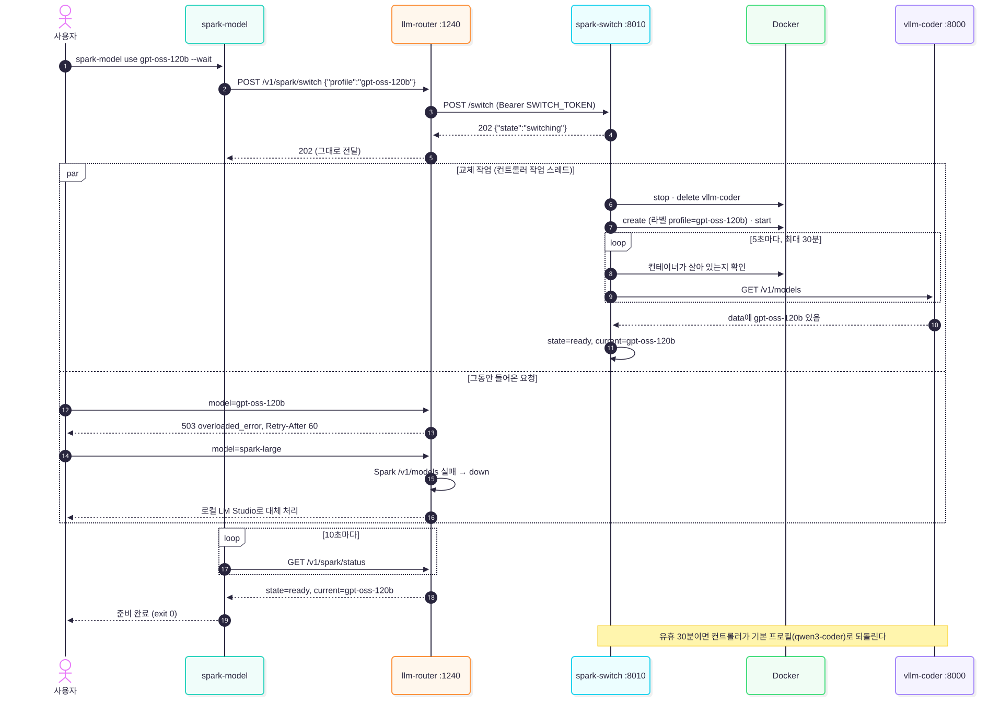

# llm-router · spark-switch 운영 문서

상태: **운영 중** (2026-11-12 운영 Mac과 Spark에 설치, [§2](#2-설치-순서)) · 작성 2026-11-12 · 갱신 2026-11-24

prod-mac의 Claude Code(claude-lms, VS Code 확장)가 주소 하나(`http://127.0.0.1:1240`)로 로컬 LM Studio와 DGX Spark vLLM을 함께 쓰게 하는 구성이다.
설계 검토 단계의 문서는 저장소의 `archive/docs/SPARK-ROUTING-DESIGN.md`(설치본에는 없음)이고, 구현하면서 바뀐 결정은 [§8](#8-설계안과-달라진-점)에 모았다.

- 전체 구성: [diagrams/llm-router-architecture.mmd](diagrams/llm-router-architecture.mmd)
- 모델 교체 순서: [diagrams/spark-switch-sequence.mmd](diagrams/spark-switch-sequence.mmd)
- 컨트롤러 상태: [diagrams/spark-switch-states.mmd](diagrams/spark-switch-states.mmd)
- 구성 요소 문서: [guardian/llm-router/README.md](../guardian/llm-router/README.md), [guardian/llm-router/spark/README.md](../guardian/llm-router/spark/README.md)
- 설정이 어느 파일에서 정해지고 언제 읽히는지(env·profiles.json·클라이언트, 배포본 확인 포함): SPARK-SETTINGS-MAP.md
- 실제 사용 패턴 대비 구성 검토(2026-11-15, 400 원인·폴백·coder 슬롯 활용): SPARK-USAGE-REVIEW-20261115.md
- 7명 강의·Isaac Sim 병행 구성 제안과 부하 실측: SPARK-CLASS-ISAAC-PLAN.md
- DGX 쪽을 k3s(쿠버네티스)로 옮기는 설계안: SPARK-K8S-DESIGN.md. 아직 DGX에 적용하지 않았고, 이 문서의 Docker 설치가 현재 기준이다.
- Spark에 코딩·비전 모델을 동시에 띄우는 설계안과 모델 검토: SPARK-MULTI-MODEL-DESIGN.md. 구현 전이다.

---

## 1. 구성



| 구성 요소 | 위치 | 하는 일 |
|---|---|---|
| `llm-router` | prod-mac `127.0.0.1:1240`, LaunchAgent `dev.guardian.llm-router` | Anthropic `/v1/messages`를 받아 `model` 값으로 목적지를 고르고 그대로 넘긴다. 형식 변환은 없다. 양쪽 `/v1/models`를 10초마다 읽어 모델 목록을 갱신한다. |
| LM Studio | prod-mac `127.0.0.1:1234` | `local-fast`(gemma-4-e4b). Spark가 안 될 때 모든 요청의 대체 목적지. |
| `vllm-coder`, `vllm-coder-1` | Spark `:8000`, `:8001` (LAN) | 기본은 **상주 페어**: slot0 `:8000`에 `qwen3-instruct`, slot1 `:8001`에 `qwen3-coder`(각 util 0.40). 대형 모델을 요청하면 두 슬롯을 내리고 slot0 하나로 단독 실행한다([§3.1](#31-모델-교체-spark-model)). |
| `spark-switch` | Spark `:8010` (LAN), 컨테이너 | 슬롯 컨테이너를 내리고 올린다. 유휴 30분이면 기본(페어)으로 되돌린다. |
| `spark-model` | prod-mac `~/.local/bin` | 사용자가 모델 교체를 요청하는 명령. 라우터에만 말하고 토큰을 모른다. |

### 1.1 모델 이름

| 요청 `model` | 목적지 |
|---|---|
| `spark-large` | Spark. `SPARK_PREFER` 중 지금 서빙 중인 첫 모델, 없으면 Spark가 내놓은 첫 모델. 페어일 때는 `qwen3-instruct`, 대형 모델 단독일 때는 그 모델. Spark가 다운이면 로컬. |
| `local-fast` | 로컬 `LOCAL_MODEL` |
| Spark가 지금 서빙 중인 이름 (예: `qwen3-coder`) | 그 이름을 `/v1/models`에 내놓은 Spark 주소(`:8000` 또는 `:8001`) |
| 로컬 LM Studio 목록의 id | 로컬 그대로 |
| 올라가 있지 않은 Spark 프로필 이름 | 400 또는 503 ([§3.2](#32-올라가-있지-않은-모델을-부르면)) |
| 그 밖의 이름 | 400 |

응답 헤더 `X-Route`가 실제로 간 곳을 알려 준다: `spark`, `local`, `local (spark-down)`, `local (retry)`.

## 2. 설치 순서

2026-11-12에 prod-mac와 Spark에 설치를 마쳤다. 새 장비에 설치할 때도 아래 순서를 따르고, 모두 사용자 승인 후 진행한다.

1. **Spark: 컨트롤러 설치.** `guardian/llm-router/spark/install-spark-switch.sh --dry-run`으로 확인한 뒤 `--start`.
   `~/spark-switch/env`(600)에 교체 토큰이 새로 만들어진다. 이 단계는 `vllm-coder`를 건드리지 않는다. 컨트롤러는 시작할 때 지금 컨테이너를 기본 프로필(`DEFAULT_PROFILE=qwen3-instruct`)로 인수한다.
   컨테이너 이름(`MANAGED_CONTAINER`, 기본 `vllm-coder`)은 모델 이름이 아니라 컨트롤러가 쓰는 자리 이름이다. 어떤 프로필이든 이 이름으로 뜬다.
   인수할 때 프로필은 `--served-model-name`(또는 `spark-switch/profile` 라벨)으로 알아낸다.
   2026-11-12에 컨트롤러 밖에서 띄운 `vllm-instruct`를 `vllm-coder`로 이름만 바꿨다(재시작 없음). 예전 coder 컨테이너는 `vllm-coder-prev-20261112`로 남겨 두었다.
   **전환 시험(2026-11-12 15:07–15:17 UTC):** 컨트롤러를 켜자 이 컨테이너를 `ready, qwen3-instruct`로 인수했다.
   `/switch qwen3-coder`는 301초, `/switch default`(→ 당시 기본 qwen3-instruct)는 272초 만에 준비됐다.
   coder가 떠 있을 때 라우터 `/health`의 `large`가 `qwen3-coder`로 바뀌어 `SPARK_PREFER`의 두 번째 항목이 동작했고, 되돌린 뒤 실행 인자는 profiles.json과 같았다(util 0.60).
   로드하는 동안 `spark-large` 요청은 `X-Route: local (spark-down)`으로 local gemma가 받아 200으로 끝났다.
   idle 복귀는 같은 날 11:32 UTC 로그(당시 `IDLE_MINUTES=3`)에서 동작했다. 컨트롤러는 켠 채로 두었다.
   **상주 페어 배포·시험(2026-11-14 15:24–15:55 UTC):** 컨트롤러·라우터를 새 코드로 바꾸고(`backup-20261115-002407/`, `*.bak-20261114T1525Z`에 이전본) `spark-model default`로 페어를 올렸다.
   페어 준비까지 8분 33초(slot0 → slot1 순서). slot1 로드 중에 `spark-large`는 `:8000`의 `qwen3-instruct`로 200, `qwen3-coder`는 503(`Retry-After`)이었다.
   준비 뒤 `qwen3-coder`는 `:8001`로 가서 tool_use(`get_weather`)를 돌려줬다. 페어일 때 Spark 메모리 사용 106G / 121G.
   페어 직후 `use gpt-oss-120b`는 쿨다운으로 429, 120초 뒤 다시 요청해 8분 43초 만에 준비됐다(`vllm-coder-1`은 내려감).
   이때 `spark-large`는 `gpt-oss-120b`로 200(tool_use 포함), `qwen3-coder`는 400 not loaded였다. `spark-model default`로 페어 복귀는 8분 58초.
   보존 컨테이너 `vllm-coder-prev-20261112`는 그대로였다.
   **끊김 처리 배포(2026-11-24 17:05 KST):** 운영 Mac의 `router.py`만 `73c8b4c` 판으로 바꿨다(이전본 `~/bundles/llm-router-deploy-20261124T0805Z/router.py.before`).
   바꾸기 전에 같은 폴더에서 라우터의 venv(httpx 0.28.1, httpcore 1.0.9)로 단위 테스트 94개가 통과했다. 파일을 복사한 뒤 `launchctl kickstart -k`로 다시 띄웠고, 그때 열린 연결은 없었다.
   재시작 뒤 `/health` ok, `local-fast` 200(`X-Route: local`). Spark가 내려가 있던 때라 `spark-large` 스트림은 `local (spark-down)`으로 가서 `message_stop` 하나로 끝났고, 오류 이벤트는 붙지 않았다. 재시작 뒤 로그에 오류 줄은 없었다.
   Spark에서는 다른 작업이 vLLM을 내려 둔 상태여서, 교체 중 끊김 처리는 운영에서 보지 못했다(§6).
   Spark의 `~/spark-switch/swcall.sh`(status/switch)와 `swpoll.sh`(전환 후 준비까지 대기)는 토큰을 화면에 내지 않고 호출하는 보조 스크립트다.
2. **토큰 옮기기.** Spark의 `~/spark-switch/env`에 있는 `SWITCH_TOKEN` 값을 화면에 찍지 말고 prod-mac `~/.config/llm-router/env`의 `SPARK_SWITCH_TOKEN=`에 넣는다. vLLM 키(`~/vllm-work/.vllm-env`)도 같은 방식으로 `SPARK_API_KEY=`에 넣는다.
3. **prod-mac: 라우터 설치.** `guardian/llm-router/install-llm-router.sh --load`. `spark-model`도 `~/.local/bin`에 함께 설치된다.
   `SPARK_URLS=http://spark.local:8000,http://spark.local:8001`, `SPARK_SWITCH_URL=http://spark.local:8010`을 env 파일에 적는다(아래 *Spark 주소* 참고).
   단일 모드만 쓰는 Spark라면 `SPARK_URL` 한 줄이어도 된다(`SPARK_URLS`가 있으면 그쪽이 이긴다).
   Claude Code kit로 옮겨 설치하는 Mac이라면 `./install-claude-code.sh --router-load` 한 번으로 이 단계와 4단계
   (claude-lms 연결, `CLAUDE_LMS_ROUTER`)가 같이 일어난다(시작 없이 파일만 두려면 `--with-router`). 이후
   `~/.config/llm-router/env`(600)에 `SPARK_URL`·`SPARK_API_KEY`를 채운다. kit의 `llm-router/`는 다섯 파일뿐이고
   `tests/`·`spark/`는 포함되지 않는다(Spark 컨트롤러는 Spark에서 이 저장고로 설치).
4. **claude-lms 연결.** `~/.config/claude-lms/env`에 `CLAUDE_LMS_ROUTER=http://127.0.0.1:1240`. 라우터가 응답하지 않으면 claude-lms는 예전처럼 LM Studio에 바로 붙는다.
5. **확인.** `curl -s http://127.0.0.1:1240/health`, `spark-model status`, `claude-lms -p "hi"`.
6. **로컬 네트워크 권한 (macOS 15 이상, 화면에서 직접).** LaunchAgent로 뜬 라우터는 macOS 로컬 네트워크 권한이 있어야 Spark(LAN 주소)에 닿는다.
   권한이 없으면 `/health`의 `spark.last_error`에 `ConnectError`가 남고 `spark-large`는 `local (spark-down)`으로 폴백한다.
   허용 창이 뜨거나 *시스템 설정 → 개인정보 보호 및 보안 → 로컬 네트워크*에 `python3.12`가 보이면 켠다.
   ssh에서 실행한 프로세스는 이 제한을 받지 않으므로, 확인은 반드시 라우터 `/health`(또는 `launchctl submit` 시험)로 한다.
   `~/.guardian-llm/python/bin/python3.12`를 다시 서명하거나 교체하면 권한이 맞지 않게 되니, 바꾼 뒤에는 다시 확인한다.

### 2.1 Spark 주소

Claude Code·VS Code 확장·claude-lms는 모두 라우터(`127.0.0.1:1240`)에만 요청한다. 그래서 Spark 주소를 정하는 곳은
prod-mac `~/.config/llm-router/env`의 `SPARK_URLS`(또는 `SPARK_URL`)·`SPARK_SWITCH_URL` 두 줄뿐이다. 고친 뒤
`launchctl kickstart -k gui/$(id -u)/dev.guardian.llm-router`로 다시 띄운다.

- **주소마다 따로 확인한다.** 라우터는 `SPARK_URLS`의 주소를 각각 10초마다 확인하고, 요청은 그 모델 id를 내놓은 주소로 보낸다.
  `spark`의 up·모델 목록은 살아 있는 주소들의 합이다. 대형 모델 단독일 때 `:8001`이 내려가 있는 것은 정상이며 `spark`는 up으로 남는다.
  `/health`의 `spark.nodes`에 주소별 상태가 나온다.
- **이름(mDNS)을 쓴다.** Spark는 Wi-Fi DHCP로 주소를 받아 바뀔 수 있다. Spark의 avahi가 `spark.local`을 알리므로
  env에는 2026-11-14부터 이 이름을 적어 두었다. launchd로 뜬 라우터에서도 해석된다(`launchctl submit` 시험으로 확인). ssh 별칭 `dgx-spark`도 같은 이름을 쓴다.
- **IPv4 강제(`UPSTREAM_IPV4_ONLY=1`, 기본).** macOS는 `.local` 이름을 IPv6 링크로컬 주소부터 돌려주는데 vLLM `:8000`은 IPv4(`0.0.0.0`)에서만 듣는다.
  httpx는 주소를 차례로 시도하므로(happy-eyeballs 없음) 새 연결마다 1.1–1.5초를 버렸다. 라우터는 업스트림을 IPv4로만 해석해 이 지연을 없앤다(실측 새 연결 1.56초 → 0.016초).
  업스트림 URL이 IPv6 전용일 때만 `0`으로 둔다.
- **/etc/hosts는 쓰지 않는다.** 결국 IP를 손으로 적는 것이라 DHCP가 바뀌면 같이 낡고, 고칠 때마다 sudo가 든다.
- **공유기 DNS(`spark.lan`)도 쓰지 않는다.** KT 공유기(172.30.1.254)는 이 이름을 알지만 Mac들은 통신사 DNS(168.126.63.1)를 써서 풀리지 않는다.
- 공유기에서 Spark MAC에 고정 할당을 해 두면 이름이 안 될 때 IP로 돌아가기도 쉽다(선택).

## 3. 사용

### 3.1 모델 교체: `spark-model`

```bash
spark-model status                     # 모드(pair/single), 슬롯별 포트·모델, 상태, 유휴 복귀 시각, 프로필 표
spark-model list                       # 프로필 표만
spark-model use gpt-oss-120b --wait    # 대형 모델 단독으로 교체, 준비될 때까지 10초마다 진행 단계 출력
spark-model default                    # 기본(상주 페어 qwen3-instruct + qwen3-coder)으로 되돌리기
spark-model use pair                   # default와 같다. use qwen3-coder / use qwen3-instruct도 페어로 간다
```



**상주 페어 (2026-11-15부터 기본).** 평소에는 두 모델이 늘 떠 있어 여러 사람이 서로 교체 없이 쓴다.

| 슬롯 | 컨테이너 | 포트 | 모델 | util |
|---|---|---|---|---|
| 0 | `vllm-coder` | `:8000` | `qwen3-instruct` (`spark-large`) | 0.40 |
| 1 | `vllm-coder-1` | `:8001` | `qwen3-coder` | 0.40 |

- 대형 모델(`gpt-oss-120b`, `qwen3-next-80b`, `qwen3-vl-30b`)은 누군가 `spark-model use <이름>`을 실행할 때만 올라간다. 이때 **두 상주 모델이 모두 내려가** 그동안 다른 사람의 `qwen3-coder` 요청은 400(올라가 있지 않음), `spark-large`는 대형 모델로 간다.
- 대형 모델은 30분 동안 요청이 없으면 페어로 돌아간다. 바로 돌리려면 `spark-model default`.
- 컨트롤러는 슬롯을 내린 뒤 `MemAvailable`이 두 슬롯 util 합 × 전체 메모리 + `MEM_MARGIN_GB`(4 GiB) 이상이 될 때까지 기다리고(`MEM_WAIT_TIMEOUT=600`초, phase `waiting-memory`), slot0이 준비된 뒤 slot1을 띄운다(phase `creating <이름>` · `loading <이름>`).
- 설정은 Spark `~/spark-switch/env`의 `DEFAULT_PROFILE=pair`, `RESIDENT_PROFILES=qwen3-instruct,qwen3-coder`. 페어를 끄려면 두 줄을 지우고 `DEFAULT_PROFILE=qwen3-instruct`로 둔 뒤 컨트롤러를 다시 띄운다(단독이면 util 0.60이 최적이었다, [SPARK-BENCH-REPORT.md](dev/SPARK-BENCH-REPORT.md)).



- **교체는 사람이 요청할 때만 일어난다.** 모델 요청이 들어왔다고 라우터가 알아서 바꾸지 않는다. 다른 사람이 쓰는 모델을 실수로 내리는 일을 막기 위해서다.
- 교체에는 수 분이 걸린다. 60–80 GB 모델은 첫 로드에 10분 이상 걸릴 수 있어 대기 한도를 30분으로 두었다.
- 교체 중에는 `spark-large` 요청이 로컬로 간다(Spark `/v1/models`가 응답하지 않아 다운으로 판정되기 때문). 페어로 돌아올 때는 slot0이 먼저 준비되므로 `spark-large`가 slot1보다 몇 분 먼저 돌아온다.
- 다만 슬롯이 내려가기 시작해 라우터가 다운으로 판정하기까지 십수 초 동안은 그 슬롯으로 간 요청이 실패할 수 있다. 2026-11-24 페어 → `qwen3-vl-30b` 교체에서는 slot0이 내려가는 중에 보낸 `spark-large` 요청이 시험 스크립트의 30초 제한(curl `-m 30`) 안에 응답을 받지 못했고, slot1이 내려가는 중에 보낸 요청은 502 `spark request failed: ReadError`를 받았다. 연결은 맺어졌는데 응답 헤더를 받기 전에 끊긴 경우로, 이때의 라우터는 이를 재시도하지 않았다. 지금 코드는 이 경우도 로컬로 한 번 다시 보낸다(§4, 2026-11-24 운영 Mac 배포). 그사이 slot1이 살아 있는 동안에는 `spark-large`가 `qwen3-coder`로 갔다.
- 교체 직전에 시작한 스트리밍 응답은 슬롯이 내려갈 때 중간에 끊긴다. 같은 시험에서 `spark-large` 스트림은 200으로 시작해 텍스트 조각 201개를 받은 뒤 `message_stop`도 오류 이벤트도 없이 닫혔다(curl 종료 코드 0). 지금 코드는 이렇게 끊긴 `/v1/messages` 스트림 끝에 `event: error`(`api_error`, "upstream stream ended before message_stop …") 하나를 붙여, 클라이언트가 잘린 답을 끝난 답으로 오인하지 않게 한다(§4, 2026-11-24 운영 Mac 배포). 이미 보낸 조각은 되돌릴 수 없으므로 다시 보내지는 않는다.
- 교체가 끝난 뒤 120초 동안은 기본 프로필이 아닌 다른 프로필로의 교체를 막는다(429, `retry_after`). 기본 프로필로 되돌리는 것은 막지 않는다. 그래서 누가 `default`로 페어를 올린 직후 2분 동안은 대형 모델 요청이 429로 거절된다.
- 기본 프로필이 아닌 모델이 30분 동안 요청을 받지 않으면 Spark의 컨트롤러가 기본 프로필로 되돌린다. 판단은 vLLM `/metrics`의 실행·대기 요청 수와 성공 요청 누계로 한다. 메트릭을 못 읽으면 유휴로 보지 않는다.



### 3.2 올라가 있지 않은 모델을 부르면

| 상황 | 응답 |
|---|---|
| 프로필은 있지만 올라가 있지 않음 | 400 `invalid_request_error`: `<이름> is a Spark profile but is not loaded (current: …). Load it with: spark-model use <이름>` |
| 그 프로필로 교체 중 (페어로 교체 중이면 두 상주 모델 모두) | 503 `overloaded_error`, `Retry-After: 60` |
| 라우터 업스트림 연결 풀 포화 | 503 `overloaded_error`, `Retry-After: 5` (폴백하지 않음, 헬스 상태 유지) |
| 프로필도 아니고 어디에도 없음 | 400 unknown model |

`GET /v1/models`는 올라가 있지 않은 프로필도 `route: "spark (not loaded)"`로 함께 보여 준다.
교체가 끝난 직후 라우터가 다음 헬스 확인(10초 주기)에서 새 모델을 보기 전까지는, 방금 올라간 모델을 불러도 400 `<이름> is a Spark profile but is not loaded (current: <같은 이름>)`이 날 수 있다. 2026-11-24에 `qwen3-vl-30b`(14:55:38)와 `qwen3-next-80b`(15:09:26, `spark-model use --wait`가 끝난 바로 그 초)에서 봤고, 라우터는 각각 11초 뒤(14:55:49)·6초 뒤(15:09:32) Spark를 up으로 봤다. 스크립트에서는 `--wait` 뒤에 `/v1/models`에서 그 모델의 `route`가 `spark`가 될 때까지 기다린다.
연결 풀 포화는 백엔드 장애가 아니라 라우터 자신의 과부하(`UPSTREAM_MAX_CONNECTIONS` 동시 스트림 한도 초과)라서 로컬로 폴백하지 않고 잠시 후 재시도를 안내한다(`UPSTREAM_POOL_TIMEOUT`초까지 기다린 뒤). 헬스 탐사와 모델 교체 요청은 별도 풀을 쓰므로 이 상황에서 백엔드 상태 판정과 교체에는 영향이 없다.
라우터는 시작할 때 열린 파일 수 한도(soft `RLIMIT_NOFILE`)를 `max(4096, 2×UPSTREAM_MAX_CONNECTIONS+256)`까지 스스로 올린다. 스트림 하나가 소켓 두 개(클라이언트·업스트림)를 쓰므로, macOS 기본값 256으로는 동시 약 128 스트림에서 연결 오류가 난다.

### 3.3 VS Code 확장

VS Code 확장은 claude-lms를 거치지 않으므로 `settings.json`의 `claudeCode.environmentVariables`를 라우터 쪽으로 바꾼다. 기존 항목 중 아래만 다르다.

| 변수 | 값 |
|---|---|
| `ANTHROPIC_BASE_URL` | `http://127.0.0.1:1240` |
| `ANTHROPIC_MODEL`, `ANTHROPIC_DEFAULT_OPUS_MODEL`, `ANTHROPIC_DEFAULT_SONNET_MODEL` | `spark-large` |
| `ANTHROPIC_DEFAULT_HAIKU_MODEL`, `ANTHROPIC_SMALL_FAST_MODEL` | `local-fast` |
| `CLAUDE_CODE_SUBAGENT_MODEL` | `spark-large` |
| `CLAUDE_CODE_MAX_CONTEXT_TOKENS` | `65536` 그대로. 어떤 요청이든 로컬로 넘어갈 수 있으니 로컬 창에 맞춘다. |
| `CLAUDE_CODE_MAX_OUTPUT_TOKENS` | `16384` (11-15 추가). vLLM은 `입력 + max_tokens > 65536`이면 400을 낸다. 기본 32000이면 입력 33,536부터, 16384면 49,152부터다(기본 프롬프트 실측 약 11k, 검토 §3·§8). claude-lms는 `CLAUDE_LMS_MAX_OUTPUT`(기본 16384)로 같은 값을 넣는다. |

`ANTHROPIC_AUTH_TOKEN`은 그대로 둔다. 라우터는 클라이언트 토큰을 버리고 목적지별 키를 붙인다.
라우터가 꺼져 있으면 확장은 연결 오류를 낸다(claude-lms처럼 자동으로 LM Studio에 붙지 않는다). 그때는 `ANTHROPIC_BASE_URL`을 `:1234`로 되돌린다.

## 4. 장애 시 동작

| 상황 | 결과 |
|---|---|
| Spark 꺼짐 / 네트워크 끊김 | 10초 주기 확인에서 2회 연속 실패하면 다운. `spark-large`는 로컬로 간다. |
| Spark 요청이 연결 실패·502·503 | 같은 요청을 로컬로 한 번 다시 보낸다(`X-Route: local (retry)`). 504는 요청이 이미 Spark에서 돌고 있을 수 있어 다시 보내지 않고 그대로 돌려준다. 응답 헤더를 받기 전에 연결이 끊기는 경우(`ReadError`·`RemoteProtocolError`·`WriteError`, 2026-11-24 교체 중 관찰, §3.1)도 로컬로 한 번 다시 보낸다. 클라이언트에는 아직 아무것도 가지 않았고, 연결이 끊긴 Spark 쪽 생성은 vLLM이 취소하므로 두 번 실행되는 비용은 버려지는 연산 한 번이다. 헤더 전 `ReadTimeout`과 그 밖의 오류는 502 `spark request failed: …`. 읽기 시간 제한은 두지 않으므로 응답이 늦는 것만으로는 502가 나지 않는다. 응답 헤더를 받은 뒤 `/v1/messages` 스트림(압축 없는 200 SSE)이 `message_stop` 없이 끝나면 끝에 `event: error` 하나를 붙인다. 다른 경로의 본문이 중간에 끊기면 예전처럼 응답을 중단한다. 두 동작 모두 2026-11-24 17:05(KST) 운영 Mac에 배포했다. 실제 Spark 교체 중의 동작은 아직 운영에서 보지 않았다(§6). |
| 컨트롤러 꺼짐 | 모델 요청에는 영향이 없다. `/v1/spark/switch`는 502, `/health`의 `switch.ok`가 false. |
| 교체 실패 (컨테이너 종료, 30분 초과, Docker 오류·소켓 타임아웃) | 로그 끝부분을 키·토큰을 가린 채 `last_error`에 남기고, 기본 프로필로 한 번 복구한다. 복구까지 실패하면 `state: failed, current: null`. |
| 페어에서 slot1(`:8001`)만 죽음 | 라우터는 `:8001`을 다운으로 보고 `qwen3-coder` 요청에 400을 낸다. `spark-large`는 그대로 `:8000`. 컨트롤러는 준비가 끝난 뒤에는 슬롯을 지켜보지 않는다. Docker `unless-stopped`가 컨테이너를 다시 띄운다. 그래도 안 되면 컨트롤러는 여전히 `ready, pair`로 알고 있어 `spark-model default`·`use qwen3-coder`는 `changed=false`로 끝난다. Spark에서 `docker restart spark-switch`로 다시 인수시키면 상태가 `ready`가 아니게 된다(꺼진 슬롯은 `unknown`, 응답 없는 슬롯은 인수 대기 끝에 `failed`). 그다음 `spark-model default`가 페어를 새로 올린다. |
| 컨트롤러 재시작 | 돌고 있는 `vllm-coder`(페어면 `vllm-coder-1`까지)를 인수한다. vLLM이 아직 모델을 내놓지 않으면(가중치 로딩 중) `switching`(phase `loading`)으로 두고 준비될 때까지 기다린다. |
| 로컬 네트워크 권한 없음 (LaunchAgent) | Spark 확인이 `ConnectError`(`Errno 65 No route to host`)로 실패해 다운으로 본다. `spark-large`는 로컬로 간다. §2의 6단계로 푼다. |
| Claude Code가 `messages` 안에 `role:"system"`을 보냄 (2.1.x의 SessionStart hook 내용) | vLLM은 400으로 거부한다. 라우터는 Spark로 보내는 요청에서만 이 메시지를 `<system-reminder>` user 텍스트 블록으로 접어 옆 user 메시지에 붙인다(`cache_control` 유지). 로컬과 로컬 재시도는 원래 내용 그대로 보낸다. |
| 라우터 꺼짐 (재부팅 후 화면 로그인 전 등) | claude-lms는 LM Studio에 바로 붙는다. VS Code 확장은 §3.3 참고. |

## 5. 보안

- 라우터는 루프백에만 열고, Host 헤더가 루프백 주소가 아니면 403으로 거부한다(DNS rebinding 방지).
- 브라우저 페이지가 `127.0.0.1:1240`으로 보내는 요청도 막는다. 루프백이 아닌 `Origin` 헤더가 있으면 403, `Content-Type: application/json`이 아닌 POST는 415다. Claude Code·`spark-model`·curl은 `Origin`을 보내지 않으므로 영향이 없다.
- **Spark 쪽 두 포트는 LAN에 평문 HTTP로 열려 있다.** vLLM 키와 교체 토큰이 LAN에서 엿보일 수 있다. 엿본 사람이 할 수 있는 일은 각각 모델 호출, 프로필 사이 교체까지다. 교체 API는 프로필 이름만 받고, 컨트롤러 코드는 설정에서 나온 슬롯 이름(`vllm-coder`, `vllm-coder-1`)만 다룬다. 관리 라벨로 컨테이너를 쓸어 지우지 않는다.
- 컨트롤러는 Docker 소켓을 마운트하므로 Spark에서 사실상 root 권한이다. 교체 토큰은 vLLM 키와 따로 두었다(최소 권한).
- 키와 토큰은 600 파일에만 두고 로그·응답·오류 메시지·프로세스 인자에 나오지 않는다(테스트로 확인). 설치 스크립트는 토큰 파일을 처음부터 600으로 만들고, vLLM 키 파일이 그룹·기타 사용자에게 읽히면 600으로 바꾼다.
- 더 막으려면: Spark 방화벽으로 8000·8001·8010을 prod-mac 주소에만 열거나, SSH 터널로 바꾼다(라우터 env의 URL만 바꾸면 된다).

## 6. 확인하지 않은 것

| 항목 | 상태 |
|---|---|
| `gpt-oss-120b`, `qwen3-next-80b`, `qwen3-vl-30b` 프로필 | 메모리 비율·최대 길이·도구 파서가 추정값이다(`verified: false`). `gpt-oss-120b`는 2026-11-14에 한 번 올려 짧은 응답과 tool_use를 확인했고, 2026-11-15에 7명 동시 부하(34k 토큰 프롬프트 포함)를 쟀다(SPARK-CLASS-ISAAC-PLAN.md §1). 2026-11-24에는 운영 Mac에서 `spark-model use <이름> --wait`로 세 프로필을 차례로 올리고 라우터로 짧은 질문을 보냈다(KST). `qwen3-vl-30b` 3분 55초(14:51:59–14:55:54, 답 `VL OK`, 이미지는 아래 행), `qwen3-next-80b` 10분 26초(14:59:00–15:09:26, `17×3` → `51`), `gpt-oss-120b` 8분 35초(15:11:59–15:20:34, `51`). 셋 다 교체가 실패 없이 끝났고 응답은 200에 `X-Route: spark`였으며, `spark-large`도 그 모델로 갔다. 끝으로 `spark-model default --wait`로 기본 페어로 되돌렸다(15:20:37–15:29:53, 9분 16초). 라우터는 그 10초 뒤(15:30:03) 두 모델을 다시 보았고, `spark-large`(→ `qwen3-instruct`)와 `qwen3-coder` 모두 `51`로 답했다. 그전 11-21·22에도 다른 세션의 벤치가 컨트롤러 API로 세 프로필을 올린 기록이 있다(응답 내용 기록은 없음). 짧은 응답만 봤으므로 긴 입력·도구 호출용 값은 여전히 추정이고 `verified: false`는 그대로 두었다. Isaac Sim 병행용 `gpt-oss-120b-lite`(util 0.65)와 `qwen3-coder-solo`(util 0.45)는 2026-11-15에 올려 부하까지 쟀으므로 `verified: true`다(같은 문서 §2–3). |
| vLLM 0.15.1의 Anthropic `/v1/messages`가 이미지 블록을 받는지 | **확인: 받지 못한다**(2026-11-24 14:56 KST, `qwen3-vl-30b`, 라우터 경유). 64×64 빨간색 PNG를 Anthropic 이미지 블록으로 보내면 `source.type: base64`는 400 `The URL must be either a HTTP, data or file URL.`, `source.type: url`(data URL)은 400 `multi_modal_data['image'][0] is empty …`였다. 같은 이미지를 `/v1/chat/completions`의 `image_url`(data URL)로 보내면 200에 답이 `Red`였다(`X-Route: spark`). 그래서 이미지 작업은 `/v1/chat/completions`로 보낸다(3단계 skill에서 다룸). Claude Code처럼 `/v1/messages`만 쓰는 클라이언트는 Spark에서 이미지를 넘길 수 없다. |
| Spark에서의 실제 교체·유휴 복귀 | **확인**(2026-11-12, 2026-11-15, 2026-11-21·22). 2026-11-12에 `qwen3-coder`로 교체 301초, 기본 프로필 복귀 272초를 쟀다([§2](#2-설치-순서), 그때는 `IDLE_MINUTES=3`). 2026-11-15에는 `gpt-oss-120b` → 페어 유휴 복귀를 봤다. 동시 요청 4건(전체 46 tok/s)을 보낸 뒤 약 31분에 교체가 시작되고 약 39분에 페어가 `ready`가 됐다. 지금 값 `IDLE_MINUTES=30`으로 2026-11-21·22에 두 번 더 봤다(컨트롤러 로그, KST). ① `qwen3-next-80b`가 11-21 23:29:36에 컨트롤러 재시작으로 인수됐다. 30분 뒤 23:59:36에 `idle for 30 minutes; returning to pair`가 찍혔고, 11-22 00:08:50에 페어 `ready`(reason=idle, 약 9분)가 됐다. ② `qwen3-next-80b-nvfp4`는 11-22 15:18:26에 `ready`가 됐다. 16:06:40에 같은 줄이 찍혔고, 16:16:09에 페어 `ready`(reason=idle, 약 9.5분)가 됐다. 운영 Mac 라우터 로그의 Spark down·up 시각도 이와 맞는다. |
| 운영 Mac에서의 라우터 실가동 | **확인**(2026-11-12). `--load`로 설치했고, 로컬 네트워크 권한을 허용한 뒤 `/health`가 `spark.up: true`, `/v1/messages`가 200에 `X-Route: spark`였다. 성능은 배포한 `router.py`를 시험 포트 :1242로 띄워 쟀다. 연결 풀·열린 파일 한도를 고친 뒤 동시 128에서 256/256 성공([SPARK-BENCH-REPORT.md](dev/SPARK-BENCH-REPORT.md#841-수정-후-재검증-2026-11-12)). 2026-11-24에 [LLM-ROUTER-TESTING.md](dev/LLM-ROUTER-TESTING.md) §7 점검표 1–7번을 항목별로 다시 판정했다(스트리밍 `message_stop`까지, Claude Code 별칭 분기, 교체 중 503 + `Retry-After`). 8·9번(Stage B)은 하지 않았다. 결과는 그 문서 §7. |
| 여러 사용자가 있을 때 대형 모델 교체 | 한 사람이 `use gpt-oss-120b`를 하면 다른 사람이 쓰던 상주 모델도 바로 내려간다. 진행 중 요청이 있으면 교체를 미루는 장치는 아직 없다. 2026-11-24 시험에서 진행 중이던 스트림은 `message_stop` 없이 끊겼고, 슬롯이 내려가는 순간의 요청은 응답 없음·502로 실패했다(§3.1). 끊긴 스트림의 오류 이벤트와 헤더 전 끊김의 로컬 재시도는 코드에 반영했지만(§4), 교체를 미루는 장치는 여전히 없다. |
| 교체 중 끊김 처리(헤더 전 재시도, 스트림 끝 `event: error`)의 운영 동작 | **미확인**. 2026-11-24 17:05에 운영 Mac에 배포했고, 운영 venv로 단위 테스트 94개가 통과했다(§2). 배포 때 Spark는 다른 작업으로 vLLM이 내려가 있어, 실제 교체로 끊김을 일으켜 보지 못했다. Spark가 비면 [LLM-ROUTER-TESTING.md](dev/LLM-ROUTER-TESTING.md) §7 6번을 다시 돌린다. |
| 재부팅 후 컨트롤러 자동 시작 | **확인**(2026-11-18 재부팅 기록, 2026-11-24 점검). 따로 재부팅 시험을 하지 않고 실제 재부팅 기록으로 판정했다. Spark는 2026-11-18에 여러 번 재부팅됐고, 컨트롤러 로그에 부팅마다 `listening` 줄이 새로 찍혔다. 마지막 부팅을 보면 23:31:51 KST 부팅, 23:32:02 Docker 시작(`Restoring containers`), 23:32:03 컨트롤러 대기 시작(`adopted workload still loading: current=pair`), 23:49:30 페어 `ready`(reason=adopt)다. 이때 Docker 서비스는 `enabled`, 컨트롤러 재시작 정책은 `unless-stopped`였다. |
| 운영 Mac 재부팅 뒤 라우터 | **확인**(2026-11-20 재부팅 기록, 2026-11-24 점검). 따로 재부팅 시험을 하지 않고 실제 재부팅 기록으로 판정했다. 운영 Mac은 2026-11-20 08:04에 재부팅됐고, 화면 로그인은 11-22 15:28이었다. 그 사이 라우터 로그에는 아무 줄도 없다. 로그인한 15:28에 라우터가 시작했고(15:28:35, launchd 상태 running), 15:29에 local up이었다. Spark up은 15:36으로, 그전 약 8분은 `ConnectError`였다. 이때 Spark는 이미 15:18에 `ready`였다. 그래서 그 8분의 원인은 운영 Mac 쪽(로컬 네트워크 권한, mDNS 해석 등)으로 보이지만 확인하지 않았다. 그 뒤로는 Spark 요청이 정상이다(2026-11-24 스트리밍·Claude Code 시험). |

## 7. 테스트

```bash
python -m unittest discover -s guardian/llm-router/tests -v          # 라우터 (fastapi/httpx 필요)
python3 -m unittest discover -s guardian/llm-router/spark/tests -v   # 컨트롤러 (표준 라이브러리만)
```

테스트 목록, 실행 환경, 로컬 실가동 점검 절차, 실환경 E2E 점검표는 [LLM-ROUTER-TESTING.md](dev/LLM-ROUTER-TESTING.md)에 있습니다. 매니페스트 테스트는 PyYAML이 없으면 건너뛰어지니 결과의 skip 수를 확인하세요.

## 8. 설계안과 달라진 점

| 설계안 (`archive/docs/SPARK-ROUTING-DESIGN.md`) | 구현 | 이유 |
|---|---|---|
| Spark 엔진 LM Studio 헤드리스(GGUF) | vLLM 컨테이너 | Spark에 이미 vLLM이 돌고 있었고, vLLM도 Anthropic `/v1/messages`를 지원해 `model`만 바꿔 넘기는 방식이 그대로 성립한다. |
| SSH 터널 `:1235` | LAN 직접 연결 | 사용자 선택. 터널 프로세스 관리가 필요 없다. 대신 §5의 평문 노출이 생긴다. |
| `auto` 별칭과 질의 무게 판단 | 없음. 클라이언트가 별칭으로 고른다 | Claude Code는 모델 단계(주/haiku/subagent)를 이미 나눠 부르므로 단계별 별칭으로 충분하다. 무게 판단과 이미지 감지는 3단계 skill에서 다룬다. |
| 모델 id 고정(`SPARK_MODEL_ID`) | `/v1/models`를 주기적으로 읽어 따라감 | Spark 모델이 바뀌어도 설정을 고치지 않게 한다. |
| 없음 | `spark-switch` 컨트롤러와 `spark-model` | 함께 올릴 수 없는 모델을 사용자가 골라 쓰게 한다. |
| Spark 주소 하나 | `SPARK_URLS` 여러 주소, 모델 id로 주소 선택 | 상주 페어(두 vLLM)와 대형 모델 단독을 라우터 설정을 바꾸지 않고 오간다. |
| Open WebUI·wiki도 라우터 경유 | 이번 범위는 Claude Code만 | Open WebUI 연결 변경은 별도 작업. |
