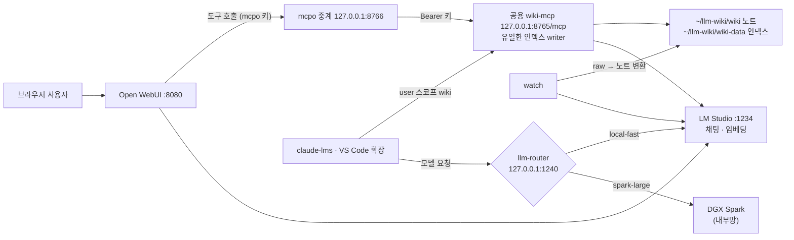

# 통합 번들 운영 가이드 (macOS arm64)

> 대상: [INSTALL-GUIDE.md](INSTALL-GUIDE.md) 대로 통합 번들을 설치한 Mac 을 매일 돌보는 담당자.
> 기준: `install-all.sh` 7단계 설치 결과 (LaunchAgent `dev.guardian.*` 다섯 개 + LM Studio. llm-router 는 4단계가 기본으로 설치·시작하며 `--no-router` 로 설치한 Mac 에는 없음).
> 사용자 쪽 쓰는 법은 [USAGE.md](USAGE.md), Claude Code 터미널 사용은 [CLAUDE-LMS-MANUAL.md](CLAUDE-LMS-MANUAL.md) 를 봅니다.
> 예전 단독 번들(번들 폴더 안 `data/`를 쓰던 방식)의 운영 절차는 이 문서에서 뺐습니다. 내부 저장소의
> `archive/`에만 보관하며 공개본에는 들어 있지 않습니다.

## 1. 구성 한눈에



같은 그림이 diagrams/install-ops-services.svg 에 있습니다.

## 2. 서비스 목록

설치 스크립트가 아래 LaunchAgent 를 만들고 켭니다. 모두 `RunAtLoad`·`KeepAlive` 라 로그인하면 뜨고, 죽으면 다시
뜹니다. plist 는 `~/Library/LaunchAgents/<Label>.plist` 입니다.

| 서비스 | Label | 주소 | 로그 |
|---|---|---|---|
| Open WebUI | `dev.guardian.openwebui` | `:8080` (기본 127.0.0.1) | `~/.guardian-llm/logs/openwebui.log` |
| mcpo 중계 | `dev.guardian.wiki-mcpo` | `127.0.0.1:8766` | `~/llm-wiki/logs/mcpo.log` |
| watch (raw 변환) | `dev.guardian.wiki-watch` | — | `~/llm-wiki/logs/watch.log` |
| 공용 wiki-mcp | `dev.guardian.wiki-mcp` | `127.0.0.1:8765/mcp` | `~/llm-wiki/logs/http.log` |
| llm-router | `dev.guardian.llm-router` | `127.0.0.1:1240` | `~/.guardian-llm/logs/llm-router.log` |
| LM Studio | 앱 (LaunchAgent 아님) | `:1234` | LM Studio 앱의 개발자 로그 |

- 공용 wiki-mcp 는 설치 5단계를 `--no-wiki-mcp-http` 로 건너뛰었으면 없고, 그때는 mcpo 가 wiki-mcp 를 직접 띄웁니다.
- llm-router 는 기본(`--router-load`)으로 켜져 있습니다. `--with-router` 로 설치했으면 plist 만 있고 꺼져 있으며,
  `--no-router` 로 설치했으면 없습니다. 이 서비스는 위키 인덱스와 상관이 없어 §4 의 정지·시작 순서에 넣지 않습니다.
- LM Studio 서버는 wiki 단계가 "앱과 함께 서버 시작" 으로 설정합니다. 앱이 꺼지면 임베딩과 raw 변환이 멈춥니다.

## 3. 매일 점검

```bash
curl -sf http://127.0.0.1:8080/health && echo " webui ok"
curl -sf -o /dev/null http://127.0.0.1:8766/openapi.json && echo "mcpo ok"
curl -sf -m 3 -o /dev/null http://127.0.0.1:1234/v1/models && echo "lm studio ok"
curl -s -o /dev/null -w '%{http_code}\n' -X POST http://127.0.0.1:8765/mcp   # 401 이면 정상 (키 없는 요청 거절)
claude mcp get wiki                                                          # 연결됨으로 표시
curl -sf -m 3 -o /dev/null http://127.0.0.1:1240/health && echo "router ok"    # 라우터 (§9)
```

| 확인 | 방법 | 정상 |
|---|---|---|
| 서비스 로드 | `launchctl print "gui/$(id -u)/dev.guardian.openwebui" >/dev/null && echo up` (Label 만 바꿔 반복) | exit 0 |
| 모델 | `~/llm-wiki/.env` 의 `EMBEDDING_MODEL`·`WIKI_INGEST_MODEL` 이 `/v1/models` 목록에 있음 | 둘 다 있음 |
| mcpo 키 | 필수 인자가 있는 도구에 빈 본문 `{}` 로 POST | 422 (401·403 이면 키 불일치) |
| 실제 임베딩 | `http.log`(공용 서버를 안 쓰면 `mcpo.log`)에 `임베딩 갱신: N개` 뒤 `❌` 없음 | ❌ 없음 |
| 변환 실패 | `ls ~/llm-wiki/raw/.failed/` | 비어 있음 |

> `검색 모드: Hybrid` 로그 줄은 설정값일 뿐입니다. 실제로 임베딩이 됐는지는 위 `임베딩 갱신` 줄로 봅니다.
> LM Studio 서버가 꺼져 있으면 앱을 켜거나 `~/.lmstudio/bin/lms server start --port 1234` (앱이 떠 있어야 함).

## 4. 정지와 시작

```bash
D="gui/$(id -u)"
LA=~/Library/LaunchAgents
```

| 작업 | 명령 |
|---|---|
| 하나 재시작 | `launchctl kickstart -k "$D/dev.guardian.wiki-mcpo"` |
| 하나 정지 | `launchctl bootout "$D/dev.guardian.wiki-mcpo"` |
| 하나 시작 | `launchctl bootstrap "$D" "$LA/dev.guardian.wiki-mcpo.plist"` |

전체를 멈추고 다시 켤 때는 **순서**를 지킵니다. 인덱스에 쓰는 프로세스가 둘이 되는 순간을 막기 위해서입니다.

```bash
# 정지: mcpo → watch → openwebui → wiki-mcp
for l in wiki-mcpo wiki-watch openwebui wiki-mcp; do launchctl bootout "$D/dev.guardian.$l" 2>/dev/null; done

# 시작: wiki-mcp → mcpo → openwebui → watch
for l in wiki-mcp wiki-mcpo openwebui wiki-watch; do launchctl bootstrap "$D" "$LA/dev.guardian.$l.plist"; done
```

> 같은 Mac 의 여러 계정이 각자 설치했다면 포트(8080·8765·8766·1234)는 Mac 전체에서 하나뿐입니다. 다른 계정의
> 서비스가 포트를 쥐고 있으면 Open WebUI 가 바인드에 실패한 채 멈춰 있을 수 있습니다. 그 계정의 서비스를 먼저
> 멈추고 `launchctl kickstart -k "$D/dev.guardian.openwebui"`.
> `launchctl print gui/<uid>` 는 그 계정으로 실행해야 보입니다.

## 5. 설정

| 파일 | 내용 | 바꾼 뒤 |
|---|---|---|
| `~/llm-wiki/.env` (권한 600) | 위키 경로, 모델 id, mcpo 키, 공용 서버 키 | `wiki-mcpo`·`wiki-watch` 재시작 (공용 서버를 쓰면 §4 순서로 전체) |
| `~/.config/claude-lms/env` | claude-lms 의 모델 id·context, 라우터 주소 | 실행할 때마다 읽음 — 재시작 없음 ([CLAUDE-LMS-MANUAL.md](CLAUDE-LMS-MANUAL.md) §3.2) |
| `~/.config/llm-router/env` (권한 600) | 라우터 대상·키 | `launchctl kickstart -k "$D/dev.guardian.llm-router"` |
| Open WebUI DB | 위키 도구 서버 주소·키, RAG 임베딩 설정 | 관리자 화면에서 직접 (환경변수로는 안 바뀜) |

키 값은 화면에 출력하거나 문서·메신저에 붙이지 않습니다. 확인이 필요하면 §3 의 422 검사처럼 결과만 봅니다.

## 6. 백업과 복원

| 대상 | 경로 | 백업 |
|---|---|---|
| **위키 노트** | `~/llm-wiki/wiki/` | **필수** — 유일한 원본 |
| 원문 보관 | `~/llm-wiki/raw/.processed/` | 권장 |
| Open WebUI DB | `~/.guardian-llm/openwebui-data/webui.db` (+`-wal`·`-shm`) | 권장 (계정·대화) — 서비스를 멈추고 복사 |
| 검색 인덱스 | `~/llm-wiki/wiki-data/` | 불필요 — 재인덱싱으로 복구 |
| 실행 환경 | `~/.guardian-llm/venv/` | 불필요 — 설치 스크립트로 다시 만듦 |

```bash
B=~/wiki-backup-$(date +%Y%m%d); mkdir -p "$B"
tar -czf "$B/wiki.tar.gz" -C "$HOME/llm-wiki" wiki raw/.processed

launchctl bootout "gui/$(id -u)/dev.guardian.openwebui"
cp -p ~/.guardian-llm/openwebui-data/webui.db* "$B/"
launchctl bootstrap "gui/$(id -u)" ~/Library/LaunchAgents/dev.guardian.openwebui.plist
```

복원: §4 순서로 전체를 멈춘 뒤 `wiki/` 를 풀어 놓고(DB 도 되돌린다면 `webui.db*` 를 제자리에) 다시 시작합니다.
노트만 되살아나면 인덱스는 §7 로 다시 만들 수 있습니다.

## 7. 재인덱싱

노트를 고치면 공용 wiki-mcp 가 스스로 감지해 바뀐 노트만 다시 임베딩합니다. 손으로 돌려야 할 때:

| 상황 | 방법 |
|---|---|
| 검색 결과가 0개, 새 노트가 안 잡힘 | 채팅이나 Claude Code 에서 `reindex` 도구 호출 (바뀐 노트만) |
| 임베딩 모델을 바꿈 | `reindex` 를 `force: true` 로 호출 (전체 다시 임베딩, 노트 수에 비례해 오래 걸림) |
| 인덱스가 깨졌다고 의심됨 | §4 순서로 정지 → `mv ~/llm-wiki/wiki-data ~/llm-wiki/wiki-data.bak-$(date +%Y%m%d)` → 시작 → `reindex` (`force: true`) |

인덱스 폴더는 지우지 말고 이름을 바꿔 두었다가, 새 인덱스로 검색이 되는 것을 본 뒤 정리합니다.

## 8. 관리자 암호 초기화

Open WebUI 관리자 암호를 잊었을 때 쓰는 `reset-admin-password.sh` 는 통합 번들 폴더 맨 위(`install-all.sh` 옆)에
들어 있습니다. 설치 때 풀린 번들 폴더로 가서 그 Mac 의 화면 터미널에서 실행합니다(원격이면 `ssh -t`). 암호는
키보드로 입력하고 화면·로그에 남지 않습니다. 번들 폴더를 지웠다면 압축 파일을 다시 풀어 씁니다. 이 스크립트가
들어가기 전(2026-11-21 이전)에 만든 번들에는 없으므로, 그때는 저장소의 `guardian/reset-admin-password.sh` 를
현장 Mac 으로 옮겨 씁니다.

```bash
cd "<번들 폴더>"
bash reset-admin-password.sh                 # 관리자가 하나일 때
bash reset-admin-password.sh --email=계정    # 관리자가 여럿일 때
```

스크립트는 Open WebUI 를 멈추고 → `webui.db`(+`-wal`·`-shm`)를 `webui.db.bak-<시각>` 으로 백업하고 → 암호 해시와
`session_stamp` 를 바꾼 뒤(기존 로그인은 모두 풀림) → 서비스를 다시 띄워 `/health` 를 확인합니다. 계정·대화·파일은
그대로입니다. 설치 위치가 기본값(`~/.guardian-llm`)이 아니면 `--prefix=`, 포트가 다르면 `--port=` 를 줍니다.

## 9. llm-router

4단계가 기본으로 설치·시작합니다(`--no-router` 로 설치한 Mac 은 해당 없음). claude-lms 와 VS Code 확장의 모델 요청을 받아
가벼운 일(`local-fast`)은 LM Studio 로, 큰 일(`spark-large`)은 DGX Spark 로 보냅니다.

```bash
curl -s http://127.0.0.1:1240/health    # 외부 서버 상태, 스위치 상태, 지금 쓰는 large 모델
spark-model status                      # 외부 서버의 모델·상태·유휴 복귀 시각
```

- `/health` 의 마지막 오류에 `ConnectError`(`Errno 65`)가 있으면 LaunchAgent 가 macOS **로컬 네트워크 권한**을
  못 받은 것입니다. *시스템 설정 → 개인정보 보호 및 보안 → 로컬 네트워크* 에서 `python3.12` 를 사람이 직접 켭니다.
  ssh 로 띄운 프로세스는 이 제한을 받지 않으므로 확인은 반드시 라우터 `/health` 로 합니다.
- 외부 서버가 안 될 때 large 요청은 로컬 모델로 넘어가므로(`X-Route: local (spark-down)`) 서비스가 멈추지는 않습니다.
- VS Code 의 Claude Code 확장은 claude-lms 와 달리 라우터가 죽으면 LM Studio 로 넘어가지 않습니다.
- `spark-large` 가 늘 local 로 가면 라우터 env 의 `SPARK_API_KEY` 가 비었거나 Spark 가 꺼진 것입니다. 번들 폴더에서
  `--spark-env=FILE` 로 다시 설치하거나 `~/.config/llm-router/env`(600)를 고친 뒤 라우터를 재시작합니다.

## 10. 되돌리기

설치기는 아무것도 지우지 않으므로 되돌리기도 손으로 합니다. 지울 때는 휴지통으로 옮기고, 위키 노트(`~/llm-wiki/wiki`)는
먼저 §6 대로 백업합니다.

| 단계 | 되돌리기 |
|---|---|
| 서비스 전체 | §4 순서로 bootout → `~/Library/LaunchAgents/dev.guardian.*.plist` 를 휴지통으로 |
| 1·3단계 (guardian, wiki) | 서비스를 멈춘 뒤 `~/.guardian-llm`, `~/llm-wiki` 를 휴지통으로 (노트를 남기려면 `~/llm-wiki/wiki` 를 먼저 옮겨 둠) |
| 2단계 (LM Studio 앱) | 앱을 닫고 `LM Studio.app` (과 `*.old-*.app`)을 휴지통으로. 모델은 `~/.lmstudio` 에 있음 |
| 4단계 (Claude Code) | `~/.local/bin/claude`, `~/.local/bin/claude-lms`, `~/.config/claude-lms/` 를 휴지통으로 |
| 4단계 (llm-router) | `launchctl bootout "gui/$(id -u)/dev.guardian.llm-router"` → `~/Library/LaunchAgents/dev.guardian.llm-router.plist` 와 `~/.config/llm-router/` 를 휴지통으로. claude-lms 는 라우터가 없으면 LM Studio 로 넘어가지만, VS Code 확장은 사용자 설정의 `claudeCode.environmentVariables` 를 LM Studio 주소로 고쳐야 함 |
| 5단계 (공용 wiki-mcp) | 번들의 `wiki-mcp-kit/` 에서 `./install-wiki-mcp.sh --uninstall` — 공용 서버를 내리고 mcpo 를 예전 방식(자기 wiki-mcp 를 직접 띄움)으로 되돌리며 Claude Code 의 `wiki` 항목도 지움 (자세한 내용은 그 폴더의 `README.md` 되돌리기) |
| 6단계 (VS Code) | `code --uninstall-extension foam.foam-vscode`, `code --uninstall-extension anthropic.claude-code`, 사용자 설정의 `claudeCode.*` 항목 삭제, 위키의 `.vscode/`·`.foam/` 삭제, 앱을 휴지통으로 |
| 7단계 (HOP) | `lsregister -u "/Applications/HOP.app"` (전체 경로는 `hop-viewer/README.md`), `HOP.app` 을 휴지통으로, `.hwp` 정보 가져오기 → 다음으로 열기 → **모두 변경** 으로 기본 앱 복구 |

## 11. 장애 대응표

| 증상 | 먼저 볼 곳 | 조치 |
|---|---|---|
| 웹 화면이 안 열림 | `openwebui.log`, §3 `/health` | `kickstart -k` openwebui. 포트 충돌이면 §4 의 다른 계정 안내 |
| 채팅에서 위키 도구가 실패 | `mcpo.log`, §3 mcpo 키 검사 | 401·403 이면 키 불일치 → wiki 단계 다시 실행 (`wiki-layer/install-wiki.sh`) |
| Claude Code 에서 wiki 가 끊김 | `claude mcp get wiki`, `http.log` | `kickstart -k` wiki-mcp, 그다음 mcpo |
| 검색이 키워드로만 됨 | `/v1/models`, `http.log` 의 `❌` | LM Studio 서버 켜기 → `reindex` |
| raw 에 넣은 파일이 안 바뀜 | `watch.log`, `raw/.failed/` | 모델이 목록에 있는지 확인. id 충돌이면 노트 id 를 고쳐 다시 넣기 |
| 응답이 갑자기 엉망 | LM Studio 의 로드된 context 크기 | [INSTALL-ISSUES.md](INSTALL-ISSUES.md) 1.1·1.2 |
| 재부팅 뒤 임베딩이 안 됨 | LM Studio 가 서버와 함께 뜨는지 | 앱을 한 번 열고 `wiki-layer/install-wiki.sh` 다시 실행 |
| VS Code 의 Claude 가 응답 없음 | §9 `/health` | `kickstart -k` llm-router (확장은 LM Studio 로 넘어가지 않음) |
| `spark-large` 가 늘 local 로 감 | §9 `/health`, 라우터 env 의 키 | `--spark-env=FILE` 로 다시 설치하거나 env 를 고친 뒤 라우터 재시작 |

## 12. 알려진 제약

| 제약 | 내용 | 완화 |
|---|---|---|
| watch 단일 스레드 | raw 변환 중에는 다른 파일이 기다림 | 대량 투입은 나눠서 |
| 변환 지연 | 노트 하나에 LLM 호출 한 번. 모델과 Mac 에 따라 수십 초 걸릴 수 있음 (MLX 모델 기준 측정값은 아직 없음) | 대량 투입은 나눠서 |
| id 충돌 | 같은 id 의 노트가 있으면 변환 실패 | 원문이 `raw/.failed/` 로 이동 — 로그 확인 후 손으로 처리 |
| 스캔 PDF | OCR 은 번들의 `ocr/vision-ocr`(macOS 전용)를 씀 | 없으면 스캔 PDF 변환 실패 |

## 13. 향후 개선 후보

아직 구현하지 않은 항목입니다. 전체 로드맵은 PROJECT-STATUS.md §6 을 봅니다.

- **변환 비동기화** — watch 의 감시와 변환 작업 분리 (대량 투입 때 막힘 해소)
- **재시도 정책** — `raw/.failed/` 자동 재시도 (모델 일시 오류 대응)
- **점검 스크립트** — §3 을 `health.sh` 로 묶어 주기 실행
- **관리자 암호 초기화 스크립트를 번들에 포함** — 지금은 저장소에서 따로 옮겨야 함 (§8)
