# VS Code add-on (오프라인 위키 편집 + Claude Code 확장)

인터넷과 VS Code가 없는 현장 Mac에 VS Code, Foam, Claude Code 확장을 함께 설치하는 꾸러미다. 2026-11-19부터 통합 번들에도 `vscode-addon/` 폴더로 들어가 `install-all.sh` 6/7 단계가 자동으로 돌린다(§3.3). 단독 꾸러미는 이미 설치된 Mac에 더하거나 새 버전으로 바꿀 때 따로 옮긴다. 묶는 방식은 docgen add-on(`make-docgen-kit.sh`)을 따랐다.

- 기준 add-on: VS Code 1.146.0, Foam 0.48.0, Claude Code 확장 2.1.325 (UTC 2026-11-25 23:19, 커밋 `2d8fca1`까지 반영)
  - `vscode-addon-1.146.0-cc2.1.325-20261125T2319Z-macos-arm64.tar.gz` (488 MB)
  - sha256 `9442154b721523ded615abedf7a57a69c5d6a39eda54339d68a23179eb819ed3`
  - 11-15판 대비 바뀐 점: 확장 설정에 `claude-vscode` 래퍼를 등록해 도구 제한·축소 프롬프트가 확장에도 적용된다(§4, 커밋 `8564916`). 이미 더 새 Claude Code 확장이 깔려 있으면 내리지 않는다(§3.1, 커밋 `7bac747`). 라우터 모드의 모델 선택 목록 기본값이 네 행이 됐다(§4.1, 커밋 `2d8fca1`).
  - 인수 시험(`accept_vscode_addon`·`accept_claude_vscode`·`test_vscode_model_picker`)은 커밋 `7bac747`에서 통과했다. 2319Z 빌드 자체를 다시 시험한 기록은 확인하지 못했다. 시험 Mac 현장 시험은 11-15판으로 한 것이다(§9).
- 설치 스크립트 안내(현장용): [guardian/vscode-addon/README.md](../guardian/vscode-addon/README.md)
- 확장의 환경 변수가 왜 필요한지: [CLAUDE-LMS-MANUAL.md §3.5](CLAUDE-LMS-MANUAL.md#35-vs-code에서-쓰기)

## 1. 왜 VS Code인가

- Obsidian은 넣지 않았다. 사용권이 재배포를 허용하지 않아 꾸러미에 dmg를 담을 수 없다. 현장에서 내려받을 수도 없다.
- VS Code는 MIT 사용권이고 dmg 하나로 설치가 끝난다. Foam이 `[[id]]`와 `[[id|label]]` 링크, 백링크, 그래프를 제공한다. 그래프를 그릴 때 네트워크를 쓰지 않는다.
- Claude Code 확장은 자체 `claude` 바이너리를 갖고 온다. 그래서 확장만 쓸 때는 kit이 없어도 된다. 다만 접속 설정은 kit의 `~/.config/claude-lms/env`에서 읽는다(§4).

## 2. 꾸러미 구성

| 경로 | 내용 |
|---|---|
| `app/VSCode-darwin-arm64.dmg` | Microsoft 서명(팀 `UBF8T346G9`). 공증은 됐지만 staple은 안 돼 있다(§5) |
| `extensions/foam.foam-vscode-0.48.0.vsix` | Foam (Open VSX) |
| `extensions/Anthropic.claude-code-2.1.325-darwin-arm64.vsix` | Claude Code 확장. 안에 `resources/native-binary/claude`(팀 `Q6L2SF6YDW`)가 있다 |
| `wiki-workspace/` | 위키 폴더에 넣을 `.vscode/settings.json`, `.foam/templates/new-note.md` |
| `install-vscode.sh`, `README.md`, `MANIFEST.env`, `SHA256SUMS` | 설치 스크립트, 안내, 버전·팀 정보, 파일별 해시 |

## 3. 설치



원본: [diagrams/vscode-addon-install-flow.mmd](diagrams/vscode-addon-install-flow.mmd)

```bash
shasum -a 256 -c vscode-addon-<이름>.tar.gz.sha256
```

```bash
tar -xzf vscode-addon-<이름>.tar.gz && cd vscode-addon-<이름>
```

```bash
./install-vscode.sh --dry-run
```

```bash
./install-vscode.sh
```

옵션은 `--dry-run`, `--no-app`, `--no-extensions`, `--no-settings`, `--no-wiki`, `--wiki=DIR`, `--app-dir=DIR`, `--user-data-dir=DIR`, `--extensions-dir=DIR`, `--pick-models`이다. 각 옵션의 뜻은 현장용 README에 표로 있다. `--pick-models`는 §4.1에서 설명한다.

설치 스크립트는 sudo를 쓰지 않는다. `/Applications`에 쓸 수 없는 계정이면 `--app-dir=~/Applications`처럼 직접 쓸 수 있는 폴더를 준다.

### 3.1 설치 스크립트가 하는 일

| 단계 | 내용 | 다시 실행하면 |
|---|---|---|
| 0 | `SHA256SUMS` 확인, `MANIFEST.env` 읽기 | — |
| 1 | dmg를 읽기 전용으로 붙여 버전·bundle id·서명·팀을 확인한 뒤 앱을 복사한다. 복사본에서만 quarantine을 지우고 서명을 다시 확인한 다음 제자리로 옮긴다. 옛 버전은 `Visual Studio Code.old-<버전>.app`으로 옮겨 두고 지우지 않는다 | `same or newer: kept` |
| 2 | 깔린 확장 버전을 `--list-extensions --show-versions`로 읽고, 없거나 더 낮을 때만 `code --install-extension <vsix> --force`로 설치한다. 같거나 더 새 확장은 그대로 둔다 | `same or newer … kept` |
| 3 | 확장 안 `claude` 바이너리의 서명·identifier·팀을 확인하고, quarantine이 있으면 그 파일에서만 지운다 | `no quarantine` |
| 4 | 사용자 `settings.json` 작성(§4) | 내용이 있으면 옆 파일 |
| 5 | 위키에 `.vscode/settings.json`, `.foam/templates/new-note.md` 작성. 노트는 건드리지 않는다 | 옆에 `*.vscode-addon` |
| 6 | 요약과 다음 할 일 | — |

### 3.2 첫 실행

```bash
"/Applications/Visual Studio Code.app/Contents/Resources/app/bin/code" ~/llm-wiki/wiki
```

- "Do you trust the authors of the files in this folder?"에 **Trust**를 누른다. Restricted Mode에서는 Claude 확장이 켜지지 않는다.
- Claude 패널은 편집기 제목 표시줄의 스파크 아이콘이다. 채팅 패널이 둘 보이면 Copilot Chat이 아니라 Claude 쪽에 입력한다(운영 Mac GUI 확인 때 실제로 헷갈렸다).

### 3.3 통합 번들에서 설치될 때

통합 번들에는 이 꾸러미를 `.tar.gz`로 묶기 전 폴더가 `vscode-addon/`으로 들어 있다(`build-merged-bundle.sh`가 `pack-vscode-addon.sh --no-tar`를 부른다). `install-all.sh`는 Claude Code 단계(4/7)와 공용 wiki-mcp 단계(5/7) 다음, 6/7 단계에서 `vscode-addon/install-vscode.sh`를 돌린다. Claude 확장 설정을 4단계가 만든 `~/.config/claude-lms/env`에서 읽기 때문이다.

| install-all.sh 옵션 | 동작 |
|---|---|
| `--no-vscode` | VS Code 단계 건너뛰기 |
| `--no-vscode-app` | 앱은 두고 확장·설정·위키 파일만(`--no-app`) |
| `--vscode-app-dir=DIR` | 앱 위치(기본 `/Applications`, 쓸 수 없으면 `~/Applications`) |
| `--vscode-pick-models` | 6단계에 `--pick-models`를 넘겨, 확장의 모델 선택 목록에 넣을 모델을 고르게 한다(§4.1) |

- 관리자가 쓸 수 없는 `/Applications`에 VS Code를 이미 넣어 두었으면, 그 앱을 그대로 쓰고 `--no-app`으로 설치한다. sudo는 쓰지 않는다.
- 번들을 만들 때 `--no-vscode-addon`을 주면 `vscode-addon/`이 빠지고 6단계도 건너뛴다.

## 4. 사용자 설정 (`settings.json`)

위치는 `~/Library/Application Support/Code/User/settings.json`이다. `claudeCode.environmentVariables`는 machine 범위 설정이라 폴더의 `.vscode/settings.json`에 넣으면 무시된다. 그래서 사용자 설정에 쓴다.

- **파일이 없거나 비어 있으면**(공백만 있거나 `{}`) 바로 쓴다(권한 600).
- **내용이 있으면** 고치지 않는다. VS Code 설정은 주석이 들어가는 JSONC라 기계로 다시 쓰면 사용자 주석이 깨질 수 있다. 대신 옆에 `settings.vscode-addon.jsonc`를 만들고, 그 내용을 "Preferences: Open User Settings (JSON)"에 붙여 넣으라고 안내한다.

넣는 값:

- **오프라인 항목**: 텔레메트리 끄기, 자동 업데이트·확장 업데이트 확인 끄기, 실험 기능·자연어 설정 검색 끄기, npm·JSON 스키마·TypeScript 형식 내려받기 끄기, git autofetch 끄기.
- **Claude 항목**: `claudeCode.disableLoginPrompt: true`, 아래 환경 변수, 그리고 `claudeCode.claudeProcessWrapper`.
  - `claudeProcessWrapper`는 Claude Code kit이 깐 `~/.local/bin/claude-vscode`가 있을 때만 절대 경로로 넣는다(확장은 `~`를 풀지 않는다). 확장은 이 래퍼를 거쳐 `claude`를 부르고, 래퍼는 `~/.config/claude-lms/env`의 `CLAUDE_LMS_DISALLOWED_TOOLS`·`CLAUDE_LMS_SYSTEM_PROMPT_FILE`을 `--disallowedTools`·`--system-prompt-file`로 붙인다. 설치 스크립트는 두 키가 래퍼로 적용되는지, 래퍼가 없어 적용되지 않는지만 알리고 값은 출력하지 않는다. 축소 프롬프트를 켜는 법은 [CLAUDE-CODE-KIT-INSTALL.md §6.1](CLAUDE-CODE-KIT-INSTALL.md#61-축소-시스템-프롬프트-claude_lms_system_prompt_file)에 있다.

| 변수 | 라우터 모드 (`CLAUDE_LMS_ROUTER` 있음) | 직접 모드 |
|---|---|---|
| `ANTHROPIC_BASE_URL` | `CLAUDE_LMS_ROUTER` (보통 `:1240`) | `CLAUDE_LMS_URL` (기본 `:1234`) |
| `ANTHROPIC_MODEL`, `…_OPUS_MODEL`, `…_SONNET_MODEL` | `CLAUDE_LMS_LARGE` (spark-large) | `CLAUDE_LMS_MODEL` |
| `…_HAIKU_MODEL`, `ANTHROPIC_SMALL_FAST_MODEL` | `CLAUDE_LMS_FAST` (local-fast) | `CLAUDE_LMS_MODEL` |
| `CLAUDE_CODE_SUBAGENT_MODEL` | `CLAUDE_LMS_SUBAGENT` (spark-large) | `CLAUDE_LMS_MODEL` |
| `ANTHROPIC_AUTH_TOKEN` | `lmstudio` | `lmstudio` |
| `CLAUDE_CODE_MAX_CONTEXT_TOKENS` / `…_MAX_OUTPUT_TOKENS` | `CLAUDE_LMS_CONTEXT` / `CLAUDE_LMS_MAX_OUTPUT` (65536 / 16384) | 같음 |
| `CLAUDE_CODE_ATTRIBUTION_HEADER=0`, `CLAUDE_CODE_DISABLE_NONESSENTIAL_TRAFFIC=1`, `DISABLE_AUTOUPDATER=1`, `ENABLE_CLAUDEAI_MCP_SERVERS=false` | 같음 | 같음 |

`ANTHROPIC_BASE_URL`과 `ANTHROPIC_AUTH_TOKEN`은 둘 다 들어가야 한다. 하나라도 빠지면 확장이 저장된 claude.ai 로그인을 쓰고 커넥터 234개를 내려받는다(§3.5).

env 파일은 설치 스크립트가 하위 셸에서 읽고, 필요한 키만 꺼낸다. 다음 경우는 Claude 항목을 쓰지 않고 오프라인 항목만 쓴다.

- env 파일이 없다.
- 직접 모드인데 `CLAUDE_LMS_MODEL`이 비어 있다.
- 값에 `"`, `\`, 제어 문자가 들어 있다.

### 4.1 모델 선택 목록 고르기 (`--pick-models`)

확장의 모델 선택 목록(채팅창 아래 모델 이름을 누르면 열리는 "Select a model")은 위 표의 `…_OPUS/SONNET/HAIKU_MODEL` 값과 내장 Fable 행으로 채워진다. 그대로 두면 모든 행이 `spark-large`이고, Fable 행은 라우터가 모르는 모델이라 고르면 오류가 난다.

라우터 모드에서는 설치할 때 이 목록에 넣을 모델을 사용자가 고를 수 있다. 라우터를 거치는 이유는 Spark(DGX)에 설치된 모델과 지금 올라와 있는지를 라우터의 `/v1/models`가 알려 주기 때문이다. 모든 모델을 자동으로 넣지 않는 이유는 두 가지다.

- 원하지 않는 모델이 선택될 수 있다.
- 올라와 있지 않은 Spark 모델을 고르면 모델을 바꿔야 한다. `spark-model use`는 몇 분이 걸리고 모든 사용자에게 영향을 준다.

```bash
./install-vscode.sh --pick-models
```

설치 스크립트는 라우터 목록을 번호로 보여 준다. 각 줄에는 `Spark, loaded`, `Spark, NOT loaded (spark-model use <id> first)`, `local` 중 하나가 붙는다. 번호를 1~4개, 원하는 순서대로 공백·탭·쉼표로 나눠 넣는다. 빈 줄이면 고르지 않은 것으로 보고 위 표대로 쓴다. 잘못 넣으면 이유를 보여 주고 다시 묻는다. 세 번 틀리거나 답하기 전에 입력이 끝나면(EOF) 아무것도 쓰지 않고 멈춘다. 라우터가 알려 준 id 가운데 영문자·숫자·`. _ : / -` 밖의 글자가 든 것은 경고하고 목록에서 뺀다.

| 고른 순서 | 선택 목록 행 | 함께 바뀌는 값 |
|---|---|---|
| 1번 | Opus 행 | `ANTHROPIC_MODEL`(확장의 기본 모델) |
| 2번 | Sonnet 행 | 없으면 `CLAUDE_LMS_LARGE` 그대로 |
| 3번 | Haiku 행 | 없으면 `CLAUDE_LMS_FAST` |
| 4번 | Fable 행 | 없으면 1번 모델로 채워, 쓸 수 없는 행을 남기지 않는다 |

- 행 이름은 모델 id, 설명은 `Spark`, `Spark (not loaded)`, `local` 중 하나다(`…_MODEL_NAME`, `…_MODEL_DESCRIPTION`).
- 확장이 보여 주는 순서는 Default, Opus, Fable, Sonnet, Haiku다. 예를 들어 qwen3-coder, spark-large, local-fast, gpt-oss-120b 순으로 고르면 메뉴에는 Default(qwen3-coder), qwen3-coder, gpt-oss-120b, spark-large, local-fast 순으로 보인다.
- `ANTHROPIC_SMALL_FAST_MODEL`(백그라운드 호출)과 `CLAUDE_CODE_SUBAGENT_MODEL`은 바꾸지 않는다.
- 올라와 있지 않은 모델을 고르면 경고한다. 그 행을 쓰기 전에 `spark-model use <id>`로 올려야 한다.
- 고른 뒤에는 env 파일에 넣을 한 줄을 알려 준다. 설치 스크립트는 env 파일을 고치지 않는다.

```bash
CLAUDE_LMS_PICKER='qwen3-coder spark-large local-fast'
```

`~/.config/claude-lms/env`에 이 줄이 있으면 `--pick-models` 없이도 같은 순서로 쓴다. 통합 번들의 `install-all.sh`처럼 묻지 않고 설치할 때 쓰는 방법이다. 통합 번들은 라우터를 기본으로 설치하면서, 이 줄이 없으면 `CLAUDE_LMS_PICKER='spark-large qwen3-coder local-fast qwen3-instruct'`를 넣는다. 그러면 Opus 행은 `spark-large`, Sonnet은 `qwen3-coder`, Haiku는 `local-fast`, Fable은 `qwen3-instruct`가 되고, Subagent는 `spark-large`, `SMALL_FAST`는 `local-fast`다. 네 행 모두 라우터를 거쳐 처음부터 쓸 수 있다. Claude Code 키트를 다시 설치해도 이 줄은 남는다. 라우터에 닿지 않으면 확인 없이 그대로 쓰고, 목록에 없는 이름은 경고한다. `--pick-models`를 주면 이 값보다 고른 값이 앞선다.

- 직접 모드(`CLAUDE_LMS_ROUTER` 없음)에서는 고르지 않는다. 경고하고 위 표대로 쓴다.
- `--pick-models`로 실행했는데 라우터에 닿지 않으면, 아무것도 쓰지 않고 멈춘다.
- settings.json에 이미 내용이 있으면 고른 값도 옆 파일(`settings.vscode-addon.jsonc`)에 들어간다. 그 안의 `claudeCode.environmentVariables`를 붙여 넣어야 목록이 바뀐다. 기존 settings.json의 `ANTHROPIC_BASE_URL`이 라우터가 아닌 주소(예: LM Studio 직접 `:1234`)이면 경고를 띄운다.
- 목록은 확장이 새로 시작될 때 반영된다. VS Code 창을 다시 연다.
- 시험: `guardian/tests/test_vscode_model_picker.sh`(가짜 `/v1/models`로 몇 초 안에 끝난다).

## 5. 서명과 quarantine

- VS Code dmg는 공증은 됐지만 staple은 안 돼 있다. 인터넷이 되면 Gatekeeper가 공증 기록을 온라인으로 찾지만, 현장 Mac에서는 그럴 수 없다.
- 시험 Mac에서 확인한 사실: quarantine이 남은 앱은 `spctl`이 accepted라고 해도 첫 실행 때 화면 대화상자를 기다리며 멈춘다(INSTALL-ISSUES.md 4부).
- 그래서 LM Studio에 쓰는 규칙("staple 안 됐으면 빌드 중단")을 VS Code에는 적용하지 않는다. 대신 설치 스크립트가 세 가지를 확인한 뒤 **그 앱에서만** quarantine을 지운다.
  - `codesign --verify --deep --strict` 봉인
  - 팀 `UBF8T346G9`
  - bundle id `com.microsoft.VSCode`
- `pack-vscode-addon.sh`는 `stapler validate` 결과를 보고만 하고 빌드를 막지 않는다.
- 확장 안의 `claude` 바이너리는 vsix에서 풀릴 때 quarantine이 따라오지 않았다(격리 시험). 그래도 3단계에서 확인한다.

## 6. 알아 둘 제한

- **도구 제한·축소 프롬프트는 래퍼가 있어야 적용된다.** 확장 자체에는 해당 설정이 없다. `claude-vscode`가 없는 Mac(Claude Code kit 없이 이 꾸러미만 설치)에서는 두 값이 확장에 적용되지 않아 첫 요청이 터미널의 claude-lms보다 길다. 래퍼를 등록하거나 env를 고친 뒤에는 새 대화부터 반영된다.
- **폴백이 없다.** claude-lms는 라우터가 응답하지 않으면 LM Studio로 넘어간다. 확장은 settings.json에 적힌 주소 하나만 쓴다. 라우터가 내려가 있으면 확장에서 오류가 난다([LLM-ROUTER.md §3.3](LLM-ROUTER.md#33-vs-code-확장)).
- **토큰은 쓰지 않는다.** settings.json에는 `lmstudio`만 쓴다. LM Studio에 인증을 켰다면 직접 모드에서 토큰을 손으로 넣어야 한다. 설치 스크립트가 경고한다. 라우터는 클라이언트 토큰을 보지 않는다.
- **새 노트.**
  - Foam에서 없는 링크를 눌러 노트를 만들면 `.foam/templates/new-note.md` 틀이 쓰인다. 링크 글자가 `id`와 `title`이 된다.
  - 틀 없이 만든 노트(frontmatter `id` 없음)도 wiki-mcp 0.2.5부터는 파일 이름을 id로 쓴다(§7).
- **같은 Mac에서 기존 VS Code를 쓰는 경우.** 설치 스크립트는 같거나 새 버전을 그대로 두고 확장과 설정만 더한다. 기존 settings.json은 옆 파일 방식이라 직접 붙여 넣어야 한다.

## 7. wiki-mcp 0.2.5: frontmatter `id`가 없는 노트

0.2.4까지는 frontmatter에 `id`가 없는 노트를 건너뛰었다. 그래서 Foam이 만든 노트가 검색·그래프에 보이지 않았다. 0.2.5부터는 이렇게 처리한다.

1. frontmatter `id`가 있으면 그대로 쓴다.
2. 없으면 파일 이름(확장자 뺀 것)을 id로 쓴다. 노트 정보에 `id_source: "filename"`이 붙는다.
3. 파일 이름이 이미 다른 노트의 id와 같으면 그 파일을 건너뛴다. frontmatter `id`가 항상 이긴다.
   - 파일 이름만 쓰는 노트끼리 겹치면 경로 정렬 순서로 앞선 것이 이긴다.
   - 건너뛸 때 verbose 모드면 stderr에 경고를 남긴다.
4. 그런 노트를 `update_note`로 고치면 frontmatter에 `id: <파일 이름>`이 기록된다. 이후로는 1번 규칙을 따른다.
5. `.foam/`, `.vscode/` 같은 숨김 폴더 안 파일은 지금처럼 노트로 보지 않는다.

이 변경이 현장에 가려면 통합 번들을 다시 만들어야 한다. add-on에는 wiki-mcp가 들어 있지 않다. 번들은 위키를 복사할 때 `.vscode/`, `.foam/`을 뺀다(`build-merged-bundle.sh`의 `EXCL_WIKI`).

## 8. add-on 만들기 (보내는 쪽)

1. 세 파일을 `dist/vendor/vscode/`에 내려받는다. 주소는 `guardian/pack-vscode-addon.sh` 머리말에 있다.
2. 버전을 올렸으면 스크립트 머리의 버전·sha256 고정값을 고친다.
3. 묶는다.

```bash
guardian/pack-vscode-addon.sh
```

결과는 `dist/vscode-addon/<이름>.tar.gz`와 `.sha256`이다. 확인할 때는 인수 시험을 돌린다. 몇 분 걸린다. 앱과 확장은 임시 폴더에만 설치된다.

```bash
bash guardian/tests/accept_vscode_addon.sh
```

## 9. 시험 Mac 현장 시험 (2026-11-15)

시험 Mac의 Wi-Fi를 수동 IP·DNS 없음으로 바꿔 인터넷을 끊고(marketplace 이름 풀이 실패, 1.1.1.1 직접 접속 실패, LM Studio `127.0.0.1:1234`만 응답) 시험했다. 시험 Mac에는 이미 사용자의 VS Code가 있어서, 앱·사용자 데이터·확장·wiki를 모두 시험 폴더 안으로 분리했다.

```bash
./install-vscode.sh --app-dir=$T/apps --user-data-dir=$T/ud --extensions-dir=$T/ext --wiki=$T/wiki
```

tar.gz에는 Safari 내려받기와 같은 quarantine을 붙여 두었다.

| 확인 항목 | 결과 |
|---|---|
| `shasum -c`(tar.gz, SHA256SUMS 8개) | 통과. 압축 풀기 1초 |
| quarantine 전파 | tar.gz → 풀린 dmg·설치 스크립트·wiki 틀 파일까지 전파됨 |
| 설치(오프라인) | rc=0, 101초. dmg 연결 → 서명 확인 → 앱 복사 → quarantine 제거 |
| 앱 서명 | `codesign --deep --strict` 통과, 팀 UBF8T346G9, `spctl` accepted (Developer ID), quarantine 없음 |
| 뒷정리 | 임시 폴더 없음, 연결된 VS Code 이미지 0개 |
| 확장 설치(오프라인) | Foam 0.48.0, Claude Code 2.1.325 모두 설치. 확장 안 claude 바이너리 팀 Q6L2SF6YDW, quarantine 없음 |
| `settings.json` | 권한 600, 직결 모드(`ANTHROPIC_BASE_URL=http://127.0.0.1:1234`, 모델은 `CLAUDE_LMS_MODEL`), 토큰은 `lmstudio` |
| 다시 실행 | rc=0, 2초. 앱 "same or newer: kept", 확장 "already installed", 설정은 옆 파일만 씀 |
| 첫 실행 | `open -n` 30초 안에 프로세스 12개, `_dyld_start` 대기 없음, syspolicy 기록에 거부 없음 |
| 확장 활성화 | `Anthropic.claude-code` onStartupFinished로 활성화, MCP 서버는 localhost만 |
| 외부 접속 시도 | 모든 VS Code 로그에서 `ENOTFOUND`·`getaddrinfo` 0건 |
| headless 응답 | 확장의 claude 바이너리를 settings env만으로 실행: `apiKeySource=none`, `mcp_servers=[]`, 응답 `PONG`(54초) |

알게 된 점:

- quarantine은 tar로 풀린 파일에 그대로 전파된다. 앱은 설치 스크립트가 지우므로 문제없고, wiki 틀(`new-note.md`) 같은 글 파일에 남은 quarantine은 동작에 영향이 없다.
- `hdiutil attach -readonly -nobrowse`는 이 macOS에서 deprecated 경고를 낸다. 동작은 한다.
- 다시 실행하면 내용이 같아도 `.vscode-addon` 옆 파일을 만든다. 내용이 같을 때 건너뛰도록 고칠 후보다.

아직 하지 않은 것 (화면에서 해야 함):

- 작업 영역 신뢰 질문에 Trust를 누른 뒤 Claude 패널에서 여러 차례 대화. 확장 로그에 `[claudeai-mcp] Disabled via env var`가 찍히는지 확인한다(패널을 열어야 claude 프로세스가 뜬다).
- Restricted Mode에서 Claude 확장과 Foam이 꺼지는지.
- Foam에서 없는 링크를 눌렀을 때 틀이 적용되는지.

시험 방법은 [INSTALL-ISSUES.md 4부](INSTALL-ISSUES.md#4부-번들-검증-기록)의 시험 Mac 절차를 따랐다.
