# llm-router · Spark 테스트

[LLM-ROUTER.md](../LLM-ROUTER.md)에 적은 라우터(`guardian/llm-router/router.py`)와 Spark 쪽 코드(`guardian/llm-router/spark/`)를 무엇으로, 어떻게 검사하는지 정리한 문서입니다. 숫자와 결과는 **2026-11-12, 커밋 `513b6cf`** 기준으로 직접 돌려 본 값입니다.

## 1. 한눈에 보기

| 묶음 | 위치 | 개수 | 실행 시간 | 결과 (rvenv, Python 3.12) | 시스템 `python3` (3.15, 패키지 없음) |
|---|---|---|---|---|---|
| 라우터 | `guardian/llm-router/tests/test_router.py` | 94 | 약 0.4초 | 94 통과 | 실행 불가 (fastapi 없음) |
| Spark | `guardian/llm-router/spark/tests/` 5개 파일 | 221 | 35~40초 | 221 통과 | 180 통과 · 1 건너뜀 (PyYAML 없음, 아래 주의) |

- 단위 테스트는 **네트워크·Docker·Kubernetes·ssh를 하나도 쓰지 않습니다.** 모든 바깥 시스템은 가짜로 대신합니다.
- 실환경에서는 설치·로컬 네트워크 권한·모델 교체·부하 시험까지 **일부 항목만 확인**했습니다(2026-11-12, §7). §7 점검표를 항목별로 다 돌리지는 않았습니다.



원본: [diagrams/llm-router-test-layers.mmd](diagrams/llm-router-test-layers.mmd)

## 2. 테스트 3층

| 층 | 무엇을 | 비밀값 | 승인 |
|---|---|---|---|
| 1층 단위 테스트 | 라우팅 판단, 폴백, 헤더 처리, 컨트롤러 교체 절차, 설치·패커 스크립트 | 가짜 값만 (`test-spark-key-123` 같은 누가 봐도 가짜인 값) | 필요 없음 |
| 2층 로컬 실가동 점검 | 진짜 uvicorn 위에 router.py를 띄워 HTTP로 찔러 봄 | 없음 (`env -i`로 환경을 비움) | 필요 없음 |
| 3층 실환경 E2E | prod-mac 설치, Spark 실제 응답, 모델 교체, 오프라인 설치 | 실제 키 | **사용자 승인 필요** |

아래 층이 전부 통과해야 위 층으로 갑니다. 1층에서 잡을 수 있는 문제를 3층에서 처음 발견하면 원인 찾기가 훨씬 비쌉니다.

## 3. 실행 환경

라우터는 설치 대상과 같은 버전을 고정해서 씁니다.

| 패키지 | 버전 |
|---|---|
| Python | 3.12.13 |
| fastapi | 0.136.3 |
| starlette | 1.9.0 |
| httpx | 0.28.1 |
| uvicorn | 0.51.0 |
| PyYAML | Spark 매니페스트 테스트에만 필요 |

### 개발 맥에서 (임시 venv)

```bash
python3.12 -m venv /tmp/rvenv
/tmp/rvenv/bin/pip install fastapi==0.136.3 starlette==1.9.0 httpx==0.28.1 uvicorn==0.51.0 PyYAML
PY=/tmp/rvenv/bin/python
```

### 설치된 맥에서 (라우터가 쓰는 venv 그대로)

```bash
PY=~/.guardian-llm/venv/bin/python
```

### 실행

```bash
$PY -m unittest discover -s guardian/llm-router/tests -v          # 라우터 94개
$PY -m unittest discover -s guardian/llm-router/spark/tests -v    # Spark 221개
```

> **주의 — 시스템 python3로 Spark 묶음을 돌리면** PyYAML이 없어 `test_k8s_manifests.py`의 매니페스트 검사가 통째로 건너뛰어집니다(180 통과 · 1 건너뜀으로 보임). "OK"라고 나와도 매니페스트는 검사되지 않은 것이니, 매니페스트를 고쳤다면 PyYAML이 있는 환경에서 다시 돌리세요.

## 4. 라우터 테스트 목록 (주요 항목)

가짜 백엔드 `FakeUpstreams`가 LM Studio(`127.0.0.1:1234`), Spark vLLM(`172.30.1.35:8000`), 컨트롤러(`:8010`)를 `httpx.MockTransport`로 흉내 내고 받은 요청을 모두 기록합니다. Spark는 `ok · down · 400 · 500 · 502 · 503 · 504` 상태와 헤더 전 끊김(`readerror · protoerror · writeerror · readtimeout`)으로 바꿔 가며 응답합니다. 각 테스트는 `make()`로 설정을 만들고 `serve()`로 라우터 앱을 ASGI로 직접 부릅니다(포트를 열지 않음).

### 라우팅과 폴백

| 번호 | 테스트 | 확인하는 것 |
|---|---|---|
| 1 | `test_spark_large_goes_to_spark` | `spark-large` 요청이 Spark로 가고 응답 헤더 `X-Route: spark` |
| 2 | `test_preferred_absent_uses_first_served` | 선호 모델이 없으면 Spark가 서빙 중인 첫 모델 사용 |
| 3 | `test_catalog_swap_picked_up` | Spark 모델이 바뀌면 다음 `/v1/models` 확인에서 따라감 |
| 4 | `test_spark_down_falls_back_to_local` | Spark가 down이면 Spark에 보내지 않고 바로 로컬로 (`X-Route: local (spark-down)`) |
| 5 | `test_spark_failure_handling` | 연결 실패·503은 로컬로 한 번 재시도(`X-Route: local (retry)`), 400·500은 그대로 돌려줌 |
| 5b | `test_gateway_timeout_is_not_retried` | 504는 재시도하지 않음 (Spark에서 이미 돌고 있을 수 있어 같은 질문을 두 번 실행하게 됨). 502·503은 재시도 |
| 5c | `test_pre_header_disconnect_retries_on_local` | 응답 헤더 전에 끊긴 연결(`ReadError`·`RemoteProtocolError`·`WriteError`)은 로컬로 한 번 재시도(`X-Route: local (retry)`) |
| 5d | `test_read_timeout_is_not_retried` | 헤더 전 `ReadTimeout`은 재시도하지 않고 502 (Spark가 아직 실행 중일 수 있음, 504와 같은 이유) |
| 5e | `test_pre_header_disconnect_leaves_health_alone` | 끊긴 요청 하나로 Spark 상태를 down으로 바꾸지 않음 |
| 6 | `test_local_fast_uses_local_token` | `local-fast`는 로컬 토큰으로 LM Studio에 감 |
| 7 | `test_unknown_model_and_bad_body` | 모르는 모델·깨진 JSON은 400 |
| 13 | `test_count_tokens_routed_the_same` | `/v1/messages/count_tokens`도 같은 규칙으로 라우팅 |
| 14 | `test_body_too_large` | `MAX_BODY_MB` 초과 시 413, 백엔드로 보내지 않음 |

### 브라우저 공격 방어 (라우터는 루프백 전용)

| 번호 | 테스트 | 확인하는 것 |
|---|---|---|
| 8 | `test_bad_host_rejected` | Host가 루프백이 아니면 403 (DNS 리바인딩 방어) |
| 8b | `test_cross_origin_post_rejected` | 다른 출처의 POST 거부 |
| 8b | `test_loopback_origin_and_charset_are_fine` | 루프백 Origin, `charset` 붙은 JSON은 허용 |
| 8b | `test_text_plain_post_rejected_before_any_handler` | `text/plain` POST는 핸들러 전에 415 (CORS 사전 요청을 피하는 단순 요청 차단) |
| 8b | `test_gets_need_no_content_type_or_origin` | GET은 Content-Type·Origin 없이도 됨 |
| 8c | `OriginHostTest.test_variants` | Origin 해석: 대소문자·포트·`[::1]`·사용자정보가 붙어도 루프백으로 판별, `null`·확장 프로그램 출처는 거부 |

### 스트리밍과 응답 전달

| 번호 | 테스트 | 확인하는 것 |
|---|---|---|
| 9 | `test_sse_stream_passthrough` | SSE 스트림이 끊기지 않고 그대로 전달 |
| 9b | `test_compressed_upstream_response_passthrough` | 압축 응답을 깨뜨리지 않음 (`accept-encoding: identity`) |
| 9c | `test_sse_cut_by_upstream_error_gets_error_event` | `/v1/messages` 스트림이 `message_stop` 전에 오류로 끊기면 받은 조각은 그대로 두고 끝에 `event: error`(`api_error`) 하나, 경고 로그 |
| 9d | `test_sse_clean_close_without_message_stop_gets_error_event` | 오류 없이 일찍 닫혀도 같은 오류 이벤트 |
| 9e | `test_sse_cut_mid_event_still_parses_closing_error` | 이벤트 중간에서 끊겨도 오류 이벤트는 따로 파싱되는 블록으로 붙음 |
| 9f | `test_sse_message_stop_split_across_chunks_is_complete` | `message_stop`이 두 조각에 나뉘어 와도 완결로 보고 아무것도 붙이지 않음 |
| 9g | `test_sse_upstream_error_event_is_not_doubled` | 백엔드가 보낸 오류 이벤트가 있으면 덧붙이지 않음 |
| 9h | `test_sse_cut_on_other_paths_is_left_alone` | `/v1/chat/completions` 스트림은 손대지 않음 |
| 9i | `test_sse_cut_with_content_encoding_is_left_alone` | 압축된 스트림은 손대지 않음 |
| 9j | `test_non_sse_body_is_left_alone` | SSE가 아닌 JSON 응답은 손대지 않음 |
| 9k | `test_sse_text_mentioning_message_stop_is_still_closed_out` | 생성된 글에 `message_stop`이라는 낱말이 있어도 완결로 보지 않음 (이벤트 줄만 인정) |
| 9l | `test_sse_error_event_without_space_is_not_doubled` | `event:error`(콜론 뒤 공백 없음)도 오류 이벤트로 인정 |
| 9m | `test_sse_error_event_as_first_bytes_is_not_doubled` | 첫 바이트부터 오류 이벤트인 스트림에도 덧붙이지 않음 |
| 9n | `test_transport_error_on_unguarded_path_still_propagates` | 보호 대상이 아닌 경로에서 본문 중간 끊김은 예전처럼 응답을 중단 (정상 종료로 바꾸지 않음) |
| 9o | `test_sse_event_name_starting_with_error_is_still_closed_out` | `error_notice`처럼 `error`로 시작하는 다른 이벤트는 종료로 보지 않음 (이벤트 이름 뒤 줄 끝까지 일치해야 함) |
| 9p | `test_sse_crlf_message_stop_is_complete` | CRLF 줄 끝 스트림의 `message_stop`도 완결로 인식 |
| 9q | `test_sse_message_stop_split_before_line_end_is_complete` | 마커와 그 뒤 줄 끝이 서로 다른 청크로 나뉘어도 완결로 인식 |
| 9r | `test_sse_lookalike_content_type_is_left_alone` | `text/event-stream-custom` 같은 다른 media type은 보정하지 않음 |
| 9s | `test_sse_content_type_with_params_is_still_guarded` | `Text/Event-Stream; charset=utf-8`(대소문자·파라미터)도 보정 대상 |
| 15 | `test_duplicate_headers_survive_filtering` | `anthropic-beta`처럼 같은 이름 헤더가 여러 개면 모두 백엔드에 전달 |

### 상태 확인 (health)

| 번호 | 테스트 | 확인하는 것 |
|---|---|---|
| 10 | `test_health_thresholds` | 연속 실패 `HEALTH_FAIL`번(기본 2)에 down, 연속 성공 `HEALTH_OK`번(기본 2)에 up |
| 10 | `test_first_probe_decides_from_unknown` | 시작 직후에는 첫 확인 한 번으로 up/down 결정 (기준 횟수를 기다리지 않음) |

### 비밀값

| 번호 | 테스트 | 확인하는 것 |
|---|---|---|
| 11 | `test_no_secrets_in_bodies_or_logs` | 응답 본문·로그 어디에도 키가 안 나옴 |
| 21 | `test_switch_token_nowhere` | 컨트롤러 토큰이 클라이언트 쪽 어디에도 안 나옴 |

### 설정

| 번호 | 테스트 | 확인하는 것 |
|---|---|---|
| 12 | `LoadConfigTest.test_load_config` | 환경변수 → 설정 |
| 12 | `LoadConfigTest.test_bad_numbers` | 숫자가 아닌 값은 명확히 실패 |
| 22 | `test_switch_config` | 컨트롤러 주소·토큰 설정 |

### 모델 교체 (spark-switch 연동)

| 번호 | 테스트 | 확인하는 것 |
|---|---|---|
| 16 | `test_spark_status_endpoint` | `GET /v1/spark/status`가 캐시한 컨트롤러 상태를 돌려줌, 기능이 꺼져 있으면 404 |
| 17 | `test_spark_switch_passthrough` | `POST /v1/spark/switch`를 컨트롤러로 전달 |
| 18 | `test_unloaded_profile_errors` | 안 올라간 프로필이면 400과 `spark-model` 안내, 올리는 중이면 503 + `Retry-After` |
| 19 | `test_models_list_profiles` | `/v1/models`에 프로필 목록 |
| 20 | `test_switch_failure_isolated` | 컨트롤러가 죽어도 일반 라우팅은 영향 없음 |

### 인증 헤더 (빈 키 버그 회귀 방지, `513b6cf`)

| 번호 | 테스트 | 확인하는 것 |
|---|---|---|
| 23 | `test_health_probe_without_key_sends_no_auth` | 키가 비면 health 확인에 `authorization`·`x-api-key`를 아예 안 붙임 |
| 23b | `test_health_probe_with_key_sends_exact_headers` | 키가 있으면 두 헤더를 정확한 값으로 붙임 |
| 24 | `test_forward_without_key_never_sends_client_auth` | 키가 비어도 클라이언트가 보낸 인증 헤더는 넘기지 않음 |
| 25 | `test_whitespace_only_key_behaves_like_empty` | 공백뿐인 키는 빈 키와 같음 |
| 26 | `test_switch_probe_without_token_sends_no_auth` | 컨트롤러 토큰이 비면 `authorization`을 안 붙임 |

## 5. Spark 테스트 묶음 (221개)

표준 라이브러리 `unittest`만 씁니다. Docker Engine API·Kubernetes API는 가짜 HTTP 서버나 가짜 클라이언트로, 시간은 가짜 시계로, 셸 스크립트가 부르는 `docker`·`kubectl`·`k3s`·`hf` 같은 명령은 `PATH` 맨 앞에 둔 가짜 실행 파일로 대신합니다.

| 파일 | 개수 | 다루는 것 | 주요 클래스 |
|---|---|---|---|
| `test_spark_switch.py` | 59 | 컨트롤러: 프로필 읽기, 기존 컨테이너 채택, 교체 성공·실패·되돌리기, 유휴 시 기본 모델 복귀, `/metrics` 파싱, Docker API, HTTP 서버, 로그에 비밀값 없음 | `LoadProfiles` `SwitchHappyPath` `SwitchFailure` `Idle` `ParseMetrics` `DockerAPI` `HTTPServer` `LoggingSecrets` |
| `test_spark_backend_kube.py` | 43 | Kubernetes 백엔드: Deployment 교체, 실패 경로, 채택·드리프트, 준비 완료 판정, 비밀값 가림·네임스페이스 범위, kubeconfig, Docker 없이 전체 수명 주기 | `Replace` `FailurePath` `Adopt` `Drift` `ReadinessGate` `RedactionAndScope` `KubeAPI` `FullLifecycleWithDockerNone` |
| `test_k8s_manifests.py` | 42 | 매니페스트 정적 검사: 네임스페이스, RBAC 최소 권한, vLLM·컨트롤러 Deployment, Service, 저장소, GPU 디바이스 플러그인, 오프라인 패치, 정책, 비밀값 검사 (**PyYAML 필요**) | `Rbac` `VllmDeployment` `SwitchDeployment` `DevicePlugin` `OfflinePatch` `SecurityScan` |
| `test_spark_offline.py` | 51 | 오프라인 묶음: 패커(`pack-spark-offline.sh`), 설치기(`install-spark-offline.sh`)의 검증·k3s·이미지·모델 단계, 정적 소스 검사, vLLM 오프라인 설정 | `PackOffline` `InstallOffline` `StaticSource` `VllmOfflineConfig` `BuildCreateBodyOffline` |
| `test_install_spark_k8s.py` | 26 | `install-spark-k8s.sh`: 기본은 아무것도 만들지 않는 `--dry-run`, `--apply`의 Secret 생성, 사전 점검(GPU·이미지·비밀값·포트), Docker → k8s 이전과 되돌리기, 토큰 교체, 이미지 지정, 오프라인 패치 | `InstallSparkK8sTests` |

## 6. 로컬 실가동 점검 (2층)

단위 테스트는 ASGI를 직접 부르므로 uvicorn·실제 소켓·실제 httpx 연결은 거치지 않습니다. 그 구간을 보려고 라우터를 진짜로 띄워 봅니다. **키를 넣지 않고, 임시 포트에, 끝나면 바로 끕니다.**

```bash
S=$(mktemp -d)
cd guardian/llm-router
env -i HOME="$S" PATH=/usr/bin:/bin \
  LLM_ROUTER_PORT=12401 LOCAL_MODEL=dummy SPARK_URL=http://172.30.1.35:8000 \
  "$PY" router.py > "$S/router.log" 2>&1 &
RP=$!
sleep 3   # 첫 health 확인을 기다림

curl -s -o /dev/null -w '%{http_code}\n' http://127.0.0.1:12401/health
curl -s -o /dev/null -w '%{http_code}\n' http://127.0.0.1:12401/v1/models
curl -s -o /dev/null -w '%{http_code}\n' -H 'Host: evil.example' http://127.0.0.1:12401/health
curl -s -o /dev/null -w '%{http_code}\n' -X POST -H 'Content-Type: text/plain' -d x http://127.0.0.1:12401/v1/messages
curl -s -o /dev/null -w '%{http_code}\n' -X POST -H 'Content-Type: application/json' \
  -d '{"model":"no-such","max_tokens":1,"messages":[]}' http://127.0.0.1:12401/v1/messages
curl -s -o /dev/null -w '%{http_code}\n' -X POST -H 'Content-Type: application/json' \
  -d '{"model":"spark-large","max_tokens":1,"messages":[{"role":"user","content":"hi"}]}' \
  http://127.0.0.1:12401/v1/messages
curl -s http://127.0.0.1:12401/health   # spark.last_error 확인

kill $RP
```

| 점검 | 기대값 | 2026-11-12 결과 |
|---|---|---|
| `/health` | 200 | 200 |
| `/v1/models` | 200 | 200 |
| Host가 루프백이 아님 | 403 | 403 |
| `text/plain` POST | 415 | 415 |
| 모르는 모델 | 400 | 400 |
| `spark-large`, 로컬(LM Studio)도 없음 | 502 (키 없이 Spark가 401이라 down → 로컬로 보냈지만 LM Studio도 없음) | 502 |
| `/health`의 `spark.last_error` (키 없음) | `HTTP 401` — Spark가 키를 요구한다는 정상 응답 | 고치기 전: `LocalProtocolError: Illegal header value b'Bearer '` → 고친 뒤: `HTTP 401` |

- 마지막 줄이 이 점검으로 찾은 버그입니다. 단위 테스트의 가짜 전송은 헤더 값을 검사하지 않아 통과했지만, 실제 httpx는 보내기 전에 거부했습니다.
- DGX(`172.30.1.35`)에 닿지 않는 곳에서 돌리면 `last_error`가 연결 실패로 나옵니다. 나머지 점검은 같습니다.
- 끝나면 `ps`로 12401 포트 프로세스가 남지 않았는지 확인하세요.

## 7. 실환경 E2E 점검표 (3층, 1–7번 판정)

2026-11-12 운영 Mac과 Spark에 설치하면서 1·2·4·7번을 사실상 확인했고([LLM-ROUTER.md](../LLM-ROUTER.md) §2·§6), 2026-11-24에 1–7번을 항목별로 다시 판정했습니다. 통과 기준의 모든 문장에 관찰이 있을 때만 "확인"으로 적습니다. 8·9번(Stage B)은 사용자 결정으로 이번 점검 범위에서 빼서 미확인입니다. 시각은 KST입니다.

각 항목은 **설치나 컨테이너 조작이 따르므로 하기 전에 사용자 승인**을 받습니다.

| 순서 | 항목 | 통과 기준 | 결과 |
|---|---|---|---|
| 1 | 운영 Mac에 라우터 설치, Spark 키는 0600 env 파일에 | `launchctl` 서비스가 뜨고 `/health`에서 local·spark 모두 up | **확인**(2026-11-12). 재부팅 뒤 자동 시작도 2026-11-20 재부팅 기록으로 확인했다(LLM-ROUTER.md §6). |
| 2 | `spark-large`로 실제 질문 | 응답 헤더 `X-Route: spark`, 내용이 정상 | **확인**(2026-11-12, 2026-11-24). 11-24 10:04 스트리밍 시험에서 `X-Route: spark`, 답 `1 2 3 4 5 6 7 8 9 10`(라우터 로그 `id=qwen3-instruct status=200`). |
| 3 | 스트리밍(`"stream": true`) | SSE 이벤트가 끊기지 않고 `message_stop`까지 옴 | **확인**(2026-11-24 10:04:47). `spark-large`, `max_tokens` 64. HTTP 200 `text/event-stream`, `message_start` 1 · `content_block_start` 1 · `content_block_delta` 11 · `content_block_stop` 1 · `message_delta` 1 · `message_stop` 1, 마지막 이벤트가 `message_stop`. |
| 4 | Spark vLLM을 잠시 멈춘 상태 | 로컬로 폴백, `X-Route: local (retry)` 또는 `local (spark-down)` | **확인**(2026-11-12, 2026-11-24). 11-24 14:53:18부터 교체가 끝날 때까지 `spark-large` 요청이 `X-Route: local (spark-down)` 200(gemma-4-e4b). `local (retry)`는 이번에 보지 못했다. 슬롯이 내려가는 순간의 요청은 폴백되지 않고 실패할 수 있다(LLM-ROUTER.md §3.1). |
| 5 | Claude Code를 라우터로 연결해 한 세션 사용 | 주 모델·haiku·subagent가 별칭대로 갈라짐 | **확인, 조건 있음**(2026-11-24 14:50, 운영 Mac Claude Code 2.1.322, `claude -p`). `settings.json`은 건드리지 않고 환경 변수로만 라우터에 붙였다. 주 모델 `spark-large` → `qwen3-instruct`, subagent → 별도 값 `qwen3-coder`(구분하려고 문서 값 `spark-large` 대신 씀, `query_source agent:builtin:general-purpose`), `--model haiku` → `local-fast` → gemma-4-e4b. 조건: haiku는 `--model haiku`로 강제했고, `-p` 모드에서 백그라운드 small-fast 호출은 나오지 않았다. |
| 6 | 컨트롤러 설치 후 `spark-model status` · `use <profile>` | 교체 후 `/v1/models`가 새 모델, 진행 중이던 요청은 503 + `Retry-After` | **앞 문장 확인, 뒤 문장은 관찰이 다름**(2026-11-24 14:51:59–14:55:54, 페어 → `qwen3-vl-30b`, 3분 55초). 교체 뒤 `/v1/models`에 `qwen3-vl-30b`가 `route: spark`로 나왔다. 교체 중 **새로** 들어온 `qwen3-vl-30b` 요청은 503 `overloaded_error` + `Retry-After: 60`이었다. 그러나 **진행 중이던** `spark-large` 스트림은 503을 받지 않고 텍스트 조각 201개 뒤에 `message_stop` 없이 끊겼다. 이후 라우터를 고쳐 이런 스트림 끝에 `event: error`를 붙이게 했다(9c–9s). 2026-11-24 17:05에 운영 Mac에 배포했지만, 실제 교체로 다시 보는 일은 남았다(§9). |
| 7 | 유휴 시간 경과 | 기본 프로필로 자동 복귀 | **확인**(2026-11-12 `IDLE_MINUTES=3`, 2026-11-21·22 `IDLE_MINUTES=30` 두 번). 30분 무요청 뒤 복귀 시작, 약 9–9.5분 뒤 페어 `ready`(LLM-ROUTER.md §6). |
| 8 | Stage B: 오프라인 DGX에서 `install-spark-offline.sh --verify` | 외부 통신 없이 SHA256SUMS·MANIFEST 통과 | 미확인. 이번 점검 범위에서 뺐다(사용자 결정). |
| 9 | Stage B: k3s 설치 후 `install-spark-k8s.sh --dry-run` → `--apply` | Pod Ready, 2번 점검을 k8s 백엔드로 반복해 통과 | 미확인. 이번 점검 범위에서 뺐다(사용자 결정). |

## 8. 회귀 테스트로 묶어 둔 실제 버그와 함정

| 내용 | 어떻게 드러났나 | 막는 테스트 |
|---|---|---|
| 키가 비면 `Bearer `(빈 값) 헤더를 만들어 httpx가 거부 → Spark가 영원히 down (`513b6cf`에서 수정) | §6 실가동 점검 | 23 · 23b · 24 · 25 · 26 (고치기 전 코드에서 5개 모두 실패 확인) |
| starlette 1.x `Headers`에는 `multi_items()`가 없어, 흔한 방식으로 헤더를 거르면 같은 이름 헤더가 하나만 남음. 그래서 ASGI scope의 원본 목록(`.raw`)을 씀 | 최초 구현(`2ba142b`) 때 | 15 |
| 시작 직후 기준 횟수(2번)를 기다리면 그동안 상태가 "모름"으로 남음 → 첫 확인 한 번으로 결정 | 최초 구현 때 | 10 (`test_first_probe_decides_from_unknown`) |
| 504를 로컬로 재시도하면 같은 질문을 두 번 실행 | 최초 구현 때 설계 판단 | 5b |
| 교체 중 응답 헤더 전에 끊긴 요청이 로컬 재시도 없이 502 `ReadError` | §7 6번 실가동 점검 (2026-11-24) | 5c · 5d · 5e (고치기 전 코드에서 5c 실패 확인) |
| 교체로 끊긴 스트림이 `message_stop`도 오류 이벤트도 없이 닫혀 잘린 답을 구별할 수 없음 | §7 6번 실가동 점검 (2026-11-24) | 9c–9s (고치기 전 코드에서 9c·9d·9e 실패 확인) |
| 끊긴 스트림 보정의 함정: 글 속 `message_stop` 낱말을 종료로 오인, `event:error` 미인식, 다른 경로의 전송 오류를 정상 종료로 삼킴 | codex 리뷰 (2026-11-24) | 9k · 9l · 9n |
| 종료 마커가 이름 앞부분만 비교(`error_notice`를 `error`로 오인), content-type을 `startswith`로 비교(`text/event-stream-custom` 오인) | Antigravity 리뷰 (2026-11-24) | 9o · 9r (9p · 9q · 9s는 회귀 방지) |

## 9. 확인하지 않은 것

- 끊긴 스트림의 오류 이벤트와 헤더 전 끊김의 로컬 재시도를 운영 Mac에서 실제 교체로 다시 본 적은 없다. 2026-11-24 17:05에 배포했고, 그 전에 운영 Mac의 라우터 venv(httpx 0.28.1, httpcore 1.0.9)로 단위 테스트 94개가 통과했다(§3 "설치된 맥에서"). 배포 때 Spark는 다른 작업으로 vLLM이 내려가 있어 교체 시험을 미뤘다. Spark가 비면 §7 6번을 다시 돌려야 한다.
- 받아들인 한계(Antigravity 리뷰, 2026-11-24): `event: message_stop` 줄까지 넘어간 뒤, 그 이벤트를 끝내는 빈 줄이 오기 전에 연결이 정상 종료(EOF)되면 오류 이벤트를 붙이지 않는다. 클라이언트 SSE 파서는 끝나지 않은 이벤트를 버리므로 `message_stop`도 오류도 보지 못한다. 그래도 고치지 않았다. 이 자리에 오류 이벤트를 붙이면 `data:`가 잘린 `message_stop`이 먼저 전달되어 더 나쁘다. vLLM은 SSE 이벤트 하나를 한 번에 쓰므로 이 틈은 몇 바이트뿐이다. 이 틈에서 `httpx.HTTPError`가 나면 응답을 중단하므로 조용히 묻히지 않는다.
- 운영 Mac 화면 로그인 직후 Spark `ConnectError`가 약 8분 이어진 원인(2026-11-22, 로컬 네트워크 권한·mDNS 의심, LLM-ROUTER.md §6)
- 실제 오프라인 묶음 생성(패커 실행)과 오프라인 DGX 설치
- k3s 위에서의 동작 전체

2026-11-24에 이 목록에서 뺀 것: 운영 Mac 라우터의 재부팅 뒤 자동 시작(2026-11-20 재부팅 기록으로 확인), 실제 Spark 키로 받은 모델 응답(운영 Mac 라우터가 600 env 파일의 키로 받았고, 키 값은 꺼내지 않았다), 추정 프로필(`gpt-oss-120b`·`qwen3-next-80b`·`qwen3-vl-30b`)로의 실제 교체와 짧은 응답(2026-11-24, LLM-ROUTER.md §6. 프로필 값은 여전히 `verified: false`)

## 10. 테스트를 추가할 때

1. **가짜만 씁니다.** 네트워크, docker, ssh, kubectl, k3s, launchctl, sudo를 테스트에서 부르지 않습니다. 셸 스크립트는 `PATH` 앞의 가짜 명령으로 검사합니다.
2. **비밀값은 누가 봐도 가짜인 값**(`test-key`, `test-switch-token-456`)으로 씁니다. 실제 키를 테스트·로그·커밋 어디에도 넣지 않습니다.
3. **버그를 고칠 때는 고치기 전 코드에서 새 테스트가 실패하는지 먼저 확인합니다.** 통과만 확인하면 테스트가 버그를 실제로 잡는지 알 수 없습니다.
4. 가짜가 실제와 다르게 너그러운 부분(이번의 헤더 값 검사처럼)이 있을 수 있으니, 요청 처리 경로를 바꿨다면 §6 실가동 점검도 다시 돌립니다.
5. 라우터 테스트 개수가 바뀌면 이 문서 §1·§4의 숫자도 고칩니다.
