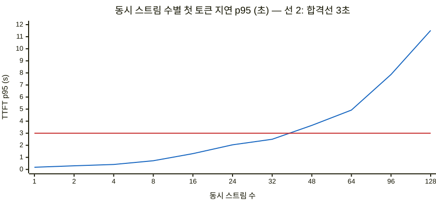
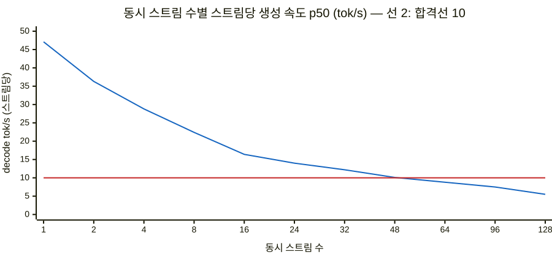
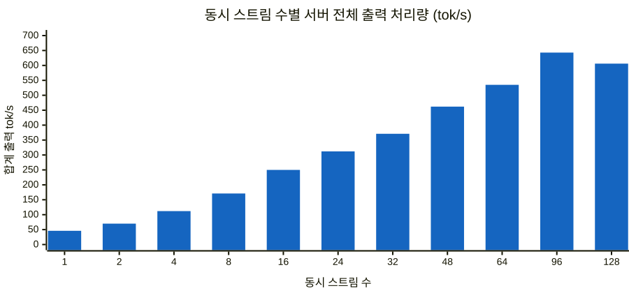
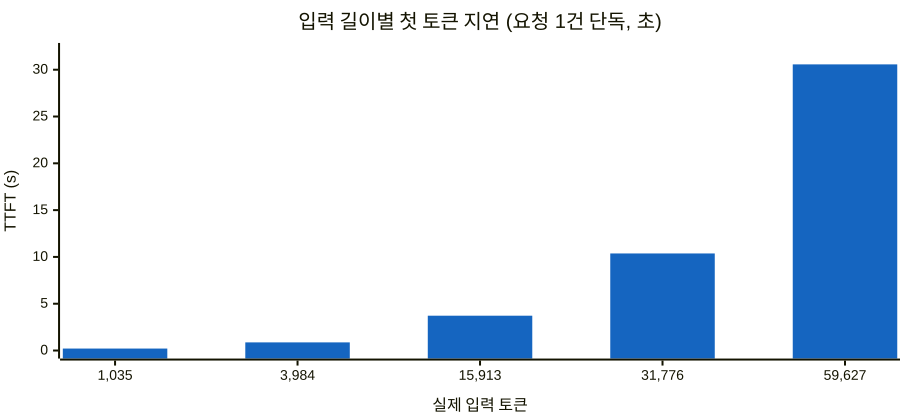

# DGX Spark 강의용 LLM 서비스 한계 측정 리포트

상태: **실측 완료** · 1차 측정 2026-11-12 10:47–11:00 UTC (util 0.35) · **재벤치 11:58–12:48 UTC (util 0.60 · 실제 경로)** · 작성 2026-11-12

DGX Spark를 강의 시스템으로 쓸 때 **한 대가 학생 몇 명까지 버티는지**를 알기 위해,
지금 운영 중인 vLLM 서비스에 부하를 걸어 측정했다.

- **1차 측정**(§1–§7)은 인증·라우터·Open WebUI를 거치지 않고 **LLM 모델 서비스(vLLM OpenAI 호환 API)만** 직접 쟀다.
- **재벤치**(§8)는 1차 권고 가운데 util 상향과 Isaac Sim 중지를 적용한 뒤 다시 쟀다. 이번에는 **llm-router를 거치는 실제 경로**도 함께 쟀다.

| 그림 | 파일 |
|---|---|
| 동시 스트림 수별 첫 토큰 지연(TTFT) p95 | [diagrams/spark-bench-ttft.mmd](diagrams/spark-bench-ttft.mmd) ([SVG](diagrams/spark-bench-ttft.svg)) |
| 동시 스트림 수별 스트림당 생성 속도 | [diagrams/spark-bench-decode.mmd](diagrams/spark-bench-decode.mmd) ([SVG](diagrams/spark-bench-decode.svg)) |
| 서버 전체 출력 처리량 | [diagrams/spark-bench-aggregate.mmd](diagrams/spark-bench-aggregate.mmd) ([SVG](diagrams/spark-bench-aggregate.svg)) |
| 입력 길이별 첫 토큰 지연 | [diagrams/spark-bench-longctx.mmd](diagrams/spark-bench-longctx.mmd) ([SVG](diagrams/spark-bench-longctx.svg)) |
| KV 캐시 한계와 공유 프롬프트 효과 | [diagrams/spark-bench-kv-limit.mmd](diagrams/spark-bench-kv-limit.mmd) ([SVG](diagrams/spark-bench-kv-limit.svg)) |
| 재벤치: 합계 처리량 1차 대비 | [diagrams/spark-rebench-aggregate.mmd](diagrams/spark-rebench-aggregate.mmd) ([SVG](diagrams/spark-rebench-aggregate.svg)) |
| 재벤치: 경로별 TTFT p95 (라우터·Anthropic 직통·OpenAI 직통) | [diagrams/spark-rebench-paths.mmd](diagrams/spark-rebench-paths.mmd) ([SVG](diagrams/spark-rebench-paths.svg)) |
| 재벤치: c=128 라우터 연결 풀 고갈 과정 | [diagrams/spark-rebench-router-pool.mmd](diagrams/spark-rebench-router-pool.mmd) ([SVG](diagrams/spark-rebench-router-pool.svg)) |

- 원자료(단계별 요약, 요청별 기록 제외)
  - 1차: [bench/spark-bench-20261112.json](bench/spark-bench-20261112.json)
  - 재벤치: [라우터 경로](bench/spark-rebench-20261112-router.json) · [Anthropic 직통](bench/spark-rebench-20261112-direct-anthropic.json) · [OpenAI 직통](bench/spark-rebench-20261112-direct-openai.json)
- 측정 도구: 레포의 `guardian/llm-router/bench/spark_bench.py` (사용법은 같은 폴더의 `README.md`)

> **수치 표기**
> - 표시 없는 수치는 이번 측정의 **실측값**이다.
> - *(추정)*은 실측값과 설정값으로 계산한 값이다. 실제로 검증하지 않았다.
> - *(가정)*은 강의 상황에 대한 가정이다. 강의 형태에 맞게 바꿔 읽어야 한다.

---

## 0. 결론 먼저

### 0.1 지금 설정 (util 0.60 · Isaac Sim 중지) — 재벤치

| 항목 | 값 | 근거 (§8) |
|---|---|---|
| 혼자 쓸 때 | 첫 토큰 0.14초, **초당 51토큰** | baseline (OpenAI 직통) |
| **쾌적한 동시 생성 상한** | **여전히 약 32 스트림** | c=32: TTFT p95 2.3–2.4초, 스트림당 13.5–13.8 tok/s. c=48은 TTFT p95 3.26–3.42초로 아슬아슬하게 탈락 |
| 동시 질문 버스트 | 32명 쾌적, **64명도 경계선에서 통과** | burst_64 p95 2.91–3.03초·10.9 tok/s (1차 3.19초·9.8) |
| 서버 최대 처리량 | c=128에서 초당 약 **740토큰**, 포화 없음 | KV 23.1%·선점 0 (1차 606·KV 100%·선점 20) |
| KV 캐시 | **423,056토큰** (1차의 4.6배) | 26,441블록 × 16. §5의 0.6 추정(약 41만)과 맞다 |
| 서로 다른 3.3K 문맥 32건 | TTFT p95 **17.4초**, 선점 0 | KV 24.5%. 병목이 KV에서 **prefill 처리량**으로 옮겨 갔다 |
| 긴 입력 60K | TTFT 27.4초, KV **14.1%** | 1차 30.6초·65.3% |
| **llm-router 경로** (Claude Code용) | c=96까지 직통과 같은 수치. c=128에서 실패했으나 **수정 후 c=128도 직통과 같다**(735 tok/s, 256/256) | 원인은 httpx 연결 풀(기본 100) 고갈과 열린 파일 한도 256. 둘 다 고쳤다 (§8.4, §8.4.1) |
| 오류 | 직통 두 경로 **0건**. 라우터는 c=128 한 단계에서만 156건 → 수정 후 **0건** | §8.4.1 |
| 발열 | 최고 78°C · 97.1W · SM 클럭 최저 2,275MHz | 약 56분 연속 측정, 쓰로틀링 징후 없음 |

**한 줄 요약**: util 0.60에서도 **동시에 답을 받는 학생 약 30명**이 쾌적한 상한이다. 생성 속도가 정하는 한계라 메모리로는 움직이지 않는다.
달라진 점은 두 가지다.

- **긴 대화에서 KV가 먼저 바닥나던 문제가 사라졌다.** 이제 문맥이 8K까지 길어져도 상한은 KV가 아니라 생성 속도가 정한다 *(추정, §5)*.
- **라우터가 새 병목이었다(고침).** 동시 100스트림을 넘기면 Spark는 멀쩡한데 라우터가 Spark를 "다운"으로 오판했다. 연결 풀과 열린 파일 한도를 고친 뒤 c=128까지 직통과 같은 수치가 나온다(§6 0번 ✅, §8.4.1).

### 0.2 1차 측정 (util 0.35 · Isaac Sim 동작 중)

| 항목 | 값 | 근거 |
|---|---|---|
| 혼자 쓸 때 | 첫 토큰 0.14초, **초당 47토큰** | baseline |
| **쾌적한 동시 생성 상한** | **약 32 스트림** | c=32: TTFT p95 2.5초, 스트림당 12.2 tok/s |
| 동시 질문 버스트 | 32명 동시 → 쾌적, 64명 동시 → 경계 | burst_32 p95 2.3초 / burst_64 p95 3.2초·9.8 tok/s |
| 서버 최대 처리량 | 초당 약 **640토큰**(c=96)에서 포화 | c=128에서 오히려 606으로 하락 |
| **병목 ① 짧은 질문** | **스트림당 생성 속도** (KV 여유 있음) | c=48에서 TTFT p95 3.65초·10.1 tok/s로 탈락할 때 KV는 40.6% |
| **병목 ② 긴 대화·자료** | **KV 캐시 91,472토큰** | 3.3K 문맥 32건(unique)에서 KV 99.9%·선점, TTFT p95 31.6초 |
| 긴 입력 | 16K 입력 3.7초, 32K 10.4초, 60K **30.6초** | longctx |
| 공유 프롬프트 효과 | 같은 3K 과제문 32명: TTFT p95 **0.68초** ↔ 서로 다른 3K: **31.6초** | shared / unique |
| 오류 | 전 단계 **0건** (총 1,030요청) | — |
| 발열 | 최고 77°C · 89.5W · SM 클럭 최저 2281MHz | 쓰로틀링 징후 없음 (약 13분 측정) |

**한 줄 요약 (1차)**: 1차 설정 그대로면 Spark 한 대로 **동시에 답을 받는 학생 약 30명**까지 쾌적하다.

한계는 질문 형태에 따라 두 가지다.

- **짧은 질문**: 상한 약 32는 **생성 속도의 한계**다. 동시 수가 늘면 한 사람에게 돌아가는 토큰 속도가 떨어진다. 이때 KV 캐시는 여유가 있다.
- **긴 대화·자료 붙여 넣기**: 문맥이 학생당 약 3K 토큰을 넘으면 **`--gpu-memory-utilization 0.35`로 잡힌 작은 KV 캐시(약 9.1만 토큰)**가 먼저 바닥난다. 상한은 4K 문맥에서 약 22, 8K에서 약 11로 내려간다 *(추정)*. 자세한 내용은 [§5](#5-kv-캐시가-긴-대화의-한계다)에 있다.

KV를 늘리면 ②의 상한을 ①의 상한(약 32)까지 끌어올릴 수 있다. ①을 넘어서지는 못한다.
→ 재벤치에서 그대로 확인됐다(§0.1, §8).

---

## 1. 측정 환경

1차 측정 기준이다. 재벤치에서 바뀐 조건은 [§8.1](#81-조건)에 있다.

| 항목 | 값 |
|---|---|
| 하드웨어 | NVIDIA DGX Spark (GB10, 통합 메모리 121 GiB, 20코어) |
| 서빙 | vLLM **0.15.1** (`nvcr.io/nvidia/vllm:26.02-py3`), V1 엔진 |
| 모델 | `Qwen/Qwen3-30B-A3B-Instruct-2507-FP8` → 이름 `qwen3-instruct` (MoE, 활성 3B) |
| 주요 설정 | `--gpu-memory-utilization 0.35`, `--max-model-len 65536`, prefix caching 켜짐 |
| 스케줄러 | chunked prefill, `max_num_batched_tokens=2048` (기본값) |
| KV 캐시 | 5,717블록 × 16토큰 = **91,472토큰** (64K 요청 기준 동시 1.40건) |
| 함께 도는 프로세스 | Isaac Sim `kit` (GPU 메모리 2.2 GiB, 측정 직전 GPU 전체 사용률 5% — 유휴로 보임) |
| Spark 네트워크 | Wi-Fi (wlP9s9) |
| 측정 클라이언트 | 같은 LAN의 macOS 개발 머신, Python 3.12 + httpx 0.28.1 |
| 경로 | 클라이언트 → `http://spark.local:8000` (vLLM 직접, 인증은 vLLM API 키만) |

측정 전후 상태:

| 시점 | 부하 | GPU | vLLM |
|---|---|---|---|
| 직전 (10:47Z) | load 1.36, 메모리 사용 61G / 가용 59G | 49°C, 14W, 사용률 5% | 요청 0 |
| 직후 (11:01Z) | load 1.60 | 56°C, 15.6W, 사용률 5% | 요청 0, 선점 누적 23 (모두 이번 측정) |

> **문서와 다른 점**
> - [LLM-ROUTER.md](../LLM-ROUTER.md)와 설계안(`archive/docs/SPARK-ROUTING-DESIGN.md`)은 Spark에 `vllm-coder`(Qwen3-Coder-30B-A3B)가 떠 있다고 가정한다.
>   실제로는 `vllm-instruct`(Qwen3-30B-A3B-Instruct-2507)가 떠 있었다.
> - 두 모델은 같은 30B-A3B 구조(48층, KV 헤드 4개)다. 같은 설정이면 이 수치를 거의 그대로 옮겨 쓸 수 있다 *(추정)*.

---

## 2. 측정 방법

### 2.1 요청 하나를 재는 법

모든 요청은 스트리밍 chat completion이다.
설정은 `temperature 0`, `ignore_eos true`, `stream_options.include_usage true`이다.

| 지표 | 정의 |
|---|---|
| TTFT | 요청 송신 → 내용이 있는 첫 청크 수신 |
| decode tok/s (스트림당) | `(completion_tokens − 1) / (마지막 청크 − 첫 청크)` — 토큰 수는 서버 usage 값, SSE 청크 수를 세지 않는다 |
| 합계 처리량 | 단계 안에서 성공한 요청의 출력 토큰 합 ÷ 단계 벽시계 시간 |
| e2e | 송신 → 마지막 청크 |

- **prefix cache 무력화**
  - 모든 프롬프트 **맨 앞에** 요청마다 다른 nonce를 넣었다. 서로 캐시를 재사용하지 못하게 하려는 것이다.
  - 예외는 shared 단계다. 이 단계는 일부러 앞부분을 같게 만들었다.
- **길이 보정**
  - 측정 시작 시 `/tokenize`로 단어당 토큰 수를 보정했다(1.0585).
  - longctx 목표 대비 실제 입력 토큰은 1,035 / 3,984 / 15,913 / 31,776 / 59,627이었다.
- **서버 상태 수집**
  - `/metrics`를 1초마다 읽었다: running, waiting, KV 사용률, 선점 수, 성공 수.
  - 같은 간격으로 `nvidia-smi`도 읽었다: 온도, 전력, SM 클럭, 사용률.

### 2.2 측정이 오염되지 않게 둔 장치

- **유휴 대기**: 각 단계 시작 전에 `num_requests_running == 0`이 될 때까지 기다렸다. 모든 단계가 0.03초 안에 유휴로 확인됐다.
- **외부 요청 검출**
  - 단계마다 서버의 성공 요청 증가분을 우리가 보낸 성공 수와 비교했다.
  - **전 단계에서 일치**했다. 즉 측정 중 다른 사용자의 요청은 없었다.
- **API 키 비노출**
  - 키는 환경변수로만 전달했다.
  - 결과 JSON과 로그에서 키 문자열은 0회 검출됐다.

### 2.3 단계 구성

| 단계 | 내용 |
|---|---|
| baseline | 순차 3건, 입력 약 200토큰, 출력 512 |
| sweep | 동시 c개 작업자가 각 2건씩 연속 송신. c = 1, 2, 4, 8, 16, 24, 32, 48, 64, 96, 128. 입력 약 500, 출력 256 |
| longctx | 입력 1K–60K 단독 1건씩, 출력 64 |
| burst | N건을 **같은 순간에** 송신(배리어). N = 16, 32, 64. 입력 약 300, 출력 512 |
| shared | 32건 동시 송신, 두 가지: ① 같은 3K 과제문 + 서로 다른 질문(nonce 끝) ② 앞부터 서로 다른 3K(nonce 앞) |

재현 명령(키는 환경변수로만):

```bash
VLLM_API_KEY=... python guardian/llm-router/bench/spark_bench.py \
  --base-url http://spark.local:8000 --model qwen3-instruct --out results.json \
  --concurrency 1,2,4,8,16,24,32,48,64,96,128 --rounds 2 --burst 16,32,64 --max-minutes 60 \
  --gpu-sample-cmd "ssh dgx-spark nvidia-smi --query-gpu=temperature.gpu,power.draw,clocks.sm,utilization.gpu --format=csv,noheader,nounits -lms 1000"
```

---

## 3. 결과

### 3.1 동시 스트림 수에 따른 변화 (sweep)

입력 약 500토큰, 출력 256토큰. 각 단계 요청 수는 c × 2건이다.

| 동시 | TTFT p50 | **TTFT p95** | **스트림당 tok/s p50** | 느린 꼬리 p10 | e2e p95 | **합계 tok/s** | 최대 대기 | KV 최대 | 선점 |
|---:|---:|---:|---:|---:|---:|---:|---:|---:|---:|
| 1 | 0.17 | 0.18 | 47.1 | 47.0 | 5.6 | 46 | 0 | 0.9% | 0 |
| 2 | 0.23 | 0.30 | 36.3 | 35.7 | 7.4 | 70 | 0 | 1.7% | 0 |
| 4 | 0.37 | 0.41 | 28.8 | 28.5 | 9.3 | 112 | 0 | 3.4% | 0 |
| 8 | 0.56 | 0.72 | 22.4 | 21.9 | 12.1 | 171 | 3 | 6.9% | 0 |
| 16 | 0.82 | 1.31 | 16.4 | 16.1 | 16.9 | 250 | 11 | 13.6% | 0 |
| 24 | 1.37 | 2.04 | 14.0 | 13.6 | 19.9 | 312 | 15 | 20.2% | 0 |
| **32** | 0.92 | **2.50** | **12.2** | 12.0 | 23.4 | 371 | 24 | 27.2% | 0 |
| 48 | 1.09 | 3.65 | 10.1 | 10.0 | 29.1 | 462 | 43 | 40.6% | 0 |
| 64 | 1.35 | 4.92 | 8.8 | 8.7 | 34.1 | 535 | 43 | 53.9% | 0 |
| 96 | 4.09 | 7.87 | 7.5 | 7.2 | 41.6 | **643** | 84 | 80.4% | 0 |
| 128 | 3.33 | 11.52 | 5.5 | 5.1 | 60.7 | 606 | 117 | **100%** | **20** |

(시간 단위는 초)





**읽는 법**

- **스트림당 속도는 동시 수가 늘수록 꾸준히 떨어진다.** 혼자일 때 47 tok/s, 32명일 때 12 tok/s다.
  - 합계 처리량은 c=96까지 계속 오른다.
  - 즉 GPU는 일을 더 받을 수 있다. 다만 한 사람이 받는 몫이 줄어든다.
- **c=96 → 128에서 합계가 오히려 줄어든다**(643 → 606).
  - KV 캐시가 100% 차서 선점이 20회 일어났다. 요청이 쫓겨났다가 다시 계산된 것이다.
  - 이 지점이 **포화점**이다.
- **c=8부터 waiting이 생긴다**(KV는 6.9%뿐).
  - 메모리가 원인은 아니다. `max_num_batched_tokens=2048` 때문으로 보인다 *(추정)*.
  - 500토큰 입력 8건(≈4,000토큰)이 한꺼번에 오면 한 스텝에 2,048토큰씩만 prefill한다. 나머지는 다음 스텝까지 대기열에 있다.
  - 동시 수가 늘면 한 스텝의 시간도 길어진다. 이 대기와 함께 TTFT를 키우는 요인이다. 두 요인의 비중은 따로 재지 않았다.
- **c=48에서 탈락한 이유는 KV가 아니다.**
  - TTFT p95 3.65초, 스트림당 10.1 tok/s로 기준을 넘었다. 그때 KV 사용은 40.6%였다.
  - 짧은 질문에서 상한을 정하는 것은 **스텝마다 모든 스트림을 함께 처리하는 생성 속도**다. 메모리를 늘려도 이 상한은 그대로다 *(추정)*.

### 3.2 동시 질문 버스트 (burst)

수업 중 "다 같이 지금 질문을 입력해 보세요" 상황이다. 입력 약 300토큰, 출력 512토큰이다.

| 동시 송신 | TTFT p50 | TTFT p95 | 모두 첫 글자 받을 때까지 | 스트림당 tok/s p50 | 모두 끝날 때까지 | 합계 tok/s | 최대 대기 | KV 최대 |
|---:|---:|---:|---:|---:|---:|---:|---:|---:|
| 16 | 0.79 | 0.93 | 0.93 | 16.2 | 32.4 | 253 | 2 | 14.6% |
| 32 | 1.81 | 2.31 | 2.32 | 12.7 | 42.1 | 389 | 10 | 28.2% |
| 64 | 1.81 | 3.19 | 3.32 | 9.8 | 54.4 | 602 | 39 | 57.9% |

- 32명이 동시에 보내도 **모두 2.3초 안에 답이 시작**된다.
- 64명이면 3.3초 안에 시작한다. 다만 글자가 초당 약 10토큰으로 나온다. 읽기에는 느리다고 느낄 수 있는 경계다.
- 512토큰 답을 끝까지 받는 데 32명은 42초, 64명은 54초가 걸렸다.

### 3.3 입력 길이 (longctx)

요청 1건만 단독으로 보냈다. 출력은 64토큰이다.

| 실제 입력 | TTFT | prefill tok/s | 생성 tok/s | KV 사용 |
|---:|---:|---:|---:|---:|
| 1,035 | 0.21 | 4,988 | 45.6 | 1.2% |
| 3,984 | 0.87 | 4,572 | 48.7 | 4.4% |
| 15,913 | 3.72 | 4,276 | 37.3 | 17.5% |
| 31,776 | 10.37 | 3,064 | 28.3 | 34.8% |
| 59,627 | **30.57** | 1,950 | 20.3 | **65.3%** |



- prefill 속도는 입력이 길수록 떨어진다(어텐션 비용). 4K까지 초당 약 4,500토큰, 60K에서 초당 약 2,000토큰이다.
- 생성 속도도 문맥이 길수록 느려진다. 1K에서 46 tok/s, 60K에서 20 tok/s다.
- **60K 입력 한 건이 KV 캐시의 65%를 차지한다.**
  - 이 요청이 도는 동안 다른 학생 요청이 쓸 공간은 약 3.2만 토큰뿐이다.
  - 그 30초 동안 다른 요청의 prefill도 늦어진다 *(추정: chunked prefill이 스텝을 나눠 쓰므로)*.

### 3.4 공유 프롬프트 효과 (shared vs unique)

32건 동시 송신, 각 입력 약 3,300토큰(과제문 3K + 질문), 출력 256토큰이다.

| 경우 | TTFT p50 | TTFT p95 | TTFT 최대 | 스트림당 tok/s | 합계 tok/s | 최대 대기 | KV 최대 | 선점 |
|---|---:|---:|---:|---:|---:|---:|---:|---:|
| **shared** — 같은 과제문 + 다른 질문 | 0.67 | **0.68** | 0.68 | 13.7 | 424 | 0 | 12.8% | 0 |
| **unique** — 앞부분부터 서로 다름 | 8.43 | **31.55** | 48.73 | 6.1 | 135 | 28 | **99.9%** | 3 |



- 같은 과제문을 앞에 두면 vLLM prefix cache가 3K 토큰을 **한 번만 계산하고 32명이 공유**한다. TTFT p95가 46배 빨라졌다(p50 기준 12.6배).
- 서로 다른 3.3K 입력 32건은 약 10.6만 토큰이다. KV 캐시(9.1만)를 넘어서 대기, 선점, 재계산이 일어났다. 가장 늦은 학생은 **48.7초 뒤에야 첫 글자**를 받았다.

### 3.5 발열·전력

| 구간 | 최고 온도 | 최대 전력 | 최저 SM 클럭 |
|---|---:|---:|---:|
| sweep c≥32 (지속 부하) | 72°C | 72W | 2,392MHz |
| longctx 60K (prefill 집중) | 77°C | 89.5W | 2,281MHz |
| 유휴 | 49–56°C | 14–16W | 2,405MHz |

약 13분 측정에서 클럭 저하는 최대 5%였다. 쓰로틀링 징후는 없었다.
**90분 수업 같은 장시간 부하는 측정하지 않았다**([§7](#7-측정의-한계)).

---

## 4. 강의 인원으로 환산하기

1차 측정 기준이다. 재벤치(util 0.60)에서는 burst 64가 기준을 통과했고(2.94초·10.9 tok/s), 나머지 판정은 같았다([§8.3](#83-1차-대비-같은-openai-직통-경로-d)).

합격 기준은 다음 두 가지로 정했다 *(가정)*.

- **TTFT p95 ≤ 3초**: 질문 후 3초 안에 답이 시작된다.
- **스트림당 생성 ≥ 10 tok/s**: 한국어 답을 읽는 속도보다 빠르게 나온다.

| 수업 형태 | 기준이 되는 측정 | 쾌적 | 경계 | 비고 |
|---|---|---|---|---|
| **일제 실습** ("지금 다 같이 질문") | burst | **≤ 32명** | 64명 | 64명이면 시작 3.3초·10 tok/s |
| **자유 질의** (각자 시간에 질문) | sweep | 동시 생성 ≤ 32 | 48 | 수강생 수 = 동시 생성 수 ÷ 활동 비율 |
| 긴 문서 붙여 넣기 | longctx·unique | 16K 이하 | 32K | 60K는 1건만으로 30초·KV 65% |

### 자유 질의에서 수강생 수 추정 *(가정)*

동시에 답을 받고 있는 학생 수는 다음과 같이 계산한다.

> 동시 생성 수 = 수강생 수 × (답을 받는 시간 ÷ 질문 한 번의 주기)

- 답 하나에 약 20초가 걸린다고 하자(c=32에서 256토큰 e2e ≈ 22초).
- 질문 한 번의 주기(답 받기 + 읽고 다음 질문 쓰기)가 약 2분이라고 하자.
- 그러면 활동 비율은 약 1/6이다. 동시 생성 32는 **수강생 약 190명**에 해당한다.

**그러나 이 계산은 짧은 질문(문맥 약 500토큰)만 가정했다.** 대화가 길어지면 다음 절의 KV 제약이 먼저 걸린다.

---

## 5. KV 캐시가 긴 대화의 한계다

sweep은 입력 500토큰짜리 짧은 질문으로 쟀다. 실제 채팅은 다르다.

- 대화 기록 전체를 매번 다시 보낸다. 대화가 이어질수록 입력이 길어진다.
- 동시에 생성 중인 요청은 **각자 문맥 전체를 KV 캐시에 들고 있어야** 한다.

실제 상한은 두 값 가운데 작은 쪽이다.

- **KV 상한**: KV 캐시 토큰 수 ÷ 학생당 문맥
- **속도 상한**: 약 32 (§3.1의 짧은 질문 측정)

| 학생 1명의 평균 문맥 | KV 상한 (1차 0.35, 9.1만) | 실제 상한 (0.35) | KV 상한 (**지금 0.60, 실측 42.3만**) | **실제 상한 (지금)** |
|---:|---:|---:|---:|---:|
| 750 (짧은 단발 질문) | 약 120 | 약 32 (속도) | 약 560 | **약 32** (속도) |
| 2,000 | 약 45 | 약 32 (속도) | 약 210 | **약 32** (속도) |
| 4,000 (몇 차례 이어진 대화) | 약 22 | 약 22 (KV) | 약 105 | **약 32** (속도) |
| 8,000 (긴 대화·자료 붙여 넣기) | 약 11 | 약 11 (KV) | 약 52 | **약 32** (속도) |

(KV 토큰 수 9.1만·42.3만은 실측이고, 나머지 상한은 *(추정)*이다. 긴 문맥은 생성 속도도 느리다(§3.3). 그래서 4K·8K의 속도 상한은 32보다 낮을 수 있다.)

- unique 측정이 KV 상한을 실측으로 보여 준다. 1차(0.35)에서는 3.3K 문맥 32건이 캐시를 넘자 TTFT p95가 **0.7초 → 31.6초**로 무너졌다.
- 1차 설정에서는 **문맥이 학생당 약 3K 토큰을 넘으면 속도보다 KV가 먼저 바닥났다.**
- 재벤치(0.60)에서는 같은 unique 측정이 **KV 24.5%·선점 0**으로 끝났다. KV 상한이 풀린 것을 실측으로 확인했다. 남은 지연(TTFT p95 17.4초)은 prefill 처리량 때문이다([§8.5](#85-긴-문맥-동시-투입은-이제-prefill이-정한다)).

### 왜 KV가 이렇게 작은가 *(추정)*

| 항목 | 값 |
|---|---|
| `--gpu-memory-utilization 0.35` × 통합 메모리 | ≈ 41.7 GiB 예약 (실측 EngineCore 41,056 MiB) |
| FP8 가중치 + 활성값·CUDA graph | ≈ 33 GiB |
| 남는 KV 캐시 | ≈ 8.4 GiB = 91,472토큰 × 96 KiB/토큰 |

KV는 토큰당 96 KiB다(48층 × KV 헤드 4 × 128차원 × K·V × BF16).
**예약 메모리의 80%가 가중치에 들어가고, 학생 대화를 담을 공간은 8 GiB뿐**이다.
Spark에는 통합 메모리가 59 GiB 이상 남아 있다(가용 59G).

0.60에서는 예약이 약 72.6 GiB로 늘고, 가중치·활성값 몫(약 33 GiB, 재시작 로그상 가중치 29.1 GiB)은 그대로다 *(추정)*.
늘어난 몫이 모두 KV로 가서 KV는 **423,056토큰 × 96 KiB ≈ 38.7 GiB**가 됐다(토큰 수는 실측). 위 계산과 맞는다.

---

## 6. 강의 전에 할 일 (권고)

- **1번·5번은 적용했고 재벤치로 검증했다**(§8).
- **0번은 재벤치에서 새로 찾은 문제**다. 고쳤고 재검증했다(§8.4.1).
- 나머지는 아직 검증하지 않은 권고다. 바꾼 뒤 같은 벤치를 다시 돌려 확인해야 한다.

| 순위 | 조치 | 기대 효과 *(추정)* | 대가 |
|---|---|---|---|
| **0 ✅** | **llm-router의 httpx 연결 풀을 고친다** → **적용·검증**(d32ddce + 열린 파일 한도 e5eb32f, c=128 256/256 성공, [§8.4.1](#841-수정-후-재검증-2026-11-12)). ① `httpx.Limits`로 연결 상한을 명시한다(예상 최대 동시 스트림 이상). ② 헬스 프로브는 별도 클라이언트로 분리한다. ③ `PoolTimeout`은 백엔드 다운이 아니라 **라우터 과부하**로 처리한다(503 반환, 헬스 상태는 그대로) | 동시 100스트림을 넘겨도 Spark를 "다운"으로 오판하지 않는다. 502와 Mac 폴백 쏠림(최대 904초 지연)이 사라진다([§8.4](#84-c128-라우터-실패-분석)) | `router.py` 수정과 테스트가 필요하다. 동시 100 이하에서는 지금도 문제없다 |
| 1 ✅ | `--gpu-memory-utilization`을 0.35 → **0.55~0.6**으로 올린다 → **0.60 적용·검증** | 실측: KV 9.1만 → **423,056토큰**. unique 32건 선점 3 → 0, c=128 포화 해소(합계 606 → 742). 짧은 질문의 상한 약 32는 예측대로 그대로였다 | Spark에서 다른 작업(Isaac Sim 등)에 쓸 메모리가 준다. 다중 모델 계획(SPARK-MULTI-MODEL-DESIGN.md)과 예산을 맞춰야 한다 |
| 2 | **수업 공통 시스템 프롬프트·과제문을 대화 맨 앞에** 둔다 (Open WebUI 모델 프리셋) | shared 측정처럼 앞부분을 한 번만 계산한다. KV도 공유한다 | 학생별로 다른 내용을 앞에 넣으면 효과가 사라진다 |
| 3 | `--max-model-len`을 65536 → **16K~32K**로 낮추거나, 업로드 문서 크기를 제한한다 | 한 학생이 KV의 65%를 차지하는 일을 막는다 | 긴 문서 요약 실습에는 별도 시간대가 필요하다 |
| 4 | `--max-num-batched-tokens` 2048 → **4096~8192** | 버스트 때 prefill이 빨라져 TTFT가 줄어든다(waiting의 주원인). 재벤치에서도 KV 4.4%인 c=24에서 waiting 15가 생겨, 여전히 KV가 아니라 이 값이 waiting을 만든다 | 큰 prefill 스텝 동안 다른 학생의 글자 출력이 잠깐 끊긴다 |
| 5 ✅ | 수업 중 **Isaac Sim 등 다른 GPU 작업을 멈춘다** → **중지 적용·검증** | 측정 변동과 메모리 경쟁을 없앤다. 재벤치에서 중간 동시 수의 생성 속도가 약 10% 올랐다(c=32: 12.2 → 13.5 tok/s). 다만 util·클라이언트도 함께 바뀌어 원인을 분리하지 못했다 *(추정)* | — |
| 6 | Spark를 **유선**으로 연결한다 | Wi-Fi 지연과 끊김의 위험을 없앤다 | — |
| 7 | 출력 길이를 제한한다 (기본 `max_tokens` 1024 안팎) | 긴 답 하나가 슬롯을 오래 잡지 않게 한다 | — |

### 수업 중 감시할 지표

`http://<spark>:8000/metrics`에서 다음 지표를 본다.

| 지표 | 경고 기준 *(가정)* | 의미 |
|---|---|---|
| `vllm:num_requests_waiting` | 10초 넘게 계속 > 0 | 대기열이 생겼다. TTFT가 늘어난다 |
| `vllm:kv_cache_usage_perc` | > 0.9 | 곧 선점이 시작된다 |
| `vllm:num_preemptions_total` | 증가 | 이미 쫓겨나 재계산 중이다. 체감 속도가 급락한다 |

---

## 7. 측정의 한계

- **조건마다 한 번씩 측정했다.** 각 동시 단계는 2라운드다.
  - 같은 조건을 반복해 분산을 보지는 않았다.
  - 재벤치의 두 직통 경로(Anthropic·OpenAI)는 같은 설정에서 연달아 쟀다. 사실상 반복 측정 역할을 했고, c=96까지 합계 처리량이 약 3% 안에서 일치했다.
- **합성 프롬프트로 쟀다.**
  - 영어 단어 나열 + 한국어 지시문을 썼다.
  - 출력은 `ignore_eos`로 길이를 고정했다.
  - 실제 학생 질문(한국어, 짧은 질문, 다양한 답 길이)과 분포가 다르다.
- **1차는 vLLM만 쟀다. 재벤치에서 llm-router 경로를 더했다.**
  - c=96까지 라우터가 더하는 지연은 잡음 수준이었다(§8.2). c=128에서는 라우터 자체가 실패했다(§8.4).
  - Open WebUI와 인증 프록시의 지연·동시성 제한은 여전히 빠져 있다.
- **측정 클라이언트가 1대다.** 수십 대 브라우저의 연결 특성(TLS, 프록시 등)과 다르다. 1차와 재벤치는 서로 다른 Mac에서 쟀다.
- **Spark가 Wi-Fi에 있었다.** 네트워크 지연이 TTFT에 일부 포함됐다(baseline 0.14초).
- **1차에는 Isaac Sim이 함께 돌고 있었다.** 측정 직전 GPU 전체 사용률은 5%로 유휴로 보였지만, 측정 중 이 프로세스의 사용률을 따로 재지 않았다. 재벤치는 Isaac Sim을 멈추고 쟀다.
- **90분 연속 부하는 아직 재지 않았다.** 재벤치까지 약 56분 연속 부하에서 쓰로틀링은 없었다(최고 78°C). 90분 수업 전체의 발열·클럭은 모른다.
- **thinking 모델을 쓰지 않았다.**
  - Instruct-2507은 추론 토큰을 내지 않는다.
  - thinking 계열 모델로 바꾸면 답 하나의 출력 토큰이 몇 배로 늘어난다. 그만큼 동시 수가 준다.
- **§4·§5의 수강생 수와 §6의 미검증 권고(2·3·4·6·7번) 효과는 계산값이다.** 1·5번은 재벤치로 실측했다(§8). 나머지는 설정을 바꾼 뒤 다시 측정해야 확정된다.

---

## 8. 재벤치 (util 0.60 · Isaac Sim 중지 · 실제 경로)

1차 권고 1번(util 상향)과 5번(Isaac Sim 중지)을 적용했다. 그 뒤 같은 벤치를 **세 경로**로 다시 돌렸다.

### 8.1 조건

| 항목 | 1차 | 재벤치 |
|---|---|---|
| 측정 시각 (UTC) | 10:47–11:00 | 11:58–12:48 (KST 20:58–21:48) |
| 서빙 모델 | Qwen3-30B-A3B-Instruct-2507-FP8 (`qwen3-instruct`) | 같음 (instruct를 기본으로 고정) |
| `--gpu-memory-utilization` | 0.35 | **0.60** |
| KV 캐시 | 91,472토큰 | **423,056토큰** (26,441블록 × 16) |
| Isaac Sim | 동작 중 | **중지** |
| 그 밖의 vLLM 설정 | max-model-len 65536 · prefix caching · max_num_batched_tokens 2048 | 같음 |
| 측정 클라이언트 | 다른 Mac (Python 3.12.13) | prod-mac (Python 3.12.11) |
| 토큰 보정 (tokens_per_word) | 1.0585 | 1.0585 (같음) |

| 경로 | API | 거치는 것 | 시작 (UTC) |
|---|---|---|---|
| **R** (라우터) | Anthropic `/v1/messages`, 모델 `spark-large` | prod-mac의 llm-router → Spark vLLM | 11:58:21 |
| **DA** (Anthropic 직통) | Anthropic `/v1/messages` | Spark vLLM | 12:24:37 |
| **D** (OpenAI 직통) | OpenAI `/v1/chat/completions` | Spark vLLM (1차와 같은 경로) | 12:36:41 |

- R은 prod-mac에 배포된 `router.py`를 그대로 시험 포트 :1242로 띄워 쟀다. 운영 인스턴스(:1240)는 건드리지 않았다.
- R은 `--require-route spark`로 쟀다. 응답 헤더 `x-route`가 `spark`가 아니면(예: Mac 폴백) 성공으로 세지 않고 `route_mismatch`로 기록한다.

### 8.2 경로 비교

그림: [spark-rebench-paths](diagrams/spark-rebench-paths.mmd) ([SVG](diagrams/spark-rebench-paths.svg))

| 동시 | TTFT p95 (초) R / DA / D | 스트림당 decode p50 (tok/s) R / DA / D | 합계 처리량 (tok/s) R / DA / D |
|---:|---|---|---|
| 1 | 0.154 / 0.159 / 0.168 | 51.7 / 51.0 / 50.7 | 50 / 49 / 49 |
| 2 | 0.98\* / 0.28 / 0.29 | 40.9 / 40.2 / 41.0 | 75 / 78 / 79 |
| 4 | 0.37 / 0.36 / 0.37 | 32.0 / 30.7 / 31.1 | 124 / 119 / 120 |
| 8 | 0.65 / 0.67 / 0.66 | 23.9 / 23.5 / 23.5 | 183 / 179 / 180 |
| 16 | 1.18 / 1.22 / 1.17 | 18.1 / 18.1 / 18.1 | 274 / 271 / 274 |
| 24 | 1.76 / 1.76 / 1.74 | 15.3 / 15.5 / 15.3 | 337 / 348 / 348 |
| **32** | **2.34 / 2.26 / 2.40** | **13.7 / 13.8 / 13.5** | 410 / 412 / 402 |
| 48 | 3.39 / 3.42 / 3.26 | 11.4 / 11.4 / 11.3 | 514 / 511 / 513 |
| 64 | 4.38 / 4.47 / 4.37 | 10.1 / 9.9 / 9.9 | 603 / 595 / 598 |
| 96 | 7.14 / 7.30 / 7.17 | 7.8 / 8.0 / 7.7 | 691 / 697 / 692 |
| 128 | **실패** (8.23†) → 수정 후 11.16‡ / 10.66 / 10.52 | 7.7† → 6.3‡ / 6.2 / 6.3 | 27† → 735‡ / 729 / 742 |

\* 표본 4건 중 1건이 튄 값이다. 앞뒤 단계와 다른 두 경로에는 없다.
† 실패한 단계에서 Spark까지 가서 끝난 요청만 집계했다(§8.4).
‡ 라우터 수정(e5eb32f) 후 같은 조건으로 다시 잰 값이다. 256건 모두 성공했다(§8.4.1).

- **c=96까지 세 경로는 사실상 같다.** 라우터가 더하는 지연은 잡음 범위 안이다. Anthropic 형식 변환도 비용이 거의 없다. 라우터를 고친 뒤에는 **c=128에서도 같다**.
- 직통 두 경로(DA·D)는 같은 설정에서 연달아 쟀으므로 반복 측정 역할을 한다. 합계 처리량은 c=96까지 3% 안에서 일치했다.
- 쾌적 기준(TTFT p95 ≤ 3초, 스트림당 ≥ 10 tok/s)은 세 경로 모두 **c=32에서 통과, c=48에서 TTFT로 탈락**한다. 1차와 같은 결론이다.

### 8.3 1차 대비 (같은 OpenAI 직통 경로 D)

그림: [spark-rebench-aggregate](diagrams/spark-rebench-aggregate.mmd) ([SVG](diagrams/spark-rebench-aggregate.svg))

| 지표 | 1차 (0.35) | 재벤치 D (0.60) | 변화 |
|---|---:|---:|---|
| baseline TTFT / decode | 0.14초 / 47 tok/s | 0.137초 / 51.0 tok/s | decode +8% |
| c=32 TTFT p95 / decode | 2.50초 / 12.2 | 2.40초 / 13.5 | 소폭 개선 |
| c=48 TTFT p95 / decode | 3.65초 / 10.1 | 3.26초 / 11.3 | 개선, 그래도 3초 초과 |
| c=64 TTFT p95 / decode | 4.92초 / 8.8 | 4.37초 / 9.9 | 개선 |
| c=96 TTFT p95 / 합계 | 7.87초 / 643 | 7.17초 / 692 | 개선 |
| **c=128 합계 / KV / 선점** | 606 / **100%** / **20** | **742 / 23.1% / 0** | **포화 해소** |
| burst_32 p95 / decode | 2.31초 / 12.7 | 1.54초 / 14.1 | 개선 |
| burst_64 p95 / decode | 3.19초 / 9.8 | 2.94초 / 10.9 | **기준 통과로 바뀜** |
| shared 32건 TTFT p95 | 0.68초 | 0.64초 | 같음 (KV 2.8%) |
| **unique 32건 TTFT p95 / max** | **31.6초 / 48.7초** | **17.4초 / 18.8초** | 절반 수준 |
| unique 32건 KV / 선점 | 99.9% / 3 | 24.5% / 0 | KV 한계 해소 |
| 60K 입력 TTFT / KV | 30.6초 / 65.3% | 27.4초 / 14.1% | 개선 |

D의 KV 사용률 최대값은 c=8 1.5%, c=32 5.8%, c=64 11.6%, c=128 23.1%였다. 같은 단계의 1차 값과 비율이 약 4.6–4.7배로, KV 크기 비율(423,056 ÷ 91,472 ≈ 4.6)과 맞는다.

해석:

- **KV를 늘린 효과는 "부하가 KV를 넘던 곳"에서만 났다.** c=128, unique, 60K가 그렇다. 짧은 질문 c≤32 구간은 1차에도 KV가 남았으므로 거의 그대로다.
- 중간 동시 수(c=32–64)에서 decode가 약 10% 오른 것은 Isaac Sim 중지 효과로 보인다 *(추정)*. util·클라이언트·시각도 함께 바뀌어 원인을 분리하지는 못했다.
- 그래서 **쾌적 상한 약 32는 그대로**다. §0에서 말한 "① 생성 속도 상한"이 이제 유일한 한계로 남았다.

### 8.4 c=128 라우터 실패 분석

그림: [spark-rebench-router-pool](diagrams/spark-rebench-router-pool.mmd) ([SVG](diagrams/spark-rebench-router-pool.svg))

R 경로의 c=128 단계는 오류율 61%로 중단됐다(wall 942.7초). Spark는 이때 KV 18%로 여유가 있었다. **실패는 라우터 안에서 일어났다.**

| 결과 | 건수 | 내용 |
|---|---:|---|
| Spark까지 가서 성공 (`x-route: spark`) | 100 | vLLM running 최대값이 **정확히 100**이었다 |
| Mac으로 폴백 (`x-route: local (spark-down)`) | 100 | `route_mismatch`로 기록. Mac gemma-4-e4b가 받아 최대 **904초** 걸렸다 |
| 502 "spark request failed" | 56 | e2e ≈ 10.03초. 연결 풀 대기 시간 초과 |

동작 순서 (`guardian/llm-router/router.py`):

1. 라우터는 공유 `httpx.AsyncClient` 하나로 Spark에 요청한다. `Limits`를 지정하지 않아 **기본 연결 상한 100**이 걸린다.
2. 스트리밍 요청 100개가 연결 100개를 응답이 끝날 때까지 붙잡는다. 101번째부터는 풀에서 빈 연결을 기다린다(기본 대기 한도 10초).
3. **헬스 프로브도 같은 클라이언트**를 쓴다. 프로브가 풀을 못 얻어 `PoolTimeout`을 받는다.
4. 라우터가 이것을 "Spark 다운"으로 판정했다(21:05:01 KST). 같은 이유로 local 프로브도 실패해 local도 down으로 표시됐다.
5. 그 뒤 들어온 `spark-large` 요청은 `resolve()`가 `local (spark-down)`으로 보냈다. 100건이 Mac 한 대로 몰렸다.
6. 풀을 기다리던 56건은 10초 뒤 `PoolTimeout`이 났다. 폴백 대상 예외가 `ConnectError`·`ConnectTimeout`뿐이라 폴백도 못 하고 502가 됐다.

영향:

- **동시 스트림 100 이하에서는 생기지 않는다.**
- 지금 라우터를 거치는 것은 Claude Code(`claude-lms`)뿐이다. Open WebUI는 라우터를 거치지 않으므로([LLM-ROUTER.md](../LLM-ROUTER.md)) 강의 채팅은 이 문제와 무관하다.
- Claude Code 사용자의 동시 스트림이 100을 넘거나, 나중에 Open WebUI를 라우터 경유로 바꾸면 닿는다. 그때는 Spark가 멀쩡해도 **라우터를 쓰는 모든 사용자가 Mac으로 밀려난다.**
- `--require-route spark`가 없었다면 이 100건은 "느린 성공"으로 집계됐을 것이다. 오류 없이 답의 품질만 조용히 떨어지는 실패라서 더 위험하다.

수정안은 §6 0번에 있다. 요점은 세 가지다. 연결 상한을 명시하고, 헬스 프로브를 별도 클라이언트로 떼고, `PoolTimeout`을 백엔드 다운과 구분한다.

#### 8.4.1 수정 후 재검증 (2026-11-12)

같은 조건(prod-mac 사이드 포트 :1242, `--require-route spark`, sweep 500/256토큰, 2라운드)으로 c=64/96/128을 다시 쟀다. 수정은 두 번에 나눠 들어갔다.

| 라우터 | 셸 열린 파일 한도 | c=128 결과 | Spark 헬스 (5초 간격) |
|---|---|---|---|
| 수정 전 (§8.4) | 256 | 오류 61%로 중단. 100건 Mac 폴백, 502 56건 | 21:05에 down으로 오판 |
| 연결 풀 수정만 (d32ddce) | 256 | 256건 중 **21건 실패**: 502 14건, `local (retry)` 2건, 클라이언트 `ReadError` 5건 | 43회 모두 up. `PoolTimeout` 0건 |
| 연결 풀 수정만 (d32ddce) | **4096** (대조 실험) | **256/256 성공**, 전부 `spark` | 18회 모두 up |
| 두 수정 모두 (e5eb32f) | 256 | **256/256 성공**, 전부 `spark` | 43회 모두 up |

1. **연결 풀 수정은 의도대로 동작했다.** 헬스 프로브가 별도 풀을 쓰므로 부하 중에도 Spark를 다운으로 오판하지 않았다.
2. **그 뒤에 두 번째 한계가 드러났다. 열린 파일 수 한도다.** c=128 단계가 시작된 순간(같은 밀리초)에 Spark 연결 16건이 `ConnectError`로 실패했다. 그중 14건은 로컬로 재시도했지만, 같은 Mac의 127.0.0.1 LM Studio 연결도 `ConnectError`로 실패해 502가 됐다.
   - 원격과 로컬이 동시에 연결을 거부했으므로 네트워크 문제가 아니다. 라우터 프로세스가 `socket()`을 더 만들지 못한 것이다.
   - 스트림 하나는 소켓 두 개(클라이언트 쪽과 업스트림 쪽)를 쓴다. macOS 기본 soft `RLIMIT_NOFILE` 256은 동시 약 128스트림에서 바닥난다.
   - 수정 전에는 연결 상한 100이 이 한계를 가리고 있었다.
3. **대조 실험으로 원인을 확인했다.** 코드는 그대로 두고 `ulimit -n 4096`만 바꾸자 같은 c=128이 오류 없이 끝났다.
4. **두 번째 수정(e5eb32f)**: 라우터가 시작할 때 soft 한도를 `max(4096, 2×UPSTREAM_MAX_CONNECTIONS+256)`까지 스스로 올린다(hard 한도 안에서). LaunchAgent도 기본 soft 한도가 256이라 셸에서만 올려서는 소용이 없다. 그래서 코드에 넣었다.

수정 후 수치 (e5eb32f, 셸 한도 256):

| 동시 | 성공 | TTFT p95 (초) | 스트림당 decode p50 (tok/s) | 합계 처리량 (tok/s) | vLLM waiting 최대 | KV 최대 |
|---:|---:|---:|---:|---:|---:|---:|
| 64 | 128/128 | 4.51 | 9.98 | 595 | 51 | 11.6% |
| 96 | 192/192 | 7.54 | 7.76 | 682 | 57 | 17.4% |
| 128 | 256/256 | 11.16 | 6.33 | 735 | 90 | 23.1% |

c=128의 처리량은 직통 경로(DA 729, D 742 tok/s)와 같은 수준이다. 라우터는 더 이상 병목이 아니다. TTFT p95 11초는 Spark의 prefill 대기 때문이고(waiting 90), 쾌적 기준과는 별개다(§8.2).

**production 배포** (2026-11-12 22:51 KST): prod-mac `~/.guardian-llm/llm-router/router.py`를 e5eb32f로 교체했다(이전 파일은 `router.py.bak-20261112T1351Z`로 보관). LaunchAgent를 재시작한 뒤 로그에 `raised open-file limit 256 -> 4096`이 찍혔다.
- 배포 직후 LaunchAgent는 macOS **로컬 네트워크 권한**이 없어 Spark에 닿지 못했다(`spark down: ConnectError`, launchd에서 띄운 python은 `Errno 65`). 그동안 `spark-large`는 `local (spark-down)`으로 폴백했다. 이번 수정과는 무관한 기존 상태였다.
- 2026-11-12 23:12 KST, prod-mac 화면에서 `python3.12`의 로컬 네트워크 권한을 허용한 뒤 풀렸다. `/health`는 `spark.up: true, last_error: null`, `/v1/messages`(qwen3-instruct)는 200에 `X-Route: spark`. 라우터 재시작은 필요 없었다. 설치 절차는 [LLM-ROUTER.md](../LLM-ROUTER.md) §2의 6단계.

### 8.5 긴 문맥 동시 투입은 이제 prefill이 정한다

unique(서로 다른 3.3K 문맥 32건 동시)는 재벤치에서 KV 24.5%·선점 0이었다. 그런데도 TTFT p95가 17.4초다.

- 32건의 입력은 합쳐서 약 106K 토큰이다. 이 부하에서 prefill 처리량은 약 5.7K tok/s다.
- 106K ÷ 5.7K ≈ **18.6초**로, 관측한 TTFT 최대값(18.5–18.8초)과 맞는다.
- 즉 **마지막 학생은 앞선 31명의 prefill이 끝나기를 기다린다.** KV가 아니라 prefill 처리량이 지연을 정한다.
- 1차는 여기에 KV 부족으로 인한 선점·재계산이 겹쳐 31.6초까지 늘었다.

실제 수업에서는 이 정도로 나쁘지 않을 것이다 *(추정)*.

- 같은 대화의 다음 턴은 prefix cache가 이전 턴을 재사용하므로 새 입력만 prefill한다.
- 32명이 같은 순간에 서로 다른 긴 자료를 붙여 넣는 경우만 이 수치에 가깝다.
- §6 4번(`max-num-batched-tokens` 상향)이 이 경우의 TTFT를 줄일 후보다(미검증).

### 8.6 입력 길이 (longctx, D)

| 입력 토큰 | TTFT (초) | prefill (tok/s) | decode (tok/s) | KV | 1차 TTFT |
|---:|---:|---:|---:|---:|---:|
| 1,035 | 0.197 | 5,263 | 49.8 | 0.3% | 0.21 |
| 3,984 | 0.705 | 5,655 | 50.0 | 1.0% | 0.87 |
| 15,913 | 3.281 | 4,851 | 37.5 | 3.8% | 3.72 |
| 31,776 | 9.368 | 3,392 | 29.8 | 7.5% | 10.37 |
| 59,627 | 27.36 | 2,179 | 21.8 | 14.1% | 30.57 |

- 60K 입력은 1차에 KV의 65.3%를 차지했다. 재벤치에서는 14.1%다. 긴 입력 한 건이 다른 학생의 캐시를 밀어내던 위험이 크게 줄었다.
- R 경로의 60K는 26.86초, DA는 27.55초로 D와 차이가 없다.

### 8.7 발열·전력

Spark 시계로 20:58–21:54 KST(약 56분) 동안 1초 간격으로 기록했다.

| 지표 | 1차 (13분) | 재벤치 (약 56분) |
|---|---:|---:|
| 최고 GPU 온도 | 77°C | 78°C |
| 최대 전력 | 89.5W | 97.1W |
| 부하 중 전력 중앙값 | — | 43W |
| 부하 중 최저 SM 클럭 | 2,281MHz | 2,275MHz (중앙값 2,411) |

약 4배 긴 연속 부하에서도 온도는 1°C 올랐고 클럭 저하가 없었다. 쓰로틀링 징후는 없다. 90분은 아직 재지 않았다(§7).

### 8.8 주의: Anthropic 경로와 `ignore_eos`

- vLLM의 `/v1/messages`는 `ignore_eos` 파라미터를 받지 않고 버린다.
- 그래도 스모크 테스트에서 R·DA 모두 요청한 512토큰을 다 생성했다(512/512). 합성 프롬프트가 일찍 끝나지 않게 짜여 있기 때문이다.
- decode 속도는 응답의 `usage` 토큰 수로 계산하므로, 만약 일찍 끝난 요청이 있어도 속도 값은 왜곡되지 않는다.

### 8.9 재현

측정 도구와 사용법은 레포의 `guardian/llm-router/bench/`(`README.md`)에 있다. 키는 환경변수로만 넘긴다.

```bash
# R: 라우터 경로 (라우터가 Spark 키를 붙이므로 요청 인증 없음)
VLLM_API_KEY=... python spark_bench.py --api anthropic --base-url http://127.0.0.1:1242 --model spark-large \
    --metrics-url http://SPARK:8000 --tokenize-model qwen3-instruct --no-request-auth --require-route spark \
    --concurrency 1,2,4,8,16,24,32,48,64,96,128 --rounds 2 --burst 16,32,64 --max-minutes 60 --out rebench-router.json

# DA: Spark 직통 Anthropic
VLLM_API_KEY=... python spark_bench.py --api anthropic --base-url http://SPARK:8000 --model qwen3-instruct \
    --concurrency 1,2,4,8,16,24,32,48,64,96,128 --rounds 2 --burst 16,32,64 --max-minutes 60 --out rebench-direct-anthropic.json

# D: Spark 직통 OpenAI (1차와 같은 경로)
VLLM_API_KEY=... python spark_bench.py --api openai --base-url http://SPARK:8000 --model qwen3-instruct \
    --concurrency 1,2,4,8,16,24,32,48,64,96,128 --rounds 2 --burst 16,32,64 --max-minutes 60 --out rebench-direct-openai.json

# 수정 후 재검증 (§8.4.1): 라우터를 사이드 포트 :1242에 띄우고 같은 ssh 세션에서 실행한다
# (LaunchAgent가 아닌 ssh 프로세스라야 로컬 네트워크 권한 없이 Spark에 닿는다)
VLLM_API_KEY=... python spark_bench.py --api anthropic --base-url http://127.0.0.1:1242 --model spark-large \
    --metrics-url http://SPARK:8000 --tokenize-model qwen3-instruct --no-request-auth --require-route spark \
    --phases sweep --concurrency 64,96,128 --rounds 2 --sweep-prompt-tokens 500 --sweep-max-tokens 256 \
    --max-model-len 65536 --max-minutes 30 --out poolfix-v2.json
```
