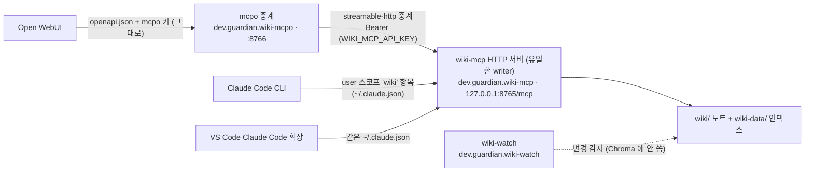

# wiki-mcp 키트 (공용 HTTP 서버 하나로 묶기 · macOS)

지금은 Open WebUI 가 mcpo(:8766)를 거쳐 wiki-mcp 를 stdio 로 직접 띄우고, Claude Code
사용자는 `run-wiki-mcp.sh serve` 로 wiki-mcp 를 **하나 더** 띄워 등록합니다. Chroma 는
프로세스마다 HNSW 인덱스를 메모리에 두므로, 벡터 저장소에 쓰거나 검색하는 프로세스는
하나여야 합니다. 이 키트는 wiki-mcp HTTP 서버 하나(127.0.0.1:8765/mcp, Bearer 키)를
LaunchAgent 로 상시 띄워 **유일한 writer** 로 만들고, 나머지는 모두 그 서버를 바라보게
합니다:

- mcpo 는 라벨·포트·키를 그대로 두고 `--server-type streamable-http` 로 중계만 합니다
  → Open WebUI 의 도구 연결(DB 안의 `http://127.0.0.1:8766` + openapi.json + mcpo 키)은
  전혀 바뀌지 않습니다
- Claude Code 에는 user 스코프 HTTP 항목 `wiki` 가 등록됩니다. VS Code 의 Claude Code
  확장도 같은 `~/.claude.json` 을 읽으므로 별도 설정이 필요 없습니다
- `dev.guardian.wiki-watch` 는 건드리지 않습니다 (Chroma 에 쓰지 않으므로)

## 구성도



## 꾸러미 구성

| 파일 | 내용 |
|---|---|
| `install-wiki-mcp.sh` | 설치 스크립트 (꾸러미 안에서 자체 SHA256SUMS 검증) |
| `run-wiki-mcp.sh` | 통합 실행기 — `http` 서브커맨드가 추가된 버전 (`~/llm-wiki` 로 설치) |
| `load-env.sh` | `.env` 로더 (`run-wiki-mcp.sh` 와 함께 설치) |
| `wheels/wiki_mcp-<버전>-py3-none-any.whl` | wiki-mcp (HTTP transport 포함, venv 에 이미 같거나 더 새 버전이 있으면 유지) |
| `MANIFEST.env` | 키트 버전·휠·라벨·빌드 시각 |
| `README.md` | 이 문서 |
| `SHA256SUMS` | 위 파일들의 sha256 (설치 전 무결성 확인에 쓰임) |

## 선행 조건

- wiki layer(`wiki-layer/install-wiki.sh`, 통합 번들에서는 `guardian/install-wiki.sh`)가
  이미 설치된 Mac — venv(`.env` 의 `WIKI_VENV`), `dev.guardian.wiki-mcpo`,
  `dev.guardian.wiki-watch`, `~/llm-wiki/.env` 를 그 layer 가 만들어 뒀어야 합니다
- Claude Code CLI 는 있으면 자동 등록하고, 없으면 수동 명령만 출력합니다

## 통합 번들에서는

통합 번들(llm-wiki-bundle-*)에는 이 키트가 `wiki-mcp-kit/` 로 들어 있고,
`install-all.sh` 의 마지막(5/5) 단계가 **자동으로 실행**합니다 — Claude Code 단계
다음에 돌므로 CLI 가 있는 상태에서 user 스코프 등록까지 함께 끝납니다. 따로 이
문서의 설치 절차를 밟을 필요가 없고, 끄고 싶으면 `install-all.sh` 에
`--no-wiki-mcp-http` 를 붙이면 됩니다(Open WebUI 는 mcpo 가 stdio 로 wiki-mcp 를
직접 띄우는 예전 방식 그대로). 서버 포트는 `--wiki-mcp-port=N` 으로 바꿀 수 있습니다.

## 설치

```bash
shasum -a 256 -c SHA256SUMS   # 먼저 무결성 확인
./install-wiki-mcp.sh --dry-run    # 할 일 미리보기
./install-wiki-mcp.sh              # 설치 + 서비스 전환
```

설치 순서(Chroma writer 가 둘이 되는 순간이 없도록): mcpo 정지 → wiki-mcp HTTP 서버
기동(401 응답 확인) → `.env` 의 `WIKI_MCPO_UPSTREAM=http` 전환 → mcpo 를 중계로 재기동.
401 확인에 실패하면 롤백됩니다: HTTP 서버를 내리고 mcpo 를 원래 stdio 모드로 되돌린
뒤 설치를 중단합니다(`logs/http.log` 확인).

| 옵션 | 동작 |
|---|---|
| `--dry-run` | 모든 행동을 출력만 하고 변경 없음 |
| `--no-start` | 파일만 쓰고 launchctl 은 건너뛰고, 직접 실행할 명령을 출력 |
| `--wiki-home=DIR` | wiki 홈 (기본 `~/llm-wiki`) |
| `--port=N` | 공용 HTTP 서버 포트 (기본 8765) |
| `--no-claude` | Claude Code 등록·`~/.claude.json` 검사 건너뛰기 |
| `--no-wheel` | wiki-mcp 휠 업그레이드 검사 건너뛰기 |
| `--uninstall` | 되돌리기 (아래 참고) |

## 확인 방법

```bash
claude mcp get wiki     # URL 이 http://127.0.0.1:8765/mcp 이고 Connected 여부
claude mcp list
curl -s -o /dev/null -w '%{http_code}\' -X POST http://127.0.0.1:8765/mcp   # 401 이면 정상 (키 없음)
```

Open WebUI 는 도구(`search_wiki` 등 15개)가 그대로 `http://127.0.0.1:8766` 에 보이면
된 것이므로 아무것도 고칠 게 없습니다.

## VS Code

VS Code 의 Claude Code 확장은 같은 `~/.claude.json` 을 읽습니다. 설치 후 창을 다시
불러오기(Reload Window)하면 `wiki` 서버가 잡힙니다.

## 프로젝트별로 쓰려면 (.mcp.json)

프로젝트 스코프로 직접 두고 싶으면 프로젝트 루트의 `.mcp.json` 에 — 키는 문자열로
넣지 말고 환경변수 전개를 쓰세요:

```json
{
  "mcpServers": {
    "wiki": {
      "type": "http",
      "url": "http://127.0.0.1:8765/mcp",
      "headers": { "Authorization": "Bearer ${WIKI_MCP_API_KEY}" }
    }
  }
}
```

`WIKI_MCP_API_KEY` 는 Claude Code 를 띄우는 셸에서 export 해야 전개됩니다(예:
`export WIKI_MCP_API_KEY="$(sed -n 's/^WIKI_MCP_API_KEY=//p' ~/llm-wiki/.env)"`).
같은 이름의 local/project 스코프 항목은 user 스코프보다 우선하므로, 예전에 넣어 둔
`wiki` stdio 항목이 있으면 지우세요.

## 알아둘 점

- Bearer 키(`WIKI_MCP_API_KEY`)는 `~/llm-wiki/.env`(mode 600)와 Claude Code 등록 시
  `~/.claude.json` 에 들어갑니다. 한번 만든 키는 재설치해도 다시 만들지 않고 유지됩니다
- mcpo 의 중계 명령과 `--api-key` 는 프로세스 인자(argv)로 전달됩니다 — 이미 있는 mcpo
  `--api-key` 와 같은 노출 범위이며, 로컬(127.0.0.1)에서만 붙도록 되어 있습니다
- 공용 HTTP 서버가 떠 있는 동안엔 `run-wiki-mcp.sh serve`(stdio)와 stdio 업스트림의
  `mcpo`(WIKI_MCPO_UPSTREAM=stdio)가 실행을 거부합니다(writer 를 하나로 유지).
  잠깐 stdio 로 쓰려면 LaunchAgent 를 내린 뒤 쓰세요
- 예전에 local 스코프로 등록한 `wiki` 항목은 user 스코프보다 우선하므로 새 항목을
  가립니다. 인스톨러가 발견하면 지우는 명령을 알려줍니다(자동으로 지우지는 않습니다)
- 위키 layer 인스톨러(`install-wiki.sh`)는 **자기 폴더의** `run-wiki-mcp.sh` 를 `~/llm-wiki/`
  로 복사해 덮어씁니다. 이 저장소·통합 번들의 wiki layer 는 `http` 서브커맨드가 포함된
  버전을 싣고 있으므로 다시 돌려도 괜찮습니다. 예전 번들의 layer(`http` 없는 실행기)를
  다시 돌렸다면 그 뒤에 이 키트를 한 번 더 실행하세요
- 로그인 직엔 두 LaunchAgent 가 동시에 올라오므로, mcpo 실행기가 서버를 최대 30초
  기다렸다 붙습니다. 서버가 재시작되면 mcpo 는 다음 호출에 스스로 복구됩니다
- HTTP 서버는 stateless 로 돌므로 wiki-mcp 가 재시작돼도 mcpo · Claude Code 를 다시
  띄울 필요가 없습니다

## 되돌리기

```bash
./install-wiki-mcp.sh --uninstall
```

mcpo 를 내리고 → wiki-mcp HTTP 서버를 내리고 plist 를 `~/llm-wiki/backup/` 으로 옮기고 →
`.env` 를 `WIKI_MCPO_UPSTREAM=stdio` 로 되돌리고 → mcpo 를 예전 방식(stdio 로 자기
wiki-mcp 를 띄우는)으로 재기동합니다. `WIKI_MCP_*` 줄은 그대로 남습니다(나중에 다시
키트를 쓸 때 키를 재사용). Claude Code 의 `wiki` 항목도 제거되며, stdio 로 다시 쓰려면
INSTALL.md §5 (`claude mcp add wiki -s user -- ~/llm-wiki/run-wiki-mcp.sh serve`) 를
참고하세요.

## 꾸러미 만들기 (빌드 Mac)

- `guardian/pack-wiki-mcp-kit.sh` 실행 → `dist/wiki-mcp-kit/wiki-mcp-kit-<버전>/` 폴더와
  `.tar.gz` + `.tar.gz.sha256` 이 만들어진다. 휠은 저장소의 `wiki-mcp/` 소스에서 직접
  빌드하므로 `import setuptools` 가능한 Python 이 필요하다(이 Mac 에선 python3.11;
  없으면 `--python=PY` 로 지정)
- 새 wiki-mcp 버전으로 옮기려면 `wiki-mcp/pyproject.toml` 의 버전을 올리고
  `guardian/tests/accept_wiki_mcp_kit.sh` 를 돌린다
